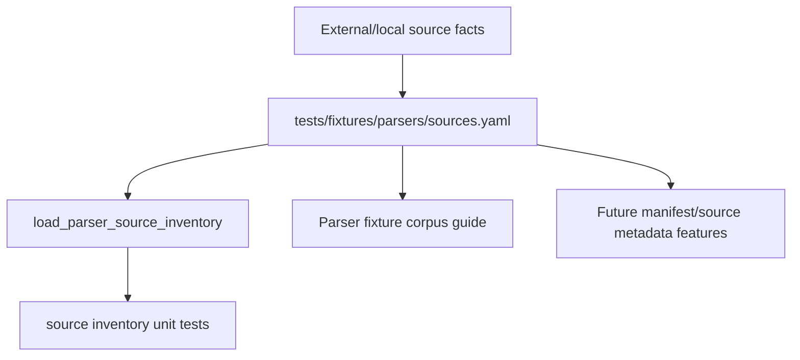

# parser-source-inventory design

## 0. 术语约定

| 术语 | 定义 | 防冲突结论 |
|---|---|---|
| Parser Source Inventory | `tests/fixtures/parsers/sources.yaml`，记录公开/本地样例来源与候选文件的机器可读清单 | 新增测试侧清单，不替代 executable fixture manifest |
| Source | 一个上游来源或本地生成策略，例如 ClickFF/MAPLE、cclib-data、ASE extxyz project-authored fixtures | 与 manifest `source` 字段同名但粒度更粗；本 feature 只登记来源 |
| Source File Entry | Source 下的单个候选或 reference-only 文件记录，包含 path、task、format、size、sha256、fixture_policy | 不要求文件已提交到仓库 |
| Fixture Policy | `candidate` / `vendored` / `reference-only` / `rejected`，说明后续是否可进入 executable corpus | 新增枚举，先用于 inventory 校验 |
| Review-required Redistribution | 来源许可或使用限制需要人工确认后才能 vendor | MAPLE 和 cclib-data 默认都按 review-required 处理 |
| Project-authored extxyz | 当前 ASE extxyz fixture 由项目内手写并用 ASE 语义校验，不 vendor 外部 extxyz 数据 | 避免把 ASE 文档或第三方数据复制进仓库 |

术语 grep 结论：现有 `Parser Fixture Corpus`、`Fixture Manifest`、`Parser Support Matrix` 已固定；新增 `Parser Source Inventory` 只作为真实样例接入前的来源登记层。

## 1. 决策与约束

### 需求摘要

本 feature 目标是让后续真实/公开 parser fixture 接入有可追溯入口：

1. MAPLE examples 记录 repo URL、branch、commit、license caveat、example 目录规模、代表性 `.out` / `.xyz` / `.sum` / `.json` / `.dat` 文件 hash 和 fixture policy。
2. cclib-data 记录 repo URL、commit、Gaussian16 / ORCA5 / ORCA6 sparse checkout 规模、代表性 Gaussian/ORCA 文件 hash 和 review-required 许可状态。
3. ASE extxyz 记录本地 installed package version、license expression、现有 project-authored extxyz fixture hash 和后续真实语法变体方向。
4. 测试侧提供 loader 校验 schema、id 去重、policy 枚举、safe path、size 和 sha256 形状。
5. 清单不得让测试依赖 `/tmp` clone、网络或外部包运行。

明确不做：

- 不 vendor MAPLE 或 cclib-data 文件。
- 不新增 executable parser fixture、golden snapshot 或 support matrix 条目。
- 不修改 parser runtime、ImportRegistryWorkflow、Platform Shell、Web UI 或报告导出。
- 不运行 Gaussian、ORCA、MAPLE、ASE 计算任务。
- 不把 review-required 来源描述成已允许商用或可无条件再分发。

### 复杂度档位

测试数据契约型小 feature。偏离点：

- 来源清单要记录真实外部仓库事实，但测试不能依赖外部 clone。
- license 信息存在不确定性：MAPLE license 文件含 BSD 3-Clause 和 academic/commercial notice；cclib-data sparse checkout 未提供 LICENSE 文件，README 只说明数据用途。因此都必须保守标记为 `review-required`。

### 关键决策

1. **source inventory 先行**：先落 `sources.yaml` 和 loader，不直接把第三方样例变成 fixture。
2. **hash 固定上游内容**：`sha256` 记录调研时看到的文件 bytes，后续上游变化可被人工发现。
3. **candidate 不等于 vendored**：`candidate` 只代表后续可评估；实际进入 `files/` 必须另起 feature 更新 manifest/source metadata。
4. **ASE 走 project-authored 起步**：首批 extxyz 继续使用项目内小 fixture；后续真实语法变体再从 docs/runtime 生成或用户授权样例补充。

## 2. 名词与编排

### 2.1 名词层：值对象 / 实体 / 接口契约

**现状**：

- `tests/fixtures/parsers/manifest.yaml` 只记录已提交 executable fixture。
- `tests/fixtures/parsers/support-matrix.yaml` 记录 fixture-backed 和 reference-only 支持边界。
- `tests/parser_fixture_harness.py` 能加载 manifest/support matrix，但没有 source inventory loader。
- `docs/dev/parser-fixture-corpus.md` 提醒真实第三方输出进入 corpus 前要确认 source policy，但没有机器可读入口。

**变化**：

- 新增 `tests/fixtures/parsers/sources.yaml`，schema version 为 `parser-source-inventory-v1`。
- 新增测试侧 dataclass 和 `load_parser_source_inventory(path)`。
- `sources.yaml` 顶层包含 `sources`，每个 source 记录 `id`、`program`、`kind`、`url`、`branch`、`commit`、`version`、`license`、`redistributable_default`、`local_reference_path`、`source_summary`、`notes`、`files`。
- 每个 file entry 记录 `id`、`path`、`task`、`format`、`size_bytes`、`sha256`、`fixture_policy`、`parser_intent`、`notes`。

**接口示例：source inventory**

```yaml
schema_version: parser-source-inventory-v1
sources:
  - id: maple-dev-example
    program: maple
    kind: upstream-git
    url: https://github.com/ClickFF/MAPLE
    branch: dev
    commit: 001636482646bca0d1e867fb257322d2a172cc86
    version: null
    license: BSD-3-Clause plus academic/commercial notice
    redistributable_default: review-required
    local_reference_path: null
    files:
      - id: maple-sp-output-example
        path: example/sp/sp.out
        task: sp
        format: maple-output
        size_bytes: 4253
        sha256: sha256:4fff4cc57b157df05ca028b7acc6c4d0fce68687b51ddd27dfbf6456de587d17
        fixture_policy: candidate
        parser_intent: maple-output
```

### 2.2 编排层：主流程与控制流



**现状**：

真实来源调研散落在 roadmap 和对话上下文里，后续 feature 无法稳定读取。

**变化**：

- 用 `sources.yaml` 固定调研结论。
- 用 loader 单测保证清单字段和策略不漂移。
- docs/architecture 只记录现状入口，不声明 parser 已支持真实 MAPLE/cclib-data 文件。

**跨层纪律**：

- 错误语义：loader 只抛 `AssertionError`，和现有 fixture harness 保持一致。
- 幂等性：重复读取同一 YAML 不产生文件写入，不访问网络。
- 扩展点：后续 `parser-corpus-source-metadata` 可复用 source id、file id、hash 和 policy。
- 可观测点：YAML 校验、focused unittest 和全量 unittest。

### 2.3 挂载点清单

- `tests/fixtures/parsers/sources.yaml` source inventory。
- `tests/parser_fixture_harness.py` 的 source inventory dataclass / loader。
- `tests/test_parser_fixture_harness.py` 的 source inventory schema tests。
- `docs/dev/parser-fixture-corpus.md` 的 inventory 维护说明。
- `codestable/architecture/core-platform.md` / `ARCHITECTURE.md` 的现状归并。

### 2.4 推进策略

1. **Design and roadmap gate**：建立 feature design/checklist，把 roadmap item 标为 in-progress。
   - 退出信号：feature checklist 与 roadmap items YAML 通过。
2. **Inventory YAML**：新增 `sources.yaml`，登记 MAPLE、cclib-data、ASE extxyz 来源与代表文件。
   - 退出信号：source ids、file ids、policy、hash、size 和 license caveat 可读。
3. **Harness loader**：新增 loader/dataclass/schema guard 和 focused tests。
   - 退出信号：loader 能读当前清单，并拒绝坏 schema、坏 policy、坏 hash 和 unsafe path。
4. **Docs and acceptance**：回写 docs/architecture/roadmap，补验收报告并运行验证。
   - 退出信号：checks 全 passed，roadmap item done，YAML / focused unittest / full unittest 通过。

## 3. 验收契约

### 关键场景清单

1. `tests/fixtures/parsers/sources.yaml` 存在，schema version 为 `parser-source-inventory-v1`。
2. 清单包含 `maple-dev-example`，记录 ClickFF/MAPLE URL、`dev` branch、commit、review-required 许可状态和代表性 MAPLE 文件。
3. MAPLE 代表文件至少覆盖 `.out`、`.xyz`、`.sum`、AutoNEB tree JSON 和 MD thermo/reference-only 文件。
4. 清单包含 `cclib-data-gaussian-orca`，记录 cclib-data URL、commit、Gaussian16 / ORCA5 / ORCA6 范围和代表性 Gaussian/ORCA 文件。
5. 清单包含 `ase-extxyz-project-authored`，记录 ASE 3.28.0、LGPL-2.1-or-later license expression 和当前 project-authored extxyz fixture hash。
6. 所有 file entries 带 `size_bytes`、`sha256:<64 hex>`、`fixture_policy` 和 `parser_intent`。
7. loader 能加载 source inventory，并提供按 policy 过滤的文件视图。
8. loader 拒绝坏 schema version。
9. loader 拒绝未知 fixture policy。
10. loader 拒绝 malformed sha256。
11. loader 拒绝 absolute、parent traversal 和 backslash path。
12. docs/architecture 明确 source inventory 不 vendor 第三方文件、不新增 runtime parser 支持。

### 明确不做的反向核对项

- 不新增 MAPLE/cclib-data executable fixture。
- 不复制第三方 example/log 文件进 `tests/fixtures/parsers/files/`。
- 不修改 parser runtime、import workflow、shell 或 Web UI。
- 不运行外部计算任务。
- 不把 `review-required` 来源标记为 unconditional redistributable。

## 4. 与项目级架构文档的关系

- architecture 归并：在 parser fixture corpus 现状中补 `sources.yaml` 和 loader 的测试侧边界。
- guide 回写：`docs/dev/parser-fixture-corpus.md` 补 source inventory 维护入口。
- roadmap 回写：验收通过后把 `parser-source-inventory` 标为 done。
