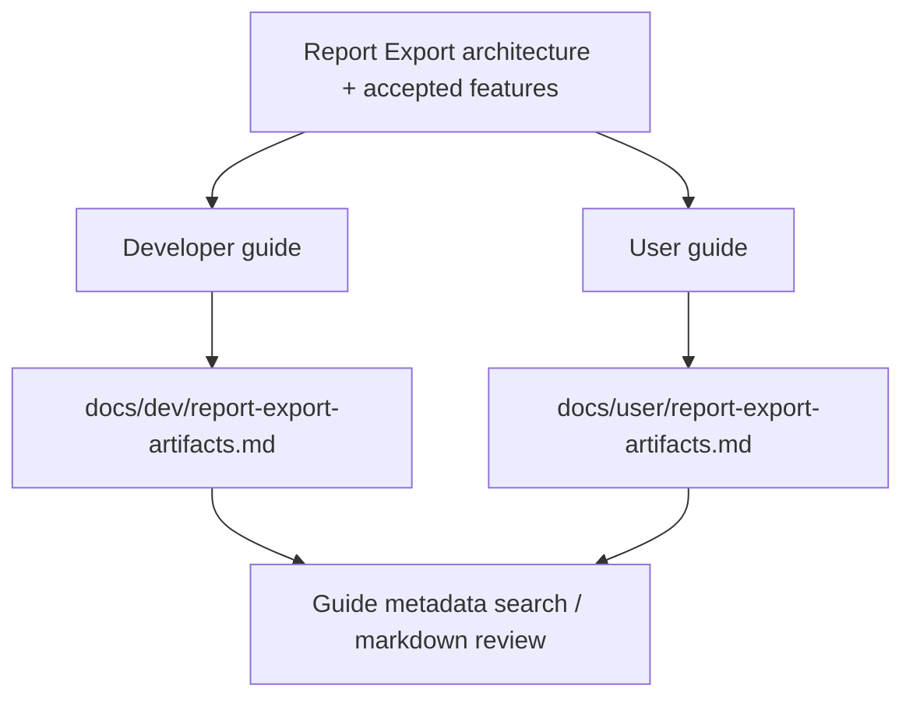

# report-export-guides design

## 0. 术语约定

| 术语 | 定义 | 防冲突结论 |
|---|---|---|
| Report Export Guide | 报告导出主题的对外指南文档集合 | 新增 docs 产物，不替代 roadmap/design/architecture |
| Developer Guide | 面向贡献者和集成方的 `docs/dev/report-export-artifacts.md` | 讲 API、字段、路径、writer metadata、边界 |
| User Guide | 面向终端用户的 `docs/user/report-export-artifacts.md` | 讲 Web 工作台操作、格式用途、保存位置、常见问题 |
| Artifact Persistence Path | 导出 artifact 在项目中的 `exports/{basename}.{format}` 路径 | Web browser-local 和 core project content 都沿用该路径语义 |
| CDXML Boundary | 当前支持 ChemDraw 可打开的 `.cdxml`，不支持 `.cdx` binary | 与 roadmap 和 core export 边界一致 |

术语 grep 结论：当前已有 `Report Export Service`、`Web Report Export Panel`、`Energy Table`、`Export Artifact Record` 等架构术语；docs 中尚无 report export 专题指南。

## 1. 决策与约束

### 需求摘要

本 feature 目标是把报告导出路线已经完成的能力写成可发布指南：

1. 开发者能知道如何调用 `ReportExportService` / Platform Shell `export.profile` 获取 PNG/CDXML/XLSX artifacts。
2. 开发者能查到 Energy Table Contract 的列口径、schema version、manual row 用法和缺失值语义。
3. 开发者能知道 `ExportArtifact`、`ShellArtifact`、`ExportArtifactRecord`、Web browser-local persistence 的职责边界。
4. 用户能知道在 Web 工作台里从 active path 计算能量、点击 Export、下载或保存 artifacts 的基本流程。
5. 用户能理解 PNG、CDXML、XLSX 分别适合什么，以及 `.cdxml` 与 `.cdx` 的当前边界。
6. 用户能知道 `exports/...`、checksum、metadata 和 warnings 的含义。

明确不做：

- 不实现新导出格式或新报告预览。
- 不承诺 CSV、CDX、PDF、PPTX、SVG、ChemDraw 编辑器或云存储。
- 不把内部 feature/roadmap 原文搬进指南。
- 不写虚构 API，不让用户以为浏览器前端会生成导出 bytes。
- 不加入截图或测试 report/trace 文件。

### 复杂度档位

文档型小 feature。偏离点：

- 需要同时写 dev-guide 和 user-guide，避免两份文档读者定位混淆。
- 指南必须同步当前边界：Web 只消费 Shell artifacts，核心 writer 只支持 PNG/CDXML/XLSX，CDX/CSV 未开放。

### 关键决策

1. **按主题命名**：两份指南同 slug `report-export-artifacts`，分别放在 `docs/dev` 和 `docs/user`，便于持续更新。
2. **dev-guide 写契约，不写 spec 历史**：重点放 API、字段、metadata、路径和测试命令。
3. **user-guide 写操作，不写实现细节**：重点放 Web 工作台操作、格式用途、保存/下载和 FAQ。
4. **边界显式化**：CDX、CSV、云存储、自动保存、报告预览都在指南里明确为当前不支持。

## 2. 名词与编排

### 2.1 名词层：值对象 / 实体 /接口契约

**现状**：

- `rxnflow.export` 已提供 `ExportRequest`、`ExportArtifact`、`ExportArtifactRecord`、`EnergyTableColumn`、`EnergyTableRow`、`ReportExportService`。
- Web `ReportExportPanel` 已展示 artifact metadata、warnings、download link、persisted path 和 checksum。
- `docs/dev/web-runtime-boundary.md` 只记录运行时边界，没有系统说明报告导出 API 和字段。
- `docs/user/` 尚无报告导出操作指南。

**变化**：

- 新增 `docs/dev/report-export-artifacts.md`：
  - 描述 core export 和 Platform Shell 调用方式。
  - 列出 supported formats、Energy Table columns、metadata、warning/error 和 persistence path。
  - 说明 CDXML/CDX、CSV 和 Web bytes generation 边界。
- 新增 `docs/user/report-export-artifacts.md`：
  - 描述 Web 工作台从能量曲线到导出的操作步骤。
  - 解释 PNG/CDXML/XLSX、Download、Persisted、Checksum、Metadata、Warnings。
  - 给出常见问题。

**接口示例：core export**

```python
service.export(
    "project-id",
    ExportRequest(formats=("png", "cdxml", "xlsx"), profile=profile, objects=objects),
)
```

**接口示例：Shell export**

```python
service.run(ShellCommand("export.profile", {"session_id": session_id, "include_bytes": True}))
```

### 2.2 编排层：主流程与控制流



**现状**：

Report export 现状分散在 architecture、roadmap、feature acceptance、Web runtime guide 和测试里；下游读者需要翻多份内部文档。

**变化**：

- 把稳定用法归并到两份外部读者文档。
- 相关文档互相链接，但不复制完整内部 spec。
- 指南 status 落为 `current`，last_reviewed 使用当前日期。

**跨层纪律**：

- 错误语义：指南只描述已存在的 `invalid_input`、`export_failed`、`artifact_persistence_failed`、`artifact_not_persisted` 和 unsupported 边界。
- 幂等性：重复导出同 basename/path 覆盖同一路径或 upsert 同 record，不描述成创建历史版本。
- 扩展点：CSV/CDX/报告组合器只作为后续方向，不写成当前入口。
- 可观测点：文档 frontmatter 可被 `search-yaml.py` 检索，YAML 校验通过。

### 2.3 挂载点清单

- `docs/dev/report-export-artifacts.md` 开发者指南。
- `docs/user/report-export-artifacts.md` 用户指南。
- `codestable/roadmap/rxnflow-report-export-quality` 的 `report-export-guides` 状态。
- architecture/requirement 的相关文档索引说明。

### 2.4 推进策略

1. **Design and checklist**：建立 feature 目录、design 和 checklist，并把 roadmap item 标为 in-progress。
   - 退出信号：feature design/checklist YAML 与 roadmap YAML 通过。
2. **Developer guide**：新增 `docs/dev/report-export-artifacts.md`，覆盖 core/Shell/Web persistence contract。
   - 退出信号：frontmatter current，API 示例来自现有代码，范围边界准确。
3. **User guide**：新增 `docs/user/report-export-artifacts.md`，覆盖 Web 操作、格式用途、保存路径和 FAQ。
   - 退出信号：用户步骤不依赖未实现能力，不承诺云同步或 CDX/CSV。
4. **Acceptance and docs index**：回写 architecture/requirement/roadmap，补验收报告和验证命令。
   - 退出信号：checks 全 passed，roadmap done，YAML / Python / Web tests 通过。

## 3. 验收契约

### 关键场景清单

1. `docs/dev/report-export-artifacts.md` 存在，frontmatter 为 `doc_type=dev-guide`、`status=current`。
2. dev-guide 说明 `ExportRequest` / `ReportExportService.export()` 和 Platform Shell `export.profile`。
3. dev-guide 列出 PNG/CDXML/XLSX 支持边界、CDX/CSV 不支持边界、XlsxWriter/Pillow 延迟依赖错误语义。
4. dev-guide 说明 Energy Table schema version、第一列结构名称、常见列和 manual row / missing value 语义。
5. dev-guide 说明 `ExportArtifact`、`ShellArtifact.bytes_base64`、`ExportArtifactRecord` 和 `exports/...` checksum 边界。
6. `docs/user/report-export-artifacts.md` 存在，frontmatter 为 `doc_type=user-guide`、`status=current`。
7. user-guide 说明 Web 工作台导出步骤：先有 active path/profile，再 Export，选择格式、include bytes、basename/title。
8. user-guide 说明 PNG/CDXML/XLSX 用途、`.cdxml` 可用 ChemDraw 打开、`.cdx` 当前不支持。
9. user-guide 说明 Download、Persisted、Checksum、Metadata、Warnings 的用户含义。
10. 指南不承诺 CSV/CDX/PDF/PPTX/SVG、云存储、自动保存或浏览器前端生成 bytes。

### 明确不做的反向核对项

- 不改运行时代码。
- 不新增 Web UI、截图或报告预览。
- 不新增导出格式。
- 不复制用户私有 workbook。
- 不把 Playwright artifacts 加入版本控制。

## 4. 与项目级架构文档的关系

- architecture 归并：在 `core-platform.md` / `ARCHITECTURE.md` / `web-workbench.md` 中补指南存在性和主题入口。
- requirement 回写：`web-workbench-shell` 用户故事不变，边界中补用户指南链接。
- roadmap 回写：验收通过后把 `report-export-guides` 标为 done。
