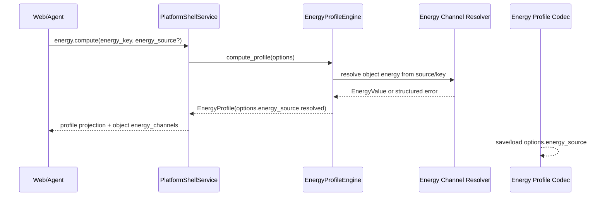

# Energy Channel Catalog

## 0. 术语约定

- **EnergyChannelSource**：能量通道来源 section，取值为 `energies` 或 `thermochemistry`。调用方可用 `auto` 表示兼容旧行为的自动选择。
- **EnergyChannel**：一个 ChemicalObject 或对象集合中可选的能量通道投影，字段为 `key`、`source`、`label`、`unit`、可选 `reference` 和 `object_ids`。
- **EnergyChannelSelection**：Energy Engine 计算时的选择口径，即 `energy_key + energy_source`。`energy_key` 保持旧字段名，`energy_source` 是新增字段。
- **energy_source**：`EnergyOptions` 的新增字段，取值 `energies` / `thermochemistry` / `auto`。缺失时等价于 `auto`。
- **ambiguous_energy_channel**：同一对象的 `energies` 与 `thermochemistry` 中存在同名 key 且调用方没有显式 source 时的错误 code。

## 1. 决策与约束

### 需求摘要

本 feature 要把 ChemicalObject 中的 `energies` 与 `thermochemistry` 从两个散落 key list 升级为统一 energy channel catalog，并允许 `energy.compute` 明确选择 `thermochemistry` 通道。成功标准是：Shell/Web 能看到对象自己的 channels；Energy Engine 能按显式 source 或 auto 规则取值；同名 key 未显式 source 时返回结构化 ambiguity；Project Content 能保存/读取新的 `EnergyOptions.energy_source` 并兼容旧 profile。

### 明确不做

- 不修改 parser 字段命名、parser 输出格式或 ChemicalObject 原始 `energies` / `thermochemistry` 存储结构。
- 不实现 composition coefficient 乘法；节点内多对象仍沿用旧 `chemical_object_ids` implicit coefficient 1 求和。
- 不实现 CorrectionPolicy、correction command 或 Web correction 表单。
- 不实现 Web energy channel selector 的完整交互；本轮只更新 Shell/Web DTO 和 fixture transport 所需字段。
- 不新增 Project Content schema version；`energy-profiles-v1` 只新增可选 `energy_source`。
- 不把 common/partial channel 汇总 UI 做成复杂推荐算法；当前只提供对象级 channel 投影和 engine 选择规则。

### 复杂度档位

走对外发布库/服务默认档位：L3 + modules + reasonable + team + stable + tested + validated。偏离点：性能只要求 reasonable，因为单项目对象与 channel 数量有限；兼容性要求 backward-compatible，因为旧 `EnergyOptions.energy_key`、旧 energy profile JSON 和 Web fixture 必须继续可用。

### 关键决策

1. **ChemicalObject 仍保留两块原始数据，catalog 是投影**：parser 和持久化已有 `energies` / `thermochemistry`，本 feature 不搬迁原始字段，只在 engine/shell/web 需要选择时统一投影。
2. **默认 `energy_source="auto"` 保持旧调用可用**：旧代码只传 `energy_key="electronic"` 时仍先查 `energies`；如果没有则 fallback 到 `thermochemistry`。
3. **同名 key 必须显式 source**：当同一对象两个 section 都有同名 key 时，auto 无法判断用户要电子能还是热化学值，返回 `ambiguous_energy_channel target=energy_options.energy_key`。
4. **EnergyOptions 持久化新增可选字段**：新 profile 写入 `energy_source`，旧 JSON 缺失时加载为 `auto`。
5. **EnergyChannel label 先用稳定默认生成**：label 采用 `{key} ({source})`；后续 UI/i18n 可替换显示文本，但不改变核心 contract。

### 前置依赖

`reaction-node-stoichiometry-contract` 已完成。当前 feature 不依赖后续 `energy-expression-engine`。

## 2. 名词与编排

### 2.1 名词层：值对象 / 实体 / 接口契约

**现状**

- `rxnflow.models.ChemicalObject` 有 `energies` 和 `thermochemistry` 两个 dict，但没有统一 channel 类型。
- `rxnflow.models.EnergyOptions` 只有 `energy_key`，Energy Engine 只读取 `obj.energies[energy_key]`。
- `rxnflow.energy_profile_codec` 保存 profile options 时不记录 source。
- `rxnflow.platform._object_summary` 只输出 `energy_keys`，Web type 虽已有 `thermochemistry_keys` 可选字段但 Python projection 没有稳定输出。
- `web/src/shell/fixtureTransport.ts` fixture object 只有 `energy_keys` 和空 `thermochemistry_keys`。

**变化**

- 新增 `EnergyChannelSource`、`EnergyChannelSelectionSource` 和 `EnergyChannel` 模型类型。
- `EnergyOptions` 新增 `energy_source: "energies" | "thermochemistry" | "auto" = "auto"`，旧 constructor 调用不需要改。
- 新增 channel catalog helper，把单个或多个 `ChemicalObject` 的 `energies` / `thermochemistry` 投影为 `EnergyChannel[]`。
- Energy Engine 取能量时走统一 resolver：explicit source 查指定 section；auto 先查 `energies` 再查 `thermochemistry`，同名冲突返回 ambiguity。
- Energy Profile codec 写入 `energy_source`，读取缺失字段时填 `auto`，并校验枚举。
- Platform Shell object projection 增加 `thermochemistry_keys` 和 `energy_channels`；profile projection 增加 `energy_key` / `energy_source`。
- Web Shell types 增加 `EnergyChannelSummary`、`EnergyChannelSource` 和 profile/source 字段；fixture transport 跟随输出。

**接口示例**

```python
# 来源：rxnflow.models EnergyOptions
EnergyOptions(
    output_unit="kcal_mol",
    include_corrections=False,
    energy_key="gibbs",
    energy_source="thermochemistry",
)
# 可观察：Energy Engine 从 obj.thermochemistry["gibbs"] 取值
```

```python
# 来源：rxnflow.energy energy_channel_catalog
energy_channel_catalog((
    ChemicalObject(
        id="object-a",
        energies={"electronic": EnergyValue(-100, "hartree")},
        thermochemistry={"gibbs": EnergyValue(-99.9, "hartree")},
    ),
))
# 输出包含 electronic/energies 与 gibbs/thermochemistry 两个 EnergyChannel
```

```json
// 来源：rxnflow.platform object summary
{
  "id": "object-a",
  "energy_keys": ["electronic"],
  "thermochemistry_keys": ["gibbs"],
  "energy_channels": [
    {"key": "electronic", "source": "energies", "label": "electronic (energies)", "unit": "hartree", "object_ids": ["object-a"]},
    {"key": "gibbs", "source": "thermochemistry", "label": "gibbs (thermochemistry)", "unit": "hartree", "object_ids": ["object-a"]}
  ]
}
```

主要错误路径：

- `energy_source` 不是 `energies` / `thermochemistry` / `auto` → `invalid_input target=energy_options.energy_source`。
- explicit source 下 key 不存在 → `missing_energy`，details 含 `object_id`、`energy_key`、`energy_source`。
- auto 下两个 section 同名 → `ambiguous_energy_channel target=energy_options.energy_key`。

### 2.2 编排层：主流程与控制流



**现状**

Energy Engine 在 `_node_total_energy` 内直接查 `obj.energies.get(options.energy_key)`；fixture compute 也直接查 `energies`。Platform Shell `_run_energy_compute` 从 args 拼 `EnergyOptions`，未读取 source。Project Content codec 对 options 的 validate/save/load 只认识 `output_unit/include_corrections/energy_key/baseline_node_id`。

**变化**

- Shell `_run_energy_compute` 解析可选 `energy_source`，缺失默认 `auto`。
- Energy Engine `_node_total_energy` 和 fixture helper 统一通过 resolver 取 `EnergyValue`。
- Resolver 只做选择和错误语义，不做 coefficient/correction policy/provenance。
- Profile id 增加非 auto source slug，避免 `gibbs/energies` 与 `gibbs/thermochemistry` 同名时 id 冲突；auto 保持旧 id 形状。
- Object projection 从单对象 catalog 生成 `energy_channels`；仍保留旧 `energy_keys` 和 `thermochemistry_keys`。
- Codec save/load 对 `energy_source` 做 optional-compatible 处理。

**跨层纪律**

- 错误语义：source shape 错误是 `invalid_input`；缺 key 是 `missing_energy`；auto 同名冲突是 `ambiguous_energy_channel`。
- 兼容性：旧 `EnergyOptions(...)` 调用、旧 `energy.compute` payload、旧 profile JSON 不带 `energy_source` 时都等价于 `auto`。
- 顺序约束：catalog 输出按 source 顺序 `energies` 再 `thermochemistry`，每个 source 内按 key 排序。
- 可观测点：Shell object summary、profile summary、energy profile JSON 和 Python/Web tests 都能观察 source。
- 解耦约束：catalog helper 不依赖 Platform Shell、Web、Project Store、Parser 或 Report Export。

### 2.3 挂载点清单

- `EnergyOptions` / `EnergyChannel` 模型契约：新增 source 字段与 channel 投影类型。
- Energy Engine 取能量路径：从直接查 `obj.energies` 改为 channel resolver。
- Energy Profile Project Content codec：options JSON 增加可选 `energy_source`。
- Platform Shell / Web DTO：object/profile projection 增加 `energy_channels` 和 source 字段。

### 2.4 推进策略

1. 名词骨架：新增 source/channel 类型、EnergyOptions 默认 source 和 catalog helper。
   - 退出信号：单对象 catalog 可同时列出 energies 与 thermochemistry，旧 EnergyOptions constructor 仍可用。
2. Engine 选择规则：把能量取值切到 resolver，覆盖 auto fallback、explicit source、ambiguity 和 missing。
   - 退出信号：同一 key 双 section 未显式 source 返回 ambiguity，显式 thermochemistry 可计算 profile。
3. 持久化兼容：Energy Profile codec 保存/加载 `energy_source` 并兼容旧 JSON。
   - 退出信号：新 JSON round-trip 保留 source，旧 JSON load 得到 `auto`。
4. Shell/Web DTO：Platform Shell object/profile projection 和 Web fixture/types 暴露 channels/source。
   - 退出信号：Shell baseline tests 与 Web ShellClient tests 能看到 energy_channels 和 energy_source。
5. 回归测试：补齐 focused tests、全量 Python、Web test/build 和 YAML 校验。
   - 退出信号：相关验证命令通过，checklist steps 全部 done。

## 3. 验收契约

### 关键场景清单

1. ChemicalObject 同时有 `energies.electronic` 与 `thermochemistry.gibbs` → object summary / Web DTO 输出两个 `energy_channels`，并保留旧 `energy_keys` / `thermochemistry_keys`。
2. `EnergyOptions(energy_key="gibbs", energy_source="thermochemistry")` 计算 profile → Energy Engine 从 `thermochemistry` 取值，relative energy 使用选中通道。
3. `energy_source` 缺失或为 `auto` 且 `energies` 缺 key、`thermochemistry` 有 key → fallback 到 `thermochemistry`。
4. 同一对象 `energies.gibbs` 与 `thermochemistry.gibbs` 都存在，且 caller 未显式 source → 返回 `ambiguous_energy_channel target=energy_options.energy_key`。
5. explicit source 下 key 缺失 → 返回 `missing_energy`，details 包含 `energy_source`。
6. Energy Profile 保存后 JSON options 包含 `energy_source`；读取旧 JSON 缺字段时 options.energy_source 为 `auto`。
7. Shell `energy.compute` 接收 `energy_source` 并在 profile summary 中回显 `energy_key` / `energy_source`。

### 明确不做的反向核对项

- 不修改 parser runtime 或 parser fixture snapshot 的原始字段结构。
- 不在本 feature 中让 Energy Engine 使用 composition coefficient。
- 不新增 CorrectionPolicy、registry.apply_correction 或 correction form。
- 不新增 Web energy channel selector UI。
- 不升级 `energy-profiles-v1` schema version。

## 4. 与项目级架构文档的关系

Acceptance 阶段需要更新 `codestable/architecture/ARCHITECTURE.md` 和 `codestable/architecture/core-platform.md`：

- 名词归并：EnergyChannelSource、EnergyChannel 和 `EnergyOptions.energy_source` 的契约。
- 动词骨架归并：Energy Engine 通过 channel resolver 选择 `energies` 或 `thermochemistry`；Shell/Web projection 输出 object energy channels。
- 跨层纪律归并：缺失 `energy_source` 兼容为 `auto`；auto 同名冲突返回 `ambiguous_energy_channel`；本 feature 不改变 parser 字段或 coefficient/correction 计算。

不需要更新 requirement 用户边界；`web-workbench-shell` 已覆盖对象能量 key、热化学 key 和能量面板，真实 selector UI 留给后续 roadmap item。
