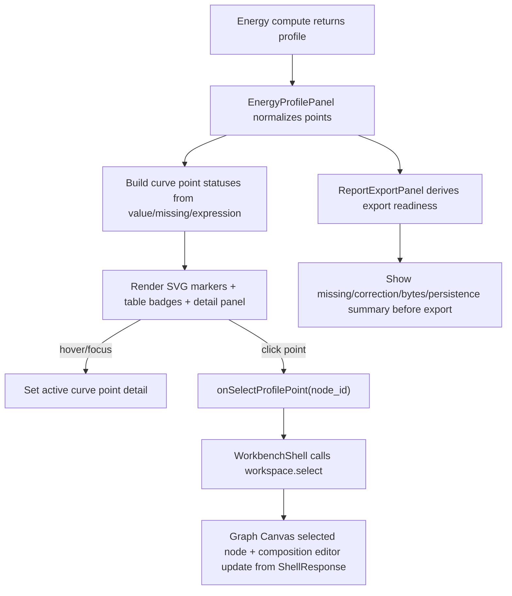

# Energy Curve Interaction Polish

## 0. 术语约定

- **Energy Curve Point**：Web `EnergyCurvePreview` 中从 `EnergyProfile.points[]` 投影出的单个曲线点或缺失点占位；它不等同于 core `EnergyPoint` dataclass。
- **Curve Point Detail**：曲线中当前 hover/focus/selected point 的紧凑详情，显示 label、node id、relative energy、missing reason、composition/correction count 和 expression total。
- **Curve Point Marker**：曲线上表达 point 状态的视觉标记。有效点、missing 点、含 correction 点和 selected 点应可区分。
- **Profile Node Linkage**：Energy Profile Panel 选中 point 后，通过既有 `workspace.select` 让 Graph Canvas 选中同一 node；它只联动 selection，不修改 graph/path/profile。
- **Export Readiness**：Report Export Panel 在导出前根据当前 profile/artifact options 给出的静态检查摘要，例如 missing point、没有 inline bytes、没有 active browser project、CDXML-only 边界。它不是新的 export validation command。

## 1. 决策与约束

### 需求摘要

当前 Web Energy Profile Panel 已能计算 profile、显示 relative energy table、Energy Expression Details 和基础 SVG 曲线，但曲线仍是静态预览：用户看不到 point tooltip，missing 点只在表格里可见，correction contribution 没有曲线级标记，点击曲线点也不会帮助定位 Graph Canvas 节点。Report Export Panel 已可导出 PNG/CDXML/XLSX，但导出前没有把当前 profile 的 missing 点、include bytes 和 browser-local persistence 状态提前汇总。

本 feature 目标是做体验层 polish：让曲线点可 hover/focus/click，显示 point detail；曲线和表格用一致的 marker 标出 missing/correction/selected 状态；点击 point 后选中对应 graph node；Report Export Panel 显示导出前一致性摘要。所有数据仍来自现有 ShellResponse `EnergyProfileSummary` / `EnergyExpressionSummary` / artifact options，不新增核心算法或 writer。

### 明确不做

- 不在前端重算相对能量、节点总能量、correction contribution、EnergyExpression 或单位换算。
- 不新增图表库、canvas chart、D3/Recharts、WebGL 或高级缩放图表；继续使用轻量 SVG/HTML。
- 不新增 Python shell command、Project Content schema、Browser Project Repository schema、ExportFormat 或 report writer。
- 不改变 PNG/CDXML/XLSX 导出文件内容，不实现报告预览、ChemDraw 编辑器、CDX、PDF、PPTX、SVG 或 CSV。
- 不自动保存 profile selection、hover point、export readiness 或 panel options 到 Project Content/localStorage/IndexedDB。
- 不实现 path-level energy channel availability 修复、correction id existence validation、自动配平、元素守恒或电荷守恒检查。
- 不让 curve selection 直接修改 path order、active path、graph edge 或 node composition。

### 复杂度档位

Frontend orchestration = L3：主要在 Energy Profile Panel、WorkbenchShell selection handler、Report Export Panel 和 CSS/i18n 内扩展，不改 core contract。

UX = L4：曲线点、tooltip、表格状态和导出提示都在右侧 inspector 内，需要桌面/窄屏无重叠、键盘可达、状态表达可扫描。

Core integration = L1：只消费现有 Shell DTO，不新增 Python 逻辑。

### 关键决策

1. **Curve point detail 做成 panel 内可访问详情，不依赖浏览器 title tooltip**：hover/focus/click 都更新同一 detail 区；移动端没有 hover 时仍可点击查看。
2. **missing 点保留 x 位置但不补 y=0**：曲线线上仍只连接有效 relative energy 点；missing point 用基线附近或独立 marker 显示断点/缺失状态，文案显示 `missing_reason`。
3. **correction 标记基于 expression.corrections.length**：有 correction contribution 的 point 用 marker badge/样式提示；不在前端重新求和 correction energy。
4. **Graph linkage 复用 workspace.select**：点击 point 只请求选择同名 node id，成功后 Graph Canvas 的 selected node 样式和 Node Composition Editor 自然联动。
5. **Export Readiness 是静态摘要，不拦截导出**：除既有 disabled 条件外，missing point、include bytes 关闭、没有 active browser project 只作为 warning/info 显示；真实导出结果仍以 `export.profile` response 为准。

### 前置依赖

roadmap 前置 `web-energy-semantics-controls` 已 done；Web 已有 `EnergyProfileSummary.expression` 投影、Graph Canvas workspace selection、Report Export Panel 和 i18n runtime。

## 2. 名词与编排

### 2.1 名词层：值对象 / 实体 / 接口契约

**现状**

- `web/src/shell/types.ts` 已有 `EnergyProfileSummary`、`EnergyProfilePointSummary`、`EnergyExpressionSummary`、`CorrectionComponentSummary`、`WorkspaceSummary.selection` 和 `WorkspaceCommandData`。
- `web/src/app/EnergyProfilePanel.tsx` 已把 `EnergyProfilePointSummary` normalize 为 label/node/value/unit/missing/expression/warnings，并渲染基础 SVG、table 和 expression details。
- `web/src/app/WorkbenchShell.tsx` 已有 `selectGraphItems` / selected node flow，可通过 `workspace.select` 更新 Graph Canvas selection。
- `web/src/app/ReportExportPanel.tsx` 当前只接收 artifacts、options、disabled、warnings，不知道当前 profile 或 active browser project 状态。

**变化**

新增 Web UI-only point selection：

```ts
type EnergyCurvePointState = {
  activeNodeId: string | null
  pinnedNodeId: string | null
}

type EnergyCurvePointStatus = {
  nodeId: string
  hasRelativeEnergy: boolean
  hasMissingReason: boolean
  hasCorrections: boolean
  isSelected: boolean
}
```

扩展 Energy Profile Panel props：

```ts
type EnergyProfilePanelProps = {
  profile?: EnergyProfileSummary
  workspace?: WorkspaceSummary
  selectedNodeId?: string | null
  onSelectProfilePoint?: (nodeId: string) => void
}
```

新增导出前摘要输入：

```ts
type ExportReadinessSummary = {
  hasProfile: boolean
  missingPointCount: number
  correctionPointCount: number
  includeBytes: boolean
  hasActiveBrowserProject: boolean
  formats: ExportFormat[]
}
```

边界：

- `EnergyCurvePointState` 只在 Web component state 中存在；不进入 ShellResponse、Project Content、Browser Project Repository 或 localStorage。
- `ExportReadinessSummary` 是 props 派生值；不调用 shell，不写 artifact metadata。
- dynamic node id、profile id、warning code、format、checksum、correction id、energy key/source/unit 原样显示，不进入翻译。

### 2.2 编排层：主流程与控制流



**现状**

- Energy curve preview 只绘制有 `relative_energy` 的 points，missing point 不画成 0。
- Graph Canvas selection 已是 ShellResponse authority，选中 node 后已有 Node Composition Editor。
- Report Export 成功后显示 artifact list、metadata、download link、persisted path/checksum；失败只显示 shell error/warnings。

**变化**

- EnergyProfilePanel 内维护 active/pinned point state：hover/focus 更新 active point；click pin point 并触发 `onSelectProfilePoint`。
- EnergyCurvePreview 不再只接收 points；它接收 selected node id 和 selection callback，给每个 point 生成可 focus 的 SVG/HTML button hit target 或可访问 marker。
- Energy Table 每行显示 marker/status，并支持点击行选择 point；selected point 与 Graph Canvas selected node 保持视觉一致。
- Curve Point Detail 显示当前 point 的 label、node id、relative energy 或 missing reason、expression total、composition term count、correction count 和 warning/missing code。
- WorkbenchShell 提供 `selectEnergyProfilePoint`：复用 `workspace.select({node_ids:[nodeId]})`；失败时用现有 shell error 展示，不本地伪改 workspace projection。
- ReportExportPanel 接收当前 profile 与 active browser project persistence state，派生 Export Readiness 摘要并显示在导出按钮附近。
- i18n catalog 补新增静态文案；CSS 补 marker、detail panel、readiness summary 的桌面/窄屏布局。

**跨层纪律**

- Shell authority：曲线点击联动 Graph Canvas 必须走 `workspace.select`，不直接 mutate `WorkbenchDomainState.workspace.selection`。
- Missing semantics：missing point 可以被标记和选中，但不得补 0、不得生成假 relative energy、不得连入有效 polyline。
- Export authority：Export Readiness 只解释当前 profile/options，不阻止或改写 `export.profile` args；导出结果仍以 ShellResponse artifacts/warnings 为准。
- UI-only isolation：hover/selected curve point、readiness derived state 和 marker display 不写 Project Content、Browser Project Repository 或 localStorage。
- Accessibility：point marker/table row 能通过键盘 focus/click，detail panel 有可读 label；颜色不是唯一状态表达。
- Responsive：右侧 inspector 窄屏下 curve、detail、table、readiness 不造成页面整体水平溢出。

### 2.3 挂载点清单

- Energy Profile Panel curve area：扩展 `EnergyCurvePreview` 的 marker/detail/selection props 和 point state。
- Energy Profile Panel table/details area：增加 table row marker、selected state 和 point detail summary。
- WorkbenchShell command orchestration：新增 profile point selection handler，复用 `workspace.select`。
- Report Export Panel：新增 Export Readiness summary props/rendering，不改变 export command。
- Web i18n/CSS/test harness：补静态文案、marker/detail/readiness 样式和组件/浏览器验证。

不新增 core Python、Shell command name、Project Content codec、Browser Repository schema、report writer 或 chart dependency 挂载点。

### 2.4 推进策略

1. **Curve Point State 与 Status 派生**：从 normalized points 派生 missing/correction/selected 状态，建立 active/pinned point UI-only state。
   - 退出信号：component tests 能看到有效点、missing 点、correction 点的状态文案/marker，切换 profile 后不保留 stale point。
2. **Interactive Curve 与 Detail Panel**：让曲线点和表格行可 hover/focus/click，并展示 Curve Point Detail。
   - 退出信号：测试能点击 curve/table point 后显示 label/node/energy 或 missing reason、term/correction count。
3. **Profile Node Linkage**：WorkbenchShell 接上 `onSelectProfilePoint`，通过 `workspace.select` 选中 Graph Canvas node。
   - 退出信号：点击 profile point 后 shell payload 为 `workspace.select(node_ids=[...])`，Graph Canvas node selected。
4. **Export Readiness Summary**：ReportExportPanel 根据 profile/options/browser project 状态显示 missing/correction/bytes/persistence/CDXML 边界摘要。
   - 退出信号：测试覆盖 missing point warning、include bytes off、无 active browser project 和正常 ready 状态。
5. **I18n/Responsive/Browser QA**：补双语文案、CSS 和桌面/窄屏浏览器验证。
   - 退出信号：`npm run test`、`npm run build` 通过；浏览器桌面/窄屏无重叠、无水平溢出，curve marker/detail/readiness 可见。

## 3. 验收契约

### 关键场景清单

1. Fixture Run 后 Energy Curve 显示有效点 marker、相对能量 label，并且 point 可通过键盘 focus。
2. hover/focus/click `node-a` point 后，Curve Point Detail 显示 label、node id、relative energy、expression total 和 composition term count。
3. 有 correction contribution 的 point 在 curve/table/detail 中显示 correction marker/count；数值来自 `expression.corrections.length`，不前端重算。
4. missing point 在 curve/table/detail 中显示 missing marker 和 `missing_reason`，不显示假 relative energy，也不连入 polyline。
5. 点击 curve point 或 table row 后，Web 调用 `workspace.select`，Graph Canvas 对应 node 进入 selected 状态，Node Composition Editor 跟随当前节点。
6. 如果 profile 更新后原 pinned point 不存在，Energy Profile Panel 不保留 stale selected point。
7. Report Export Panel 在有 missing points 时显示导出前 warning/info，说明导出会保留 missing 语义而不是补值。
8. Include bytes 关闭时，Export Readiness 显示 download/persistence 受限提示；导出按钮仍可用，结果仍以 shell response 为准。
9. 没有 active browser project 时，Export Readiness 显示 artifact 不会 browser-local persisted 的提示；运行时 inline download 不受影响。
10. 选择 CDXML 时，Export Readiness 保留 CDXML-only/ChemDraw 边界提示，不新增 CDX。
11. 中文 locale 下新增 curve detail、marker、readiness 静态文案为简体中文；动态 id/key/code/unit/format 原样显示。
12. 桌面浏览器下 curve marker、detail panel、table 和 export readiness 无文字重叠。
13. 窄屏浏览器下 curve SVG、detail panel、export readiness 不造成页面整体水平溢出。

### 明确不做的反向核对项

- 不出现新的 Shell command name、Project Content schema version、Browser Project Repository schema、ExportFormat 或 chart dependency。
- 不在 Web 代码里 import Python core、EnergyProfileEngine、ReportExportService、ProjectContentValidator 或 parser modules。
- 不调用 `project.save_content`、Browser Project Repository write 或 localStorage 来保存 curve point UI state/readiness。
- 不修改 PNG/CDXML/XLSX writer、CDXML/CDX 边界或导出文件内容。
- 不把 missing point 补成 0 或在前端生成 relative energy/correction totals。

## 4. 与项目级架构文档的关系

Acceptance 阶段需要更新：

- `codestable/architecture/web-workbench.md`：记录 interactive Energy Curve、Curve Point Detail、Profile Node Linkage、Export Readiness 和 UI-only state 边界。
- `codestable/architecture/ARCHITECTURE.md`：补充 Web Energy Profile Panel 已能用现有 profile provenance 做交互式曲线定位，但不前端重算或改变 export writer。
- `codestable/requirements/web-workbench-shell.md`：补用户故事和边界，说明用户可从曲线 point 定位 graph node，并在导出前看到 missing/bytes/persistence 口径提示。
- roadmap items/main doc：`energy-curve-interaction-polish` 验收时标记 done。

不更新 core-platform；本 feature 不改变 Python core、Energy Engine 或 Report Export Service。
