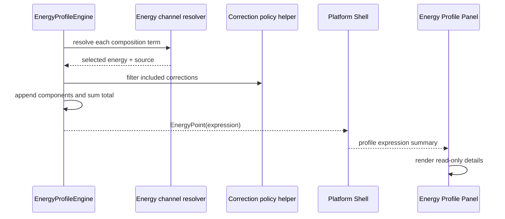

# Energy Profile Provenance Details

## 0. 术语约定

- **EnergyExpression**：roadmap 4.5/4.6 定义的节点能量来源明细，描述一个 profile point 的 composition terms、corrections、total 和 missing diagnostics。
- **EnergyComponent**：EnergyExpression 中来自 ChemicalObject selected energy channel 的贡献项，记录 object、coefficient、source、raw/converted/contribution。
- **CorrectionComponent**：EnergyExpression 中来自 ChemicalObject correction 的贡献项，记录 correction id、kind、coefficient、raw/converted/contribution。
- **Energy Expression Details**：Web Energy Profile Panel 中逐点显示 EnergyExpression 的只读明细视图，只展示 Shell 投影，不在前端重算。

## 1. 决策与约束

### 需求摘要

当前相对能量表只显示数值和 missing reason，用户无法判断 `A + 2B`、热化学通道和校正项到底怎样贡献到节点总能量。本 feature 要把 Energy Engine 已有数值规则投影成结构化 provenance：新计算出的每个 EnergyPoint 都带 `expression`，Shell/Web 能显示 term/correction 明细，Project Content codec 能保存和读取该可选字段，旧 profile 没有 expression 时仍可加载。

### 明确不做

- 不改变 Energy Engine 的数值规则、baseline 规则、unit conversion 规则或 correction policy 规则。
- 不新增 Web 节点组成编辑、energy channel selector 或 correction policy selector。
- 不自动解释化学配平、反应方向、元素守恒、电荷守恒或 TS 语义。
- 不把 Web 端变成能量计算 authority；Web 只显示 Shell DTO。
- 不升级 `energy-profiles-v1` schema version，不做 destructive migration。
- 不修改 parser、import、registry correction append、graph patch 或 report export bytes writer。

### 复杂度档位

走默认发布库档位：L3 + modules + reasonable + team + stable + tested + validated。偏离点：本轮只做 provenance projection 与 UI 显示，不做新的交互控制；Project Content 中 `expression` 是 v1 可选字段，兼容旧数据。

### 关键决策

1. **EnergyExpression 随 EnergyPoint 物化**：新计算 profile point 必须带 expression，包括 baseline point；缺失的非 baseline point 也带 `total=None` 和 missing details。
2. **数值来源不重算两遍**：Energy Engine 在计算 node total 时同时构造 expression，profile relative energy 仍由 expression total 与 baseline total 做差。
3. **raw 与 converted 都保留**：component 保存原始 EnergyValue 和 output_unit 下的 converted/contribution，方便用户看单位换算和 coefficient 影响。
4. **missing details 结构化**：缺失 energy/source ambiguity 等错误进入 expression.missing，同时 baseline missing 仍返回 error。
5. **Web 只读 expression**：Energy Profile Panel 显示 term/correction rows；没有 expression 的旧 profile 显示为空，不推断。

### 前置依赖

`energy-expression-engine` 和 `correction-command-and-ui` 已完成，composition coefficient、energy channel source、correction policy 和 Shell/Web correction summary 可直接复用。

## 2. 名词与编排

### 2.1 名词层：值对象 / 实体 / 接口契约

**现状**

- `EnergyPoint` 只有 node id、label、absolute/relative energy 和 missing reason。
- `EnergyProfileEngine._node_total_energy` 只返回 `EnergyValue`，中间 term/correction 贡献没有持久化。
- `energy-profiles-v1` codec 不读写 `expression`。
- Platform Shell `_profile_summary` 只投影 relative energy。
- Web Energy Profile Panel 只显示曲线、表格和 warnings。

**变化**

- 新增 `EnergyComponent`、`CorrectionComponent`、`EnergyExpressionMissing`、`EnergyExpression` dataclass。
- `EnergyPoint` 新增 `expression: EnergyExpression | None = None`。
- Energy Engine 节点计算 helper 返回 EnergyExpression；成功时 `total` 为 output_unit EnergyValue，缺失时 `total=None` 且 `missing` 非空。
- `energy-profiles-v1` point JSON 新增可选 `expression` 字段；旧 JSON 缺字段加载为 `None`。
- Shell/Web DTO 新增 expression summary；Web 面板展示 expression details。

**接口示例**

```json
{
  "node_id": "node-combo",
  "label": "A + 2B",
  "relative_energy": { "value": 4.0, "unit": "kcal_mol" },
  "expression": {
    "node_id": "node-combo",
    "terms": [
      {
        "object_id": "object-a",
        "coefficient": 1.0,
        "energy_key": "electronic",
        "energy_source": "energies",
        "raw_energy": { "value": 1.0, "unit": "kcal_mol" },
        "converted_energy": { "value": 1.0, "unit": "kcal_mol" },
        "contribution": { "value": 1.0, "unit": "kcal_mol" }
      },
      {
        "object_id": "object-b",
        "coefficient": 2.0,
        "energy_key": "electronic",
        "energy_source": "energies",
        "raw_energy": { "value": 2.0, "unit": "kcal_mol" },
        "converted_energy": { "value": 2.0, "unit": "kcal_mol" },
        "contribution": { "value": 4.0, "unit": "kcal_mol" }
      }
    ],
    "corrections": [],
    "total": { "value": 5.0, "unit": "kcal_mol" },
    "missing": []
  }
}
```

### 2.2 编排层：主流程与控制流



**现状**

Energy Engine 已经按 composition coefficient、selected channel 和 correction policy 计算数值。非 baseline missing 生成 missing point/warning，baseline missing 返回 error。Shell command 只存 active profile 并返回 summary；Web 不参与核心计算。

**变化**

- 节点计算从 `Result[EnergyValue]` 提升为 `Result[EnergyExpression]`。
- `compute_profile` 使用 baseline expression total 计算 relative energy，并把 point.expression 填入每个 point。
- missing non-baseline point 使用 failed expression 的 missing details；warning 行为保持。
- Platform Shell、codec、Web 类型和 fixture transport 都只做 JSON-safe expression projection。
- Web Energy Profile Panel 增加只读 details section，复用 i18n 文案，不改变 compute options。

**跨层纪律**

- 错误语义：baseline missing/error code 不变；非 baseline warning code/target 不变。
- 兼容性：旧 profile expression 缺失合法；新计算 profile expression 必填。
- 单位纪律：raw_energy 保留原单位；converted_energy、contribution、total 使用 options.output_unit。
- 解耦约束：Web 不导入计算 helper，不根据 graph/object 自己构造 expression。
- 可观测点：单测覆盖 expression terms/corrections/missing/codec round-trip/Shell projection/Web render。

### 2.3 挂载点清单

- Core model：新增 expression/component dataclass，并挂到 EnergyPoint。
- Energy Engine profile calculation：节点计算同时生成 expression。
- Energy Profile codec：读写 point.expression 可选字段。
- Platform Shell / Web DTO：profile summary 和 TypeScript types 投影 expression。
- Web Energy Profile Panel：只读显示 expression details。

### 2.4 推进策略

1. 设计与 roadmap 接线：落 design/checklist，并把 roadmap item 标为 in-progress。
   - 退出信号：feature spec 完整，items.yaml 通过校验。
2. 核心 provenance 模型：新增 EnergyExpression/components，并让 Energy Engine 生成 expression。
   - 退出信号：terms、corrections、missing details 单测通过，relative energy 不回退。
3. 持久化与 Shell 投影：codec 保存/读取 expression，Shell profile summary JSON-safe 投影。
   - 退出信号：energy-profiles-v1 round-trip、legacy no-expression、Shell focused tests 通过。
4. Web 展示接入：类型、fixture transport、Energy Profile Panel、i18n 和样式显示 expression details。
   - 退出信号：component tests 覆盖英文/中文显示，旧 profile 无 expression 不报错。
5. 回归验证：跑 focused tests、全量 Python、Web test/build，必要时浏览器健康检查。
   - 退出信号：验证通过，准备进入 acceptance。

## 3. 验收契约

### 关键场景清单

1. 新计算 profile 的 baseline point 和普通 point 都包含 `expression`。
2. `A + 2B` 节点 expression.terms 保留 term 顺序、coefficient、energy_key、energy_source、raw/converted/contribution。
3. correction policy include 后，expression.corrections 显示 correction id、kind、coefficient 和 contribution。
4. explicit thermochemistry source 在 component 中显示 `energy_source="thermochemistry"`。
5. 非 baseline missing point 保留 `missing_reason`，expression.total 为 null，expression.missing 包含 object/key/source/message。
6. baseline missing 仍返回 `missing_energy` error，不生成成功 profile。
7. energy-profiles-v1 新 expression round-trip 后字段不丢失；旧 profile 没有 expression 可加载为 null。
8. Platform Shell `energy.compute` 和 `workbench.snapshot` profile summary 含 expression。
9. Web Energy Profile Panel 显示 expression details，包含 term/correction contribution 和 missing details。

### 明确不做的反向核对项

- 不新增 Web energy channel selector、correction policy selector 或节点 composition 编辑器。
- 不修改 parser/import/registry correction append/graph patch/report export bytes writer。
- 不在前端重算 expression。
- 不升级 `energy-profiles-v1` schema version。
- 不改变 profile relative energy 数值口径。

## 4. 与项目级架构文档的关系

Acceptance 阶段需要更新 `codestable/architecture/ARCHITECTURE.md`、`codestable/architecture/core-platform.md` 和 `codestable/architecture/web-workbench.md`：

- 名词归并：EnergyExpression、EnergyComponent、CorrectionComponent、Energy Expression Details。
- 动词骨架归并：Energy Engine 在计算 point 时物化 expression，Shell/Web 只投影和显示。
- 跨层纪律归并：旧 profile expression 可缺失，新计算 profile 包含 expression；Web 不重算；schema version 不升级。

不新增 requirement；该能力属于既有 `web-workbench-shell` 下的可解释能量剖面展示。
