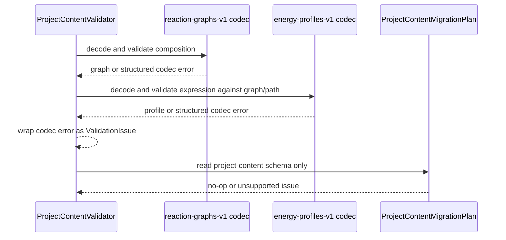

# Energy Semantics Project Content Migration

## 0. 术语约定

- **Energy Semantics Project Content Compatibility**：roadmap 4.7 定义的 v1 兼容规则，覆盖 `reaction-graphs-v1` 的 node composition / `chemical_object_ids` 投影，以及 `energy-profiles-v1` 的可选 point expression。
- **Semantic Content Validation**：Project Content Validation 中专门面向 composition / expression 的只读检查结果；它仍通过 `ProjectContentValidationIssue` 输出，不引入新 report 类型。
- **Energy Semantics Migration Plan**：`ProjectContentMigrationPlan` 对当前 v1 energy semantics 的说明；本 feature 仍保持 no-op migration，不创建 v2、不改写项目文件。
- **Legacy Energy Semantics Data**：旧项目中 reaction node 缺少 `composition` 或 energy point 缺少 `expression` 的合法 v1 数据；加载时必须保留原节点、路径、workspace 和 profile point。

## 1. 决策与约束

### 需求摘要

前面几个 feature 已经把 ReactionNode composition、EnergyPoint expression 和 v1 兼容加载局部落地，但 Project Content Validation / migration plan 层还没有把这些化学语义边界作为长期契约表达清楚。本 feature 要补齐只读验证和 migration plan 可观测性：验证能报告 composition 投影不一致、非法 coefficient、缺失 object、expression shape/unit/source/kind 错误、profile/path 顺序错位等问题；旧数据缺 composition / expression 仍合法；migration plan 明确当前 `project-content-v1` 不需要迁移，不做 silent write。

### 明确不做

- 不升级 `project-content-v1`、`reaction-graphs-v1` 或 `energy-profiles-v1` schema version。
- 不写真实迁移器，不改写旧项目文件，不补写缺失 `composition` / `expression` 字段。
- 不重新计算 EnergyProfile，不根据当前 ChemicalObject energy/corrections 修复 stale profile。
- 不新增 Web Project Sidebar 深校验 UI、不调用 Python ProjectContentValidator 进浏览器。
- 不改变 ReactionGraphService、EnergyProfileEngine、parser/import/export artifact writer 的数值或业务规则。

### 复杂度档位

走默认发布库档位：L3 + modules + reasonable + team + stable + tested + validated。偏离点：本 feature 是 validation/migration 语义补强，必须保持只读和非破坏性；测试重点落在 ProjectContentStore validation/migration 和 section codec 兼容边界。

### 关键决策

1. **复用 section codec 作为深校验节点**：Project Content Validation 继续通过 reaction graph / energy profile codec 解码，避免维护第二套 schema parser。
2. **补 semantic issue 可观测性，不新增 report 类型**：composition / expression 错误仍归入 `section_decode_error`，必要时通过 details 暴露 `error_code` / `error_target`，保证现有 Platform Shell `project.open` 错误路径不变。
3. **legacy 缺字段是合法兼容，不是 warning**：旧 node 缺 composition 会从 `chemical_object_ids` 投影；旧 point 缺 expression 会加载为 null。validation 不把这类旧数据标黄，避免用户以为项目损坏。
4. **migration plan 仍 no-op**：当前 v1 可选字段足够表达新语义，migration plan 只报告 unsupported source/target，不写 steps，也不 mutate files。
5. **文档和测试锁定边界**：实现完成后 acceptance 需要回写 architecture / requirement，明确 Project Content Validation 能覆盖这些语义，但不会修复或重算。

### 前置依赖

`reaction-node-stoichiometry-contract` 与 `energy-profile-provenance-details` 已完成，相关 codec 已具备局部 v1 兼容能力。本 feature 不要求先拆 ProjectContentValidator；现有解码聚合结构足够承载。

## 2. 名词与编排

### 2.1 名词层：值对象 / 实体 / 接口契约

**现状**

- `rxnflow.graph_workspace_codec` 已在 `reaction-graphs-v1` 保存 node `composition` 与兼容 `chemical_object_ids`，旧节点缺 composition 时按 coefficient 1 投影；新节点 composition 与 `chemical_object_ids` 投影不一致会报 `invalid_input`。
- `rxnflow.energy_profile_codec` 已在 `energy-profiles-v1` 保存可选 `point.expression`，旧点缺 expression 加载为 `None`；expression energy 允许 `hartree/kcal_mol/kj_mol`，profile absolute/relative 仍只允许 output unit。
- `rxnflow.content_store.ProjectContentValidator` 通过 `_decode_sections_for_validation` 调用各 section codec，codec error 被包装为 `ProjectContentValidationIssue(code="section_decode_error")`。
- `ProjectContentMigrationPlan` 当前只支持 `project-content-v1 -> project-content-v1` no-op，unsupported source/target 进入 issues。

**变化**

- 明确把 composition / expression 兼容规则纳入 Project Content Validation 的验收契约，并补测试覆盖其可观察 issue。
- 补足 codec 语义边界缺口：expression `node_id` 应与 point node 对齐；expression missing/total 与 point missing/energy 状态不得互相矛盾；component/correction coefficient 必须非零有限；converted/contribution/total unit 必须匹配 profile output unit，raw energy 可保留 Hartree。
- migration plan 增加测试与文档说明：v1 optional fields 不需要迁移，legacy data validation 不出 issue，unsupported source/target 仍只报告 issue 不写文件。

**接口示例**

```json
{
  "project_id": "project-a",
  "schema_version": "project-content-v1",
  "issues": [
    {
      "severity": "error",
      "code": "section_decode_error",
      "target": "profiles[0].points[1].expression.total.unit",
      "details": {
        "error_code": "invalid_input",
        "error_target": "profiles[0].points[1].expression.total.unit"
      }
    }
  ]
}
```

```json
{
  "current_schema_version": "project-content-v1",
  "target_schema_version": "project-content-v1",
  "needed": false,
  "steps": [],
  "issues": []
}
```

### 2.2 编排层：主流程与控制流



**现状**

Project Content Validation 先读 index 和 section bytes，再按 chemical objects -> import ledger -> graphs -> energy profiles -> export artifacts -> workspaces 顺序解码。reaction graph codec 可基于 object_ids 校验 node composition 引用；energy profile codec 可基于 graphs 校验 graph/path/node 顺序。migration plan 只读 index schema，不解码 sections。

**变化**

- graph codec 的 composition 兼容规则被 validation tests 固定：旧 `chemical_object_ids` 合法，新 composition projection mismatch / zero coefficient / missing object 通过 validation report 可见。
- profile codec 的 expression 语义被 validation tests 固定：旧 no-expression 合法；坏 expression shape、unsupported unit/source/kind、node id mismatch、missing/total contradiction 通过 validation report 可见。
- migration plan 测试固定 no-op 行为和只读行为：valid legacy/new energy semantics 都不需要 migration；unsupported source/target 仍是 error issue；调用 validation/plan 前后 tracked bytes 不变。

**跨层纪律**

- 只读：validation 和 migration plan 不写 index、section、manifest、raw files 或 export files。
- 错误语义：section codec 失败继续包装成 `section_decode_error`；Project Shell `project.open` 仍在 validation error 时拒绝恢复，不做部分恢复。
- 兼容性：旧 composition/expression 缺失合法；新增字段 shape 错才报错。
- 解耦：不调用 EnergyProfileEngine、ReactionGraphService patch、parser/import/export writer，也不让 Web 侧参与深校验。
- 可观测点：单测覆盖 section codec、ProjectContentStore.validate_project、migration_plan、no mutation。

### 2.3 挂载点清单

- Project Content Validation：`ProjectContentValidator.validate_project` 的 section decode 聚合 — 修改/补强 composition 与 expression 语义错误的可观测路径。
- Project Content Migration Plan：`ProjectContentStore.migration_plan` / `ProjectContentValidator.migration_plan` — 保持 no-op，但补齐 energy semantics 兼容说明和测试。
- Project Content requirement / architecture：acceptance 阶段回写 `project-content-persistence` 与 `core-platform` — 记录 v1 optional fields、validation 覆盖和 no-migration 边界。

### 2.4 推进策略

1. 验证基线盘点：用现有 ProjectContentStore 测试构造合法 legacy/new energy semantics project。
   - 退出信号：测试能证明 legacy no-composition/no-expression validation 无 error。
2. Composition validation：补 graph section / ProjectContentValidator 覆盖 projection mismatch、非法 coefficient 和 missing object。
   - 退出信号：坏 reaction-graphs section 在 validation report 中产生 `section_decode_error`，target 指向 composition/object 投影相关位置。
3. Expression validation：补 energy profile expression node/energy/unit/source/kind/missing 语义校验。
   - 退出信号：坏 energy-profiles section 在 validation report 中产生可定位 issue，合法 expression 仍 round-trip。
4. Migration plan/no-mutation：补 no-op plan、unsupported source/target、validation/plan 不写文件的 energy semantics 场景。
   - 退出信号：tracked file bytes 前后不变，plan.needed=false。
5. 回归验证：跑 focused persistence/validation tests 与全量 Python。
   - 退出信号：相关测试和 `python3 -m unittest discover` 通过，准备进入 acceptance。

## 3. 验收契约

### 关键场景清单

1. 旧 `reaction-graphs-v1` node 缺 `composition`、只带 `chemical_object_ids` 时，validate_project 不报 error，load 后 composition 为 coefficient 1。
2. 新 `reaction-graphs-v1` node 同时带 composition / `chemical_object_ids` 且投影一致时，validate_project 通过。
3. composition 与 `chemical_object_ids` 投影不一致时，validate_project 报 `section_decode_error`，target 可定位到 node object projection。
4. composition term coefficient 为 0、NaN/Infinity 或非数字时，validate_project 报 error。
5. composition 引用缺失 ChemicalObject 时，validate_project 报 error，不部分恢复 graph。
6. 旧 `energy-profiles-v1` point 缺 `expression` 时，validate_project 不报 error，load 后 expression 为 null。
7. 新 expression 合法时，validate_project 通过，并保留 raw Hartree 与 output-unit converted/contribution。
8. expression `node_id` 与 point node 不一致、component source/kind/unit 非法、coefficient 非零有限规则失败、missing/total 与 point 状态矛盾时，validate_project 报可定位 error。
9. profile graph/path/node 顺序错位仍按既有 `graph_invalid` 语义进入 validation issue。
10. migration_plan 对当前 v1 legacy/new energy semantics 都返回 `needed=false`、无 steps、无 issues。
11. migration_plan unsupported target/source 仍返回 error issue，不写文件。
12. validate_project 和 migration_plan 在上述场景均不修改 project files。

### 明确不做的反向核对项

- 不出现 `project-content-v2`、`reaction-graphs-v2` 或 `energy-profiles-v2` 的 schema 常量。
- 不新增会写 section JSON 的 migration executor。
- 不调用 `EnergyProfileEngine.compute_profile` 来修复或验证 stored profile 数值。
- 不修改 parser/import/export writer 或 Web Project Sidebar 深校验逻辑。

## 4. 与项目级架构文档的关系

Acceptance 阶段需要更新 `codestable/architecture/ARCHITECTURE.md`、`codestable/architecture/core-platform.md` 和 `codestable/requirements/project-content-persistence.md`：

- 名词归并：Energy Semantics Project Content Compatibility、Semantic Content Validation、Energy Semantics Migration Plan。
- 动词骨架归并：Project Content Validation 通过 graph/profile section codec 只读校验 composition / expression；migration plan 对 v1 optional fields 保持 no-op。
- 跨层纪律归并：旧缺字段合法，新字段 shape 错报错；validation/migration 不写文件、不重算、不修复、不升级 schema。

不更新 Web architecture；本 feature 不改变 Web runtime 或 Project Sidebar 行为。
