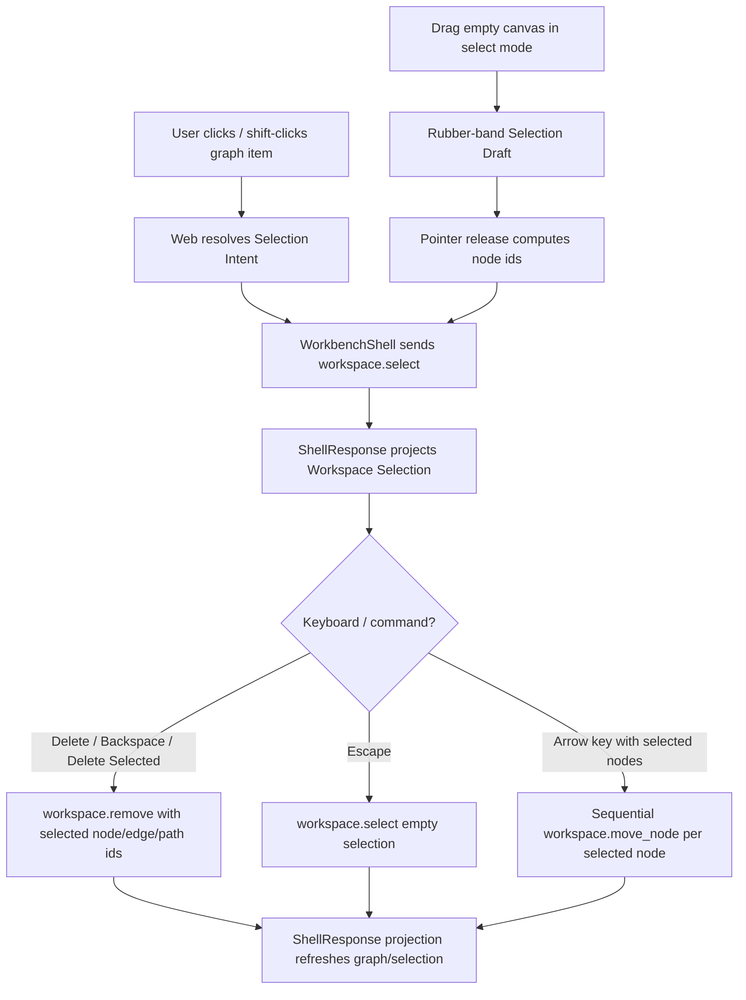

# graph-editor-multiselect-keyboard design

## 0. 术语约定

| 术语 | 定义 | 防冲突结论 |
|---|---|---|
| Multi-target Selection | 同时包含多个 node / edge / path id 的 `WorkspaceSelection` | 不新增前端私有 selection schema |
| Selection Intent | Web UI 对一次选择操作的意图，包含 replace / add / toggle | 不等同于 shell command，最终仍投影为 `workspace.select` |
| Rubber-band Selection Draft | 用户在 select mode 空白画布拖出的矩形框选草稿 | UI-only，不进入 ShellResponse、Project Content、Browser Project Repository 或 localStorage |
| Graph Keyboard Intent | Graph Canvas 获得焦点时响应 Delete / Backspace / Escape / Arrow keys | 不注册全局快捷键，不拦截表单输入 |
| Node Nudge | 使用方向键按 grid step 移动 selected nodes | 只移动 node，不移动 edge/path，也不新增 batch move command |
| Workspace Selection Authority | 选中态最终以 `WorkspaceSummary.selection` 为准 | Web 可短暂显示 UI intent，但不能把 domain state 本地 patch 成成功 |

术语 grep 结果：`WorkspaceSelection`、`workspace.select(selection.node_ids/edge_ids/path_ids)`、`workspace.remove(node_ids/edge_ids/path_ids)` 已存在；`graphEditorInteractionState.ts` 当前选择 helper 每次只替换为单个 node/edge/path；`GraphCanvas` 没有 keydown、rubber-band、Shift toggle 或 node nudge 入口。

## 1. 决策与约束

### 需求摘要

本 feature 目标是把 Graph Canvas 的选择与键盘编辑补到高频可用：

1. 普通点击 node / edge / path 仍替换当前 selection。
2. Shift-click node / edge / path 会 add/toggle 当前 item，允许 mixed selection。
3. select mode 下从空白画布拖出 Rubber-band Selection Draft，可按 node center 框选多个 nodes；无修饰键时 replace node selection，按 Shift 时 add nodes 到当前 selection。
4. Delete Selected button 和 Delete / Backspace 快捷键都发送当前 selection 的 `workspace.remove(node_ids, edge_ids, path_ids)`。
5. Escape 快捷键发送 `workspace.select(selection={})` 清空 selection，并清理 pending edge / rubber-band draft。
6. Arrow keys 对 selected nodes 执行 node nudge：按固定 graph grid step 计算新位置，逐个复用既有 `workspace.move_node(node_id, position)`。
7. edge/path 可参与 selection/delete，但 nudge 只作用于 nodes。
8. 多选时单对象编辑器保持保守：Node Composition、Edge Label Draft、Path Order Draft 只在 selection 中恰好有一个对应 item 且没有 mixed selection 时启用。

### 明确不做

- 不新增 Python core / Platform Shell command、GraphPatch op、Project Content schema、Browser Project Repository write、localStorage persistence、autosave 或第三方 diagramming library。
- 不新增 `workspace.move_nodes`、`workspace.keyboard`、`workspace.multiselect` 或 batch selection command。
- 不实现 undo/redo/history、minimap、wheel/pinch、endpoint reconnect、edge/path nudge、edge/path rubber-band hit testing、freeform lasso 或 snapping preference UI。
- 不把 keyboard shortcuts 注册为全局 app 快捷键；焦点在 input、textarea、select 或 contenteditable 内时不拦截。
- 不改变 direct edge gesture、click-driven Connect fallback、node body drag、object drop、canvas pan、Edge Label Draft、Path Order Draft、EnergyProfile 或 Report Export 行为。
- 不自动保存 nudge / delete / selection；长期保存仍由显式 Save Bridge Session 触发。

### 复杂度档位

- Web interaction state：L3。当前 selection helper 是单选/互斥，需要扩成 replace/add/toggle、rubber-band draft、keyboard intent 和 stale prune。
- GraphCanvas pointer / keyboard orchestration：L3。需要和 node drag、direct edge gesture、canvas pan、object drop、viewport transform 共存，避免事件抢占。
- WorkbenchShell orchestration：L2。复用 `workspace.select`、`workspace.remove`、`workspace.move_node`，新增 nudge sequencing。
- Shell/core：L1。不改 contract；已有 Workspace Selection arrays 和 move/remove commands 足够。
- Persistence：L1。不改 schema；selection/viewport/node positions 已由现有 WorkspaceSnapshot / ReactionGraph 保存。
- Testability：tested。helper tests、component tests 和浏览器验证可覆盖。

### 关键决策

1. **复用 Workspace Selection 数组协议**：多选只把既有 `node_ids` / `edge_ids` / `path_ids` 从单元素扩为多元素，不另建 Web-only authority。
2. **Shift-click toggle，rubber-band replace/add**：单点多选需要可撤销单个 item；框选首轮只覆盖 nodes，避免用几何启发误选 edge/path。
3. **键盘范围限定在 Graph Canvas**：只有 graph surface / graph item 获得焦点时响应快捷键；表单输入不被截断。
4. **nudge 复用 `workspace.move_node`**：按 selected node ids 稳定顺序逐个发送；任一 move 失败后停止后续 move 并显示 ShellError，不做本地回滚。
5. **single-item editors 保守启用**：mixed / multi selection 下不初始化 composition、edge label 或 path order draft，避免用户以为在批量编辑。
6. **projection authority 不变**：Delete、Escape、nudge 成功后的可见状态只来自 ShellResponse workspace projection。

## 2. 名词与编排

### 2.1 名词层：值对象 / 实体 / 接口契约

**现状**：

- `GraphEditorSelection = { nodeIds, edgeIds, pathIds }` 已是数组 shape，但 `selectGraphEditorNode/Edge/Path` 每次只保留一个 id，并清空其他类型。
- `WorkspaceSelectionSummary` / core `WorkspaceSelection` 已支持数组，`workspace.select` 校验引用，`workspace.remove` 已支持三类 ids。
- Delete Selected button 已把当前 selection 交给 `workspace.remove`，但当前 UI 只产生单选。
- Node drag release 已复用 `workspace.move_node(node_id, position)`，Auto Layout 已证明 Web 可以按稳定顺序发送多个 move。
- GraphCanvas 没有 rubber-band draft、keyboard handler、multi-selected styling 或 nudge intent。

**变化**：

新增 / 扩展 Web interaction types：

```ts
type GraphEditorSelectionMode = "replace" | "add" | "toggle"

type GraphEditorDraggingState =
  | { kind: "node"; nodeIds: string[]; origin: CanvasPoint; current: CanvasPoint }
  | { kind: "canvas"; origin: CanvasPoint; current: CanvasPoint }
  | { kind: "object-drop"; objectId: string; current: CanvasPoint }
  | { kind: "rubber-band"; origin: CanvasPoint; current: CanvasPoint; mode: "replace" | "add" }

type GraphEditorKeyboardIntent =
  | { kind: "delete-selection" }
  | { kind: "clear-selection" }
  | { kind: "nudge-selection"; delta: { x: number; y: number } }
```

内部 nudge request：

```ts
type NudgeGraphNodesRequest = {
  nodeIds: string[]
  delta: { x: number; y: number }
}
```

稳定规则：

- replace：用传入 item set 替换整个 selection。
- add：把传入 ids 追加进对应数组，保留其他类型，去重且保持已有顺序。
- toggle：存在则移除，不存在则追加；可把最后一个 item toggle 为空 selection。
- Rubber-band 首轮只计算 node center 是否落在 selection rectangle 内。
- Node nudge 只读取 selected node ids；selection 里只有 edge/path 时 no-op。
- `Connect` button 只在恰好单个 selected node 且没有 edge/path selection 时启用，避免多选 source 歧义。

### 2.2 编排层：主流程与控制流



**现状**：

- `WorkbenchShell.selectGraphItems` already sends `workspace.select`.
- `removeGraphItems` already sends `workspace.remove` with current selection arrays.
- `onMoveNode` and Auto Layout already establish single / sequential `workspace.move_node` orchestration.
- `graphViewport` and `graphNodeLayout` already provide fixed `600 x 360` graph coordinate conversion, snap and clamp helpers.

**变化**：

- `graphEditorInteractionState.ts` adds pure selection intent helpers: replace/add/toggle/clear, rubber-band start/update/resolve, keyboard intent resolver and stale prune.
- GraphCanvas item click handlers receive modifier info and call selection callbacks with a `GraphEditorSelectionMode`.
- Empty surface drag in select mode starts Rubber-band Selection Draft only when target is not node/edge handle/hitbox and pan mode is inactive.
- Rubber-band overlay renders in the graph viewport layer; pointer release computes nodes whose graph positions are inside the rectangle, then submits `workspace.select`.
- GraphCanvas root becomes focusable and scoped keydown handler resolves Delete / Backspace / Escape / Arrow keys; form controls opt out.
- WorkbenchShell adds shared selection orchestration and `nudgeGraphNodes` sequential command runner.
- Single-item editors derive active item only from single, non-mixed selection; multi selection shows selection summary and keeps drafts cleared.

**跨层纪律**：

- Command authority：selection/delete/nudge visible results come from ShellResponse workspace projection; GraphCanvas does not patch domain graph locally.
- Gesture isolation：node body drag, Edge Connect Handle direct gesture, pan mode and object drop keep their existing start targets.
- Error semantics：invalid references still surface as shell `graph_invalid`; empty delete/nudge are UI no-op and do not call shell.
- Ordering：nudge sends selected node ids in selection order; if a move fails, stop later moves and show existing ShellError without rollback.
- Persistence boundary：rubber-band draft and keyboard focus are UI-only; selection and moved positions persist only through existing explicit Save Bridge Session.
- Accessibility：button fallback remains for Delete Selected; Escape/Delete/Arrow are additive shortcuts, not the only path.

### 2.3 挂载点清单

- Web interaction state：selection intent helpers、rubber-band draft helpers、keyboard intent resolver、stale prune。
- GraphCanvas selection / keyboard UI：Shift-click node/edge/path, rubber-band overlay, focus-scoped keydown, multi-selected styling and selection summary。
- WorkbenchShell orchestration：shared `selectGraphItems` usage, selected node nudge sequencing, single-item editor guards。
- Tests / browser QA：helper tests、WorkbenchShell component tests、browser desktop/narrow validation for multi-select, delete, escape and node nudge。

本 feature 不挂入 Python core、Platform Shell、Project Content Store、Browser Project Repository、EnergyProfilePanel、ReportExportPanel、localStorage 或 third-party graph library。

### 2.4 推进策略

1. **Selection Intent State**：扩展 interaction helper 支持 replace/add/toggle/clear、rubber-band draft、keyboard intent 和 stale prune。
   - 退出信号：helper tests 证明 mixed selection 可 add/toggle/dedupe/prune，rubber-band release 可产出 node ids，keyboard intent 不处理输入控件。
2. **GraphCanvas Multi-select UI**：接入 Shift-click node/edge/path、rubber-band node selection、多选视觉和 single-item editor guard。
   - 退出信号：component tests 证明普通点击 replace，Shift-click add/toggle，框选多个 node 后只发送 `workspace.select`，multi selection 不误开单 item draft。
3. **Keyboard And Nudge Orchestration**：GraphCanvas scoped keydown 接入 Delete/Backspace/Escape/Arrow，WorkbenchShell 顺序执行 selected node nudge。
   - 退出信号：Delete/Backspace 发送 `workspace.remove`，Escape 发送空 `workspace.select`，Arrow 对 selected nodes 发送稳定 `workspace.move_node` 序列；输入框内按键不触发。
4. **Verification And Scope Guard**：跑 Web tests/build、必要 Python tests、浏览器桌面/窄屏验证。
   - 退出信号：多选、框选、删除、清空和 nudge 可用；node drag/direct edge/pan/drop/click fallback 不回退；scope grep 未新增 core/schema/autosave/energy/export 变更。

## 3. 验收契约

### 关键场景清单

1. Interaction helper 可 replace/add/toggle node/edge/path selection，去重并保持稳定顺序。
2. toggle 已存在 item 会从 selection 移除；toggle 最后一个 item 可得到空 selection。
3. prune 会清除失效 selected ids、rubber-band draft 和 dragging stale node references。
4. Rubber-band draft 可从 origin/current 计算 rectangle，并选择中心点落在 rectangle 内的 nodes。
5. 普通点击 node/edge/path 替换 selection，并发送对应 `workspace.select`。
6. Shift-click node/edge/path add/toggle selection，允许 mixed selection，并发送数组型 `workspace.select`。
7. select mode 空白画布 drag 显示 rubber-band overlay；release 后发送 selected node ids；drag 过程中不发送 shell command。
8. pan mode 空白拖动仍发送 `workspace.set_viewport`，不触发 rubber-band。
9. Edge Connect Handle direct gesture 仍可用，不被 rubber-band 或 Shift-click 误捕获。
10. Delete Selected button 和 Delete/Backspace 快捷键发送当前 selection 的 `workspace.remove(node_ids, edge_ids, path_ids)`。
11. Empty selection 下 Delete/Backspace 不发送 shell command。
12. Escape 发送空 `workspace.select`，并清理 pending edge / rubber-band draft。
13. Arrow keys 对 selected nodes 发送 `workspace.move_node`，edge/path selection 不产生 nudge command。
14. Nudge 时多个 selected nodes 按稳定顺序移动；失败时停止后续 move，不本地回滚 domain graph。
15. 焦点在 input/textarea/select/contenteditable 内时，Delete/Escape/Arrow 不触发 graph keyboard intent。
16. 多选或 mixed selection 时 Node Composition Editor、Edge Label Draft、Path Order Draft 不初始化可编辑 draft；单选行为保持。
17. Click-driven Connect fallback 只在恰好单个 node selected 时启用，direct edge gesture 不受影响。
18. 不新增 Python core / Platform Shell command、GraphPatch op、Project Content schema、Browser Project Repository write、localStorage persistence、autosave、EnergyProfile 或 Report Export 变更。
19. `cd web && npm run test -- --run` 通过。
20. `cd web && npm run build` 通过。
21. 浏览器验证 `http://127.0.0.1:5173/` 页面非空白、无 framework overlay、console clean；多选/框选/键盘在桌面/窄屏无明显重叠或水平溢出。

### 反向检查

- 不把 multi-select 做成前端本地 domain graph patch。
- 不新增 batch move / batch select shell command。
- 不把 node nudge 扩展成 undo/redo/history 或持久化操作日志。
- 不把 keyboard shortcuts 做成全局快捷键或拦截表单输入。
- 不把 rubber-band draft 写入 ShellResponse、Project Content、Browser Project Repository 或 localStorage。

## 4. 与项目级架构文档的关系

- acceptance 阶段应更新 `codestable/architecture/web-workbench.md`：记录 Multi-target Selection、Selection Intent、Rubber-band Selection Draft、Graph Keyboard Intent、Node Nudge、single-item editor guard 和 projection authority。
- acceptance 阶段应按实际情况更新 `codestable/requirements/web-workbench-shell.md`：用户可多选、框选、Delete/Escape 和方向键微调 selected nodes；仍不做 undo/redo、minimap、endpoint reconnect、autosave 或全局快捷键。
- core / platform 架构通常不需要更新，因为本 feature 复用既有 `workspace.select`、`workspace.remove` 和 `workspace.move_node`；如果实现中发现必须改 contract，需先回 roadmap/design。
- roadmap acceptance 阶段把 `graph-editor-multiselect-keyboard` 标为 `done`；后续 `graph-editor-lightweight-history` 可复用本 feature 的 selection / nudge intent 边界。
