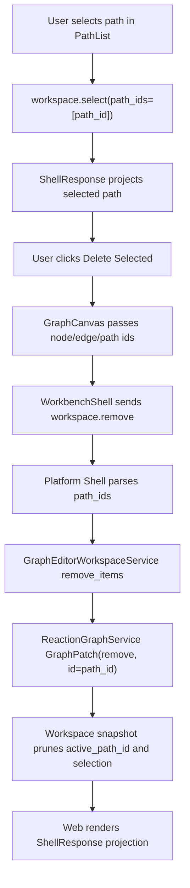

# graph-editor-path-delete design

## 0. 术语约定

| 术语 | 定义 | 防冲突结论 |
|---|---|---|
| Workspace Remove Path Contract | 在既有 `workspace.remove` args 中新增 `path_ids?: string[]`，允许删除 graph path | 不新增 `workspace.delete_path` 或新的 shell command |
| Path Delete | 删除 `ReactionGraph.paths` 中指定 path，删除后 node/edge 保留 | 不等同于删除 path 上的 node、edge 或 energy profile |
| Selected Path Delete | Graph Canvas 选中 path 后点击 Delete Selected，发送当前 selection 中的 path ids | 不等同于 Path Order Draft apply |
| Path Cascade Projection | 删除 path 后 active path、selection、preview 和 energy panel 跟随 ShellResponse workspace projection 更新 | 不由 Web 前端本地推断 |

术语 grep 结果：`ReactionGraphService` 已支持 `GraphPatch("remove", id=path_id)` 删除 path；`WorkspaceSelection.path_ids`、`workspace.select(selection.path_ids)`、Web PathList selection 和 Path Order Draft 已存在；当前 `GraphEditorWorkspaceService.remove_items`、Platform Shell `workspace.remove`、fixture transport 和 Web `RemoveGraphItemsRequest` 只暴露 node/edge 删除。

## 1. 决策与约束

### 需求摘要

本 feature 目标是补齐 Graph Canvas path 生命周期中的删除动作：

1. 用户在 Graph Canvas 的 path list 中选中 path 后，可点击 Delete Selected 删除该 path。
2. Shell command 仍复用 `workspace.remove`，args 扩展为 `node_ids?` / `edge_ids?` / `path_ids?`。
3. 删除 path 不删除任何 node 或 edge，只从 `ReactionGraph.paths` 移除对应 `ReactionPath`。
4. 如果删除的是 active path，`WorkspaceSummary.active_path_id` 必须变为 `null` 或 shell projection 给出的仍存在 path。
5. 删除后 `WorkspaceSummary.selection.path_ids` 必须由 workspace projection 修剪，Web 不本地猜测。
6. unknown path id 返回 `graph_invalid target=path_id`，空 selection 仍返回 `invalid_input target=selection`。

### 明确不做

- 不新增 `workspace.delete_path`、GraphPatch op、Project Content schema、Browser Project Repository write、localStorage key 或 autosave。
- 不删除 path 上的 nodes / edges，不做反应路径重算、自动重连、路径搜索或能量 profile 删除。
- 不新增 undo/redo/history、多选框选、键盘 Delete、path 批量管理菜单或确认弹窗。
- 不修改 Path Order Draft 的 reorder/apply 语义。
- 不改变 edge/node delete 现有 cascade 行为。
- 不改变 report export、energy compute、object registry、import inbox 或 project bundle 行为。

### 复杂度档位

- Core contract：L2。`GraphPatch("remove")` 已支持 path，workspace remove contract 只需把 `path_ids` 接入既有 patch flow。
- Platform Shell：L2。复用 `workspace.remove` command，扩展 args 解析和 error 文案。
- Web orchestration：L2。Delete Selected 包含 path selection，并继续等待 ShellResponse projection。
- Persistence：L1。不改 schema；path 删除后的 graph/workspace 状态仍由显式 Save Bridge Session 保存。
- Testability：tested。core workspace、platform shell、fixture transport、component test 和浏览器验证可覆盖。

### 关键决策

1. **复用 `workspace.remove`**：path 与 node/edge 都是 graph item，沿用统一 remove command，避免新 shell command。
2. **由 core projection 表达删除后状态**：active path、selection、preview 都以 `WorkspaceSnapshot` 为准。
3. **path delete 不碰 node/edge**：删除 path 只移除路径定义，保留图谱结构。
4. **Web 只提交 selection intent**：GraphCanvas 不直接过滤 `workspace.graph.paths` 或清空 active path。
5. **不提前做键盘/多选**：本 feature 只让已存在 path selection 能被 Delete Selected 消费，键盘和多选留给后续 roadmap item。

## 2. 名词与编排

### 2.1 名词层：值对象 / 实体 / 接口契约

**现状**：

- `ReactionGraphService._remove` 已识别 node / edge / path id；path id 命中时只从 `graph.paths` 移除 path。
- `GraphEditorWorkspaceService.remove_items(project_id, workspace_id, node_ids=(), edge_ids=())` 当前只接受 node/edge ids，并通过 `_remove_item_ids` 生成 `GraphPatch("remove")`。
- `WorkspaceSelection` 已有 `path_ids`；`select` 会校验 path 引用；`_prune_selection` 会移除失效 path selection。
- `PlatformShellService._run_workspace_remove` 当前只读取 `node_ids` / `edge_ids`。
- fixture `fixtureWorkspaceRemoveResponse` 当前只处理 `node_ids` / `edge_ids`。
- Web `RemoveGraphItemsRequest` 当前只有 `nodeIds` / `edgeIds`；GraphCanvas Delete Selected disabled 条件只看 node/edge selection。

**变化**：

核心 workspace contract：

```python
def remove_items(
    project_id: ID,
    workspace_id: ID,
    node_ids: tuple[ID, ...] = (),
    edge_ids: tuple[ID, ...] = (),
    path_ids: tuple[ID, ...] = (),
) -> Result[WorkspaceSnapshot]
```

Shell command args：

```ts
type WorkspaceRemoveArgs = {
  session_id: string
  node_ids?: string[]
  edge_ids?: string[]
  path_ids?: string[]
}
```

Web request shape：

```ts
type RemoveGraphItemsRequest = {
  nodeIds: string[]
  edgeIds: string[]
  pathIds: string[]
}
```

删除语义：

- `node_ids` 删除仍带 ReactionGraphService cascade，相关 edge/path 由 graph projection 消失。
- `edge_ids` 删除仍只移除 edge。
- `path_ids` 删除只移除 path，不删除 node/edge。
- 多类 ids 同时存在时，按稳定顺序生成 remove patches：node ids、非 incident edge ids、path ids；如果 node 删除已 cascade 掉某 path，则重复指定该 path 不应造成额外 missing error。
- 空 args 仍返回 `invalid_input target=selection`。
- unknown path id 返回 `graph_invalid target=path_id`。

### 2.2 编排层：主流程与控制流



**现状**：

- PathList button 已能调用 `onSelectPath(path.id, path.node_ids)`；WorkbenchShell 发送 `workspace.select(selection.path_ids=[pathId])`。
- Delete Selected button 已在 GraphCanvas command bar，当前只在 selected node/edge 时启用。
- WorkbenchShell `removeGraphItems` 只在 node/edge 非空时发送 command。
- Energy Profile Panel 默认跟随 `workspace.active_path_id`，active path 消失后应自然进入缺 profile/path 状态。

**变化**：

- GraphCanvas `canRemoveSelection` 纳入 `selection.pathIds`。
- Delete Selected payload 增加 `pathIds: interactionState.selection.pathIds`。
- WorkbenchShell `removeGraphItems` guard 和 command args 增加 `path_ids`。
- Platform Shell `_run_workspace_remove` 读取 `path_ids`，空 selection 判断包含三类 ids。
- GraphEditorWorkspaceService `remove_items` 接受 `path_ids` 并交给 `_remove_item_ids`。
- fixture transport 对 `path_ids` 做 missing 校验、删除 path、清理 active path / selection / path draft 依赖的 projection。
- component / shell / core tests 增加 selected path delete 主路径和 missing path error。

**跨层纪律**：

- Command authority：GraphCanvas 不直接 mutate `workspace.graph.paths`、`workspace.active_path_id` 或 selection。
- Error semantics：unknown path 统一 `graph_invalid target=path_id`；空 selection 继续 `invalid_input target=selection`。
- Idempotence：删除已不存在 path 是 error，不静默成功；删除 node 时 cascade 掉 path 后，workspace projection 负责清理 selection。
- Persistence boundary：path 删除不自动保存；长期落盘仍由显式 Save Bridge Session 触发。
- Isolation：path delete 不调用 EnergyProfileEngine、ReportExportService、Browser Project Repository、Project Content writer 或 import/object registry。

### 2.3 挂载点清单

- Core workspace remove contract：`GraphEditorWorkspaceService.remove_items` 和 `_remove_item_ids` 接入 `path_ids`。
- Platform Shell command adapter：`workspace.remove` args 解析与空 selection / error 文案。
- Fixture transport：fixture `workspace.remove` 支持 path ids，保持 Web tests 和 fixture runtime 一致。
- GraphCanvas / WorkbenchShell delete orchestration：Delete Selected 支持 selected path，并继续只消费 ShellResponse projection。
- Tests：core workspace、platform shell、ShellClient fixture、WorkbenchShell component 和浏览器验证覆盖 path delete。

本 feature 不新增 Python dataclass、Project Content codec、Browser Project Repository API、localStorage key、第三方库、report/export format 或 energy command。

### 2.4 推进策略

1. **Core Workspace Remove Contract**：扩展 `remove_items` / `_remove_item_ids` 支持 path ids，并补 core workspace tests。
   - 退出信号：删除 path 保留 node/edge，active path 和 selection 被 projection 修剪；missing path / empty selection 错误稳定。
2. **Platform Shell And Fixture Contract**：扩展 `workspace.remove` shell adapter 与 fixture transport，补 shell / fixture tests。
   - 退出信号：真实 Platform Shell 和 fixture runtime 都能用 `path_ids` 删除 path，错误 code/target 一致。
3. **Web Delete Selected Entry**：GraphCanvas / WorkbenchShell 把 selected path 纳入 Delete Selected payload，更新 component tests。
   - 退出信号：选中 path 后 Delete Selected 可用，发送 `workspace.remove(path_ids=[...])`，UI 按 ShellResponse 移除 path 并清理 path draft。
4. **Verification And Scope Guard**：跑 Python 单测、Web tests/build 和浏览器主链路。
   - 退出信号：测试通过；浏览器可选中 path 并删除，node/edge 仍保留，active path/selection UI 无残留；scope grep 未新增 schema/persistence/autosave/energy/report 变更。

## 3. 验收契约

### 关键场景清单

1. `GraphEditorWorkspaceService.remove_items(path_ids=(path_id,))` 删除 path 后，graph nodes 和 edges 保留。
2. 删除 active path 后，`WorkspaceSnapshot.active_path_id` 为 `None`，`selection.path_ids` 被修剪为空。
3. 删除非 active path 不改变仍存在的 active path。
4. 同时传入 node/edge/path ids 时，node 删除 cascade 与显式 path delete 不产生重复 missing error。
5. 空 remove args 返回 `invalid_input target=selection`。
6. unknown path id 返回 `graph_invalid target=path_id`，且 state 不变化。
7. Platform Shell `workspace.remove` 接受 `path_ids` 并返回 `command=workspace.remove` 的 workspace projection。
8. fixture transport `workspace.remove` 接受 `path_ids`，删除 path 后 path list / active path / selection projection 更新。
9. Web GraphCanvas 选中 path 后 Delete Selected 启用并发送 `workspace.remove(path_ids=[selected])`。
10. Web 删除 selected path 后 PathList 不再显示该 path，Network Preview path count 更新，node/edge 仍显示。
11. Energy panel 不直接处理删除动作；active path 消失后的显示只来自 workspace projection。
12. 不新增 `workspace.delete_path`、GraphPatch op、Project Content schema、Browser Project Repository write、localStorage persistence、autosave 或第三方库。
13. 不删除 path 上的 nodes / edges，不改变 node/edge delete 现有行为。
14. `python3 -m unittest discover` 通过。
15. `cd web && npm run test -- --run` 通过。
16. `cd web && npm run build` 通过。
17. 浏览器验证页面非空白、无 framework overlay、console clean；选中 path 删除后桌面/窄屏无明显重叠或水平溢出。

### 反向检查

- 不把 path delete 做成前端本地过滤 `workspace.graph.paths`。
- 不把 path delete 描述为反应路径搜索、能量 profile 删除或自动机理推断。
- 不把 path delete 状态写入 localStorage、Browser Project Repository 或 Project Content，除非用户显式 Save Bridge Session。

## 4. 与项目级架构文档的关系

- acceptance 阶段应更新 `codestable/architecture/core-platform.md`：记录 `workspace.remove` 支持 `path_ids`，`GraphEditorWorkspaceService.remove_items` 三类 ids，删除 path 不删除 node/edge，active path/selection 由 projection 修剪。
- acceptance 阶段应更新 `codestable/architecture/web-workbench.md`：记录 Delete Selected 对 selected path 可用，Web 只发送 `workspace.remove(path_ids)` 并等待 ShellResponse。
- requirement `web-workbench-shell` 应补充用户可删除 selected path，但仍不自动保存、不做化学合理性或能量 profile 删除。
- roadmap acceptance 阶段把 `graph-editor-path-delete` 标为 `done`；后续 `graph-editor-multiselect-keyboard` 可复用统一 node/edge/path remove contract。
