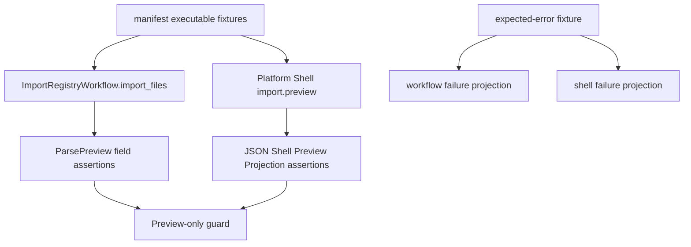

# real-output-import-preview-regression design

## 0. 术语约定

| 术语 | 定义 | 防冲突结论 |
|---|---|---|
| Fixture-backed Import Preview Regression | 使用 `tests/fixtures/parsers/manifest.yaml` 的 executable fixtures 作为输入，回归 import preview 投影 | 不新增 parser 支持承诺 |
| Workflow Preview Projection | `ImportRegistryWorkflow.import_files` 返回的 `ImportItem.preview` 与 `ParsePreview` | 已有测试覆盖所有 executable fixtures |
| Shell Preview Projection | Platform Shell `import.preview` 返回 JSON payload 中的 `batch.items[].preview/raw_resource/warnings/error` | 本 feature 重点补齐 |
| Preview-only Guard | 断言 import preview 不调用 `ChemicalRegistry.register`，不确认导入，不触碰 graph/energy/export/bundle 服务 | 继续沿用 `_PreviewOnlyRegistry` / no-op service guard |

## 1. 决策与约束

### 需求摘要

本 feature 目标是完成 roadmap 中 Import Preview Compatibility：

1. 使用已完成的 MAPLE、Gaussian/ORCA cclib、ASE extxyz、XYZ fixture corpus 运行 `ImportRegistryWorkflow.import_files`。
2. 使用同一批 supported/partial executable fixtures 运行 Platform Shell `import.preview`。
3. 核对 preview JSON 保留 parser_id、parser_version、object_count、warning codes、raw resource path/checksum 和 error code。
4. 确认 preview-only：不确认导入、不登记 ChemicalObject、不调用 graph/energy/export/bundle 服务。

明确不做：

- 不新增 parser runtime 支持，不修改 parser 解析逻辑或 snapshot 语义。
- 不确认导入，不调用 `import.register_all`，不登记 ChemicalObject。
- 不修改 Project Store、ReactionGraph、EnergyProfile、Report Export、Web UI 或本地 HTTP bridge。
- 不把 support matrix 扩成真实软件版本认证矩阵。
- 不把 expected-error fixture 当成 parse preview success。

### 复杂度档位

测试侧回归 feature。偏离点：

- 现有 workflow regression 已经遍历 executable fixtures；shell regression 只抽样一成一败。
- 本 feature 应优先扩展 `tests/test_import_preview_parser_regression.py`，如果 shell projection 已够用，不改 runtime。
- 多 warning fixture 需要比较 warning codes 的稳定投影，不依赖 parser warning 产生顺序。

### 关键决策

1. **同源 corpus**：workflow 和 shell 都以 manifest executable fixtures 为准，expected-error fixture 单独覆盖 failure projection。
2. **投影保真而非深对象复制**：shell 层只需要验证 summary fields，不把完整 `ParseResult` 暴露进 JSON。
3. **raw resource 必查**：shell payload 必须含 `raw_resource.kind/path/checksum`，并确认文件已经复制到 project raw resource 路径。
4. **preview-only guard**：测试中的 registry/graph/energy/export/bundle guard 继续确保 preview 不越界。

## 2. 名词与编排

### 2.1 名词层：值对象 / 实体 / 接口契约

**现状**：

- `ImportRegistryWorkflow.import_files` 对每个 input file 生成 `ImportItem`：成功时 status=`needs_confirmation`，含 `ParsePreview`；失败时 status=`failed`，含 error 和 raw resource。
- `PlatformShellService._run_import_preview` 调用同一个 workflow，并用 `_import_batch_summary` 投影为 JSON-safe payload。
- `_parse_preview_summary` 当前投影 `raw_resource_id`、`parser_id`、`parser_version`、`object_count`、warnings。
- 现有 `test_workflow_preview_preserves_parser_fixture_snapshot_fields` 已遍历 all executable fixtures；shell test 只抽样 `xyz-water-geometry-missing-energy` 和 `xyz-bad-atom-count`。

**变化**：

- 新增 shell corpus regression：对所有 supported/partial executable fixtures 调用 `import.preview`，核对：
  - item status 为 `needs_confirmation`
  - preview parser metadata / object_count / warning codes 与 snapshot 一致
  - preview raw_resource_id 与 item raw_resource.id 一致
  - raw_resource kind/path/checksum 存在，project 内 raw file 已落盘
  - session objects 仍为空
- expected-error fixture 保持 shell failure projection 覆盖：status=`failed`、preview=null、error.code 与 snapshot 一致、raw_resource 保留。

接口示例：

```python
service.run(ShellCommand("import.preview", {
    "session_id": session_id,
    "source_path": str(fixture.file),
}))
# => {
#      "batch": {
#        "items": [{
#          "status": "needs_confirmation",
#          "raw_resource": {"kind": "raw_file", "path": "...", "checksum": "..."},
#          "preview": {"parser_id": "...", "parser_version": "...", "object_count": N},
#          "warnings": [{"code": "..."}],
#        }]
#      }
#    }
```

### 2.2 编排层：主流程与控制流



**跨层纪律**：

- 错误语义：expected parser failure 保留 raw resource 和 `parse_failed` error code，不生成 preview。
- 幂等性：每个 fixture 使用独立 TemporaryDirectory 和 project session，避免 state 泄漏。
- 顺序：manifest fixture 顺序不作为语义，断言以 fixture id 和 snapshot 为基准。
- 可观测点：parser metadata、object_count、warning codes、raw resource id/path/checksum、session object count、JSON serialization。

### 2.3 挂载点清单

- `tests/test_import_preview_parser_regression.py` 的 shell corpus-backed success/failure regression。
- `codestable/features/2026-05-22-real-output-import-preview-regression/` 的 design/checklist/acceptance。
- `codestable/architecture/ARCHITECTURE.md`、`core-platform.md` 和 roadmap 的 Import Preview Parser Regression 描述。

### 2.4 推进策略

1. **Design and roadmap gate**：落 design/checklist，把 roadmap item 标为 in-progress。
   - 退出信号：feature doc、checklist 和 roadmap YAML 通过。
2. **Shell corpus regression**：扩展 Platform Shell `import.preview` 测试，遍历 executable fixtures 并补 expected-error failure assertion。
   - 退出信号：shell payload parser metadata、object_count、warnings、raw_resource 和 preview-only guard 全部覆盖。
3. **Docs, architecture and acceptance**：回写 docs/architecture/roadmap，补验收报告。
   - 退出信号：checks 全 passed，roadmap item done。
4. **Verification**：运行 YAML、focused import preview tests 和全量 unittest。
   - 退出信号：YAML/focused/full tests 通过。

## 3. 验收契约

### 关键场景清单

1. Workflow preview regression 继续遍历所有 supported/partial executable fixtures，且不登记 ChemicalObject。
2. Platform Shell `import.preview` 对所有 supported/partial executable fixtures 返回 `needs_confirmation`。
3. Shell preview 的 `parser_id`、`parser_version`、`object_count` 与 fixture snapshot 一致。
4. Shell item/preview warnings 的 code 投影与 fixture snapshot 一致，支持多 warning fixture。
5. Shell raw_resource 包含 `kind=raw_file`、project relative path、checksum，并且 project raw file 已落盘。
6. Shell preview `raw_resource_id` 与 item raw_resource id 一致。
7. Expected-error fixture 在 shell projection 中为 `failed`、`preview=null`、`error.code=parse_failed`，并保留 raw resource。
8. Preview-only guard 证明 import preview 不调用 register，不调用 graph/energy/export/bundle 服务。
9. docs/architecture 明确 import preview regression 是测试边界，不确认导入、不登记对象、不新增 runtime API。

### 明确不做的反向核对项

- 不修改 parser runtime 或 fixture snapshot 语义。
- 不调用 `import.register_all`，不登记 ChemicalObject。
- 不修改 Project Store、ReactionGraph、EnergyProfile、Report Export、Web UI 或 local HTTP bridge。
- 不新增真实第三方 fixture 或改变 source policy。
- 不把 expected-error fixture 当成 successful parse preview。

## 4. 与项目级架构文档的关系

- architecture 归并：更新 Import Preview Parser Regression 描述，说明 workflow 和 shell 都用 fixture corpus 验证 preview projection。
- roadmap 回写：验收通过后把 `real-output-import-preview-regression` 标为 done，并同步主文档。
