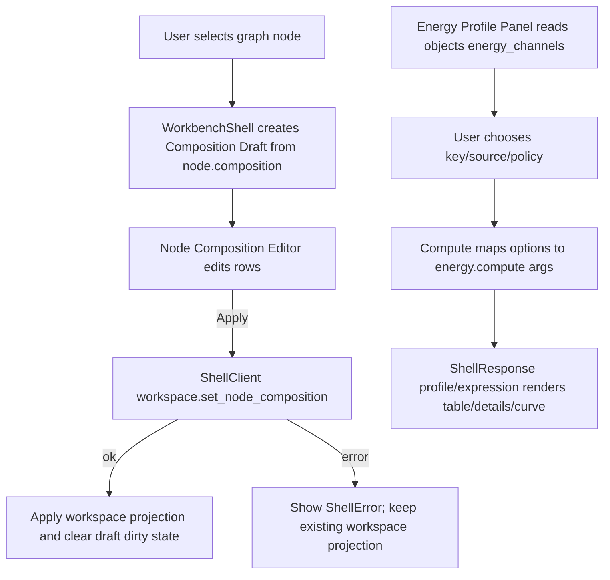

# Web Energy Semantics Controls

## 0. 术语约定

- **Node Composition Editor**：Web Graph Canvas 选中节点后出现的组成编辑区，用于查看和替换 `ReactionNode.composition`。grep 现状没有同名组件；它不等同于 core `ReactionNodeCompositionTerm`。
- **Composition Draft**：Web UI 中临时编辑的 composition rows，只有点击 Apply 时才提交 `workspace.set_node_composition`。它是 UI-only state，不写 Project Content。
- **Energy Channel Selector**：Energy Profile Panel 中选择 `energy_key` 与 `energy_source` 的控件，来源为当前 WorkbenchDomainState objects 的 `energy_channels` projection。它不解析 raw output，也不保证所有 path node 都可用。
- **Correction Policy Controls**：Energy Profile Panel 中选择 correction inclusion mode 的控件，映射为 `include_corrections` 和可选 `correction_policy` shell args。
- **Energy Semantics Controls**：本 feature 对 Node Composition Editor、Energy Channel Selector 和 Correction Policy Controls 的统称；只描述 Web UI 控件，不引入 core 新领域模型。

## 1. 决策与约束

### 需求摘要

前面几个 feature 已经把 composition、energy channel、correction policy、EnergyExpression 和 Project Content 兼容边界落到 core/Shell DTO，但 Web 仍主要停留在旧交互：Graph Canvas 只能按单 active object 添加节点，Energy Profile Panel 只有 energy key 文本框和 include corrections checkbox。用户无法在 Web 里表达 `A + 2B` 节点，也无法明确选择 `energies` / `thermochemistry` 或 none/all/kinds/ids correction policy。

本 feature 目标是在现有 Web Workbench 中补齐这些控件：选中 graph node 后可编辑 composition rows；Energy Profile Panel 可从 object energy channel projection 选择 key/source；correction policy 用可扫描控件表达 none/all/kinds/ids；点击 Compute 时把这些选项映射到既有 Shell args，成功后只展示 ShellResponse profile/expression projection。

### 明确不做

- 不在前端重算节点能量、相对能量、correction contribution、EnergyExpression 或单位换算。
- 不新增 Python Shell command、Project Content schema、Browser Project Repository schema 或 Web 深校验。
- 不实现自动反应配平、元素守恒、电荷守恒、原子映射或从分子式推断 coefficient。
- 不编辑 ChemicalObject 原始 energies / thermochemistry，也不实现 correction 编辑/删除/排序。
- 不新增 Web parser、raw output 解析、云存储、账号或自动保存。
- 不把 Composition Draft、Energy Panel options 或 correction policy options 写入 localStorage / Project Content；持久化仍依赖 ShellResponse graph/profile 和显式 Save Bridge Session。
- 不新增高级图表库、能量曲线 tooltip/polish 或报告导出新格式；这些留给后续 `energy-curve-interaction-polish`。

### 复杂度档位

Frontend orchestration = L4（偏离默认 L3）：本 feature 横跨 Graph Canvas、Energy Profile Panel、WorkbenchShell state、fixture transport、i18n 和浏览器 QA；需要保证多个 UI-only draft 不污染 ShellResponse authority。

UX = L4（偏离默认 L3）：composition rows、channel selection 和 correction policy 都是高频编辑控件，必须在桌面/窄屏下保持可扫描、可编辑和无水平溢出。

Core integration = L1：复用现有 Shell commands 和 DTO，不改变 Python core。

### 关键决策

1. **节点组成编辑挂在 Graph Canvas 选中节点上下文**：composition 是 graph node 语义，不放进 Object Registry，也不做全局 modal。选中 node 后在 Network Preview 侧边区域展示 compact editor。
2. **Composition Draft 显式 Apply**：rows 改动不立即提交；只有 Apply 调用 `workspace.set_node_composition`，失败时保留当前 ShellResponse graph state 和可见 error。
3. **Energy channel 先用全局可选列表，不做 path-level hard filter**：第一版从 `objects[].energy_channels` 汇总 key/source/unit/reference，显示 channel 来源；用户仍可输入自定义 key。path-level common/partial channel 诊断留给后续 polish。
4. **Correction policy 控件直接映射 Shell args**：`none` 发送 `include_corrections=false` 且 `correction_policy={mode:"none"}`；`all/kinds/ids` 发送 `include_corrections=true` 和对应 policy；兼容旧 include corrections 语义。
5. **工作台视觉保持 utilitarian**：这是编辑器控件，不做营销式卡片或解释性长文；用表格/segmented controls/select/input/button 组合，文案短而直接。

### 前置依赖

roadmap 中依赖的 `energy-channel-catalog`、`correction-command-and-ui`、`energy-profile-provenance-details` 均已 done；`energy-semantics-project-content-migration` 也已 done，确保 Project Content 兼容边界稳定。

## 2. 名词与编排

### 2.1 名词层：值对象 / 实体 / 接口契约

**现状**

- `web/src/shell/types.ts` 已有 `ReactionNodeCompositionTermSummary`、`GraphNodeSummary.composition`、`EnergyChannelSummary`、`EnergyProfileSummary.energy_source` 和 `CorrectionPolicySummary`。
- `web/src/shell/fixtureTransport.ts` 已支持 `workspace.set_node_composition`、`energy.compute` args 中的 `energy_source` / `correction_policy`，但 UI 未暴露控件。
- `web/src/app/GraphCanvas.tsx` 当前选中 node 后只显示 node card 和 Path/Network Preview，没有 composition editor。
- `web/src/app/EnergyProfilePanel.tsx` 当前 `EnergyPanelOptions` 只包含 `pathId`、`outputUnit`、`includeCorrections`、`energyKey`、`baselineNodeId`。

**变化**

新增 UI-only composition draft：

```ts
type CompositionDraftRow = {
  objectId: string
  coefficient: string
  role: string
  label: string
}

type CompositionDraftState = {
  nodeId: string | null
  rows: CompositionDraftRow[]
  dirty: boolean
}
```

扩展 energy panel options：

```ts
type EnergyPanelOptions = {
  pathId: string
  outputUnit: "kcal_mol" | "kj_mol"
  energyKey: string
  energySource: "auto" | "energies" | "thermochemistry"
  baselineNodeId: string
  correctionPolicyMode: "none" | "all" | "kinds" | "ids"
  correctionKinds: string[]
  correctionIds: string
}
```

Shell args 示例：

```json
{
  "command": "workspace.set_node_composition",
  "args": {
    "session_id": "session-a",
    "node_id": "node-a",
    "composition": [
      {"object_id": "object-a", "coefficient": 1, "role": "reactant", "label": null, "metadata": {}},
      {"object_id": "object-b", "coefficient": 2, "role": "reagent", "label": null, "metadata": {}}
    ]
  }
}
```

```json
{
  "command": "energy.compute",
  "args": {
    "session_id": "session-a",
    "path_id": "path-a-b",
    "output_unit": "kcal_mol",
    "energy_key": "gibbs",
    "energy_source": "thermochemistry",
    "include_corrections": true,
    "correction_policy": {"mode": "kinds", "kinds": ["solvation"]}
  }
}
```

边界：

- Composition Draft 只在 Web state 中临时存在；成功后丢弃并使用 ShellResponse workspace projection 重建。
- Energy Channel Selector 的候选列表来自 `ObjectSummary.energy_channels`，动态 object id/key/unit/reference 不翻译。
- Correction Policy ids 输入第一版用逗号/空白分隔文本，提交前转成 string array；UI 不校验 id 是否存在于每个 path node。

### 2.2 编排层：主流程与控制流



**现状**

- Graph node selection 已通过 `workspace.select` 恢复到 `WorkspaceSummary.selection`，WorkbenchShell 也有 GraphEditorInteractionState。
- Energy compute 成功只更新 profile，不 mutate graph/object/import state。
- Object Registry 已能追加 correction，但 Energy Profile Panel 只能整体 include/exclude corrections。

**变化**

- WorkbenchShell 新增 composition draft state：选中 node 时从当前 `GraphNodeSummary.composition` 初始化；node 删除/切换/workspace 更新时 prune 或重建。
- GraphCanvas/Network Preview 侧新增 Node Composition Editor：显示 selected node composition rows、object selector、coefficient input、role select、apply/reset/add/remove controls 和 error display。
- WorkbenchShell 新增 `setNodeComposition` handler：把 draft rows 转成 numeric coefficient payload，调用 `workspace.set_node_composition`，复用 `applyWorkspaceResponse`。
- EnergyProfilePanel 新增 Energy Channel Selector：从 objects 汇总 candidate channel options，同时保留 energy key 输入；source select 支持 auto/energies/thermochemistry。
- EnergyProfilePanel 新增 Correction Policy Controls：mode segmented/select，kinds checkbox，ids text input；Compute 时统一映射为 Shell args。
- Fixture transport 如有必要补强 expression fixture：composition 多 term 后 profile expression terms 应能反映 selected node composition 和 coefficient，便于 UI 验证。

**跨层纪律**

- Shell authority：GraphCanvas 不直接 patch `workspace.graph.nodes`；composition apply 成功后只使用 ShellResponse projection。
- Draft isolation：Composition Draft、energy channel candidate selection 和 correction policy input 不进入 Project Content/localStorage。
- Error semantics：非法 coefficient 或 missing object 由 ShellResponse error code/target 显示；UI 可做基础 numeric guard，但不替代 shell validation。
- I18n：静态 labels/help text 进入 `zh-CN` / `en-US` catalog；object id、channel key/source、unit、correction id、error code/target 原样显示。
- Responsive：composition editor 在桌面是 compact table，在窄屏允许行式堆叠；整页不能水平溢出。

### 2.3 挂载点清单

- Graph Canvas selected-node inspector：新增 Node Composition Editor 挂入现有 Network Preview/selected path 侧区。
- WorkbenchShell command orchestration：新增 `workspace.set_node_composition` UI handler 和 composition draft state。
- Energy Profile Panel options：新增 energy source/channel selector 和 correction policy controls，替换旧 include corrections 单 checkbox 表达。
- Web i18n catalog：新增 composition editor、energy source 和 correction policy 双语文案。
- Web fixture/test harness：补 fixture UI projection 和 component/E2E tests 覆盖新 controls。

不新增 Python command、Project Content schema、Browser Project Repository schema、HTTP route 或 Report Export 挂载点。

### 2.4 推进策略

1. **Composition Draft State**：在 WorkbenchShell 建立 selected-node composition draft 的初始化、prune、reset 和 dirty 规则。
   - 退出信号：测试能选中 node 后看到与 ShellResponse node.composition 一致的 draft；切换/删除 node 不留下 stale draft。
2. **Node Composition Editor UI**：在 Graph Canvas 侧区新增 rows 编辑、add/remove/reset/apply、object selector、coefficient/role inputs 和错误展示。
   - 退出信号：Workbench tests 能编辑 `A + 2B` 并提交 `workspace.set_node_composition` payload。
3. **Energy Channel Selector**：Energy Profile Panel 从 objects energy_channels 汇总候选，支持 key/source 选择和自定义 key fallback。
   - 退出信号：测试能选择 `thermochemistry:gibbs`，`energy.compute` args 包含 `energy_key=gibbs` 与 `energy_source=thermochemistry`。
4. **Correction Policy Controls**：替换 include corrections checkbox 为 none/all/kinds/ids 控件，并映射 `include_corrections` / `correction_policy`。
   - 退出信号：测试覆盖 none/all/kinds/ids args；kinds/ids 模式在 UI 中可编辑。
5. **Fixture/I18n/Responsive QA**：补 fixture expression projection、双语文案、样式和浏览器桌面/窄屏验证。
   - 退出信号：`npm run test`、`npm run build`、必要 focused Python 测试通过；浏览器截图无重叠/无水平溢出。

## 3. 验收契约

### 关键场景清单

1. Fixture Run 后选中 graph node，Node Composition Editor 显示当前 object id、coefficient、role 和 Apply/Reset controls。
2. 用户把 selected node composition 改成 `object-a * 1 + object-b * 2` 后点击 Apply，Web 调用 `workspace.set_node_composition`，成功后 node card 或 inspector 显示两个 object/term。
3. composition coefficient 输入 0 或非数字时，不本地写 graph；shell 返回错误时 UI 显示 code/message/target，原 workspace projection 不被本地伪改。
4. 删除 selected node 或切换 workspace 后 Composition Draft 不保留 stale node id。
5. Energy Channel Selector 显示来自 Object Summary 的 energy channels，包含 key、source 和 unit；动态 key/source/unit 原样显示。
6. 选择 `thermochemistry` channel 后 Compute 发送 `energy_source=thermochemistry` 和对应 `energy_key`。
7. 自定义 energy key 仍可输入；没有候选 channel 时用户仍可提交文本 key，由 shell 决定是否 missing/invalid。
8. Correction policy `none` 发送 `include_corrections=false` 和 `correction_policy.mode=none`；profile expression 不显示 correction terms。
9. Correction policy `all` 发送 `include_corrections=true` 和 `correction_policy.mode=all`。
10. Correction policy `kinds` 勾选 solvation/resonance/manual 后发送对应 `kinds` array。
11. Correction policy `ids` 输入 correction ids 后发送对应 `ids` array。
12. Compute 成功后 Energy Expression Details 展示 composition coefficient、energy source 和 correction contribution；UI 不自行解释或重算公式。
13. 中文 locale 下新增 composition/channel/policy 静态文案为简体中文；object id、node id、channel key/source、unit、correction id、error code/target 不翻译。
14. 桌面浏览器下 composition editor、energy options、expression details 无文字重叠。
15. 窄屏浏览器下 composition rows、channel selector 和 policy controls 不造成页面整体水平溢出。

### 明确不做的反向核对项

- 不出现新的 Python shell command name、Project Content schema version、Browser Project Repository schema 或 Web storage key。
- 不在 Web 代码里 import Python core、EnergyProfileEngine、ProjectContentValidator 或 parser modules。
- 不调用 `project.save_content`、Browser Project Repository write 或 localStorage 来保存 draft/options。
- 不新增图表库、ChemDraw/CDXML 导出逻辑、报告导出格式或 cloud/account SDK。
- 不把 missing energy / invalid composition 在前端自动修复为默认值。

## 4. 与项目级架构文档的关系

Acceptance 阶段需要更新：

- `codestable/architecture/web-workbench.md`：记录 Web Energy Semantics Controls、Node Composition Editor、Energy Channel Selector、Correction Policy Controls、Shell authority 和 UI-only draft 边界。
- `codestable/architecture/ARCHITECTURE.md`：补充 Web Workbench 已能编辑 node composition 和提交 energy semantics options，但不前端重算。
- `codestable/requirements/web-workbench-shell.md`：补用户故事和边界，说明用户可在 Web 中编辑节点组成、选择能量通道和 correction policy。
- roadmap items/main doc：`web-energy-semantics-controls` 验收时标记 done。

不更新 core-platform；本 feature 不改变 Python core 能力。
