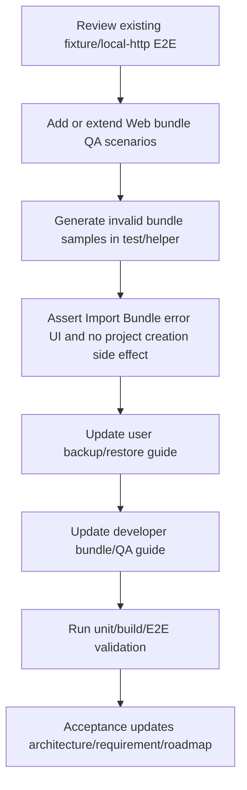

# Web Project Portability QA Guides

## 0. 术语约定

- **Portability QA Matrix**：Web 项目备份/恢复在默认 fixture runtime、local-http runtime、desktop viewport 和 narrow viewport 下的可观察验证矩阵。
- **Invalid Bundle Samples**：测试或文档中可复现的坏 `.rxnflow.zip` 样例，例如 missing manifest、unsafe entry、multi-root 或 non-zip bytes；它们只用于 QA 和指南，不作为 runtime fixture API。
- **Web Backup/Restore Guide**：面向用户的 Web Project Sidebar 操作指南，说明 Create/Save/Open Bridge/Save Bridge/Export Bundle/Import Bundle 的顺序和边界。
- **Manual Portability Boundary**：`.rxnflow.zip` 是用户手动备份/迁移格式，不是云同步、live storage、autosave 或跨设备冲突合并。
- **Guide Verification Hooks**：文档中列出的命令、E2E 名称、错误 code 和 UI 文案必须能在现有测试或源码中找到，不写无法验证的承诺。

术语检索结果：`Browser Bundle Archive Adapter`、`Browser Bundle Export Action`、`Browser Bundle Import Action`、`Web Project Portability Roundtrip` 已落地。`docs/user/project-bundle-backup.md` 当前偏 CLI；`docs/dev/project-bundle-import-export.md` 当前偏 Platform Shell / CLI；Web 侧 guide 和错误样例尚未收口。

## 1. 决策与约束

### 需求摘要

Web Project Sidebar 已能保存 browser-local project、持久化 raw inputs / exports、导出 `.rxnflow.zip`，也能导入安全 bundle 并通过显式 Open Bridge / Save Bridge Session 完成 roundtrip。最后一步需要把这条能力变成可交付状态：真实浏览器 QA 覆盖 desktop/narrow 与 local-http 主链路；错误 bundle 样例能证明用户遇到坏包时 UI 给出可理解错误；用户/开发者指南明确 Web 本地项目如何备份、恢复、保存 bridge session，以及 `.rxnflow.zip` 与云存储的边界。

### 明确不做

- 不新增 `.rxnflow.zip` schema、allowed roots、Project Manifest、Project Content 或 Browser Project Repository contract。
- 不新增 Web Import/Export Bundle 生产行为、自动 Open Bridge、自动 Save Bridge Session、dirty tracking、autosave 或 before-export save。
- 不新增 cloud storage、账号、权限、跨设备同步、live collaboration、conflict merge、OPFS/chunking、Worker、Service Worker 或 repository transaction API。
- 不调用 Python `ProjectBundleService`、`project.import_bundle` 或 `project.export_bundle`；Web import/export 仍只围绕 Browser Project Repository bytes。
- 不重新解析 raw files，不登记 ChemicalObject，不计算 energy profile，不生成报告 artifact bytes。
- 不新增营销页、引导弹窗或大 UI 改版；如发现文案不清，只做小文案/i18n 修正。
- 不把 Invalid Bundle Samples 放进 runtime bundle reader，也不把测试 helper 暴露成 public API。

### 复杂度档位

E2E QA = L3/L4：默认 fixture runtime 需要覆盖 desktop/narrow，local-http runtime 继续覆盖真实 Python bridge；重点是减少重复但保留用户路径。

Docs = L2：更新现有用户/开发者指南为主，必要时新增一份 Web portability QA guide；所有说明都要指向已实现能力和验证命令。

Error samples = L3：错误 bundle 应通过真实 file input 或 archive adapter 触发 `invalid_bundle` / `zip_failed`，不能只写静态文档。

### 关键决策

1. **以指南和 QA 收口为主，不再扩展 runtime 能力**：本 feature 成功标准是“用户知道怎么备份/恢复，测试证明关键路径和错误路径仍有效”。
2. **默认 fixture E2E 覆盖 Web UI 矩阵，local-http E2E 覆盖真实 bridge 窄链路**：不把 local-http 做成桌面/窄屏全矩阵，避免慢而脆。
3. **错误 bundle 样例动态生成优先**：E2E 或 helper 中用 `fflate` / raw bytes 生成 missing manifest、unsafe path、non-zip 等样例，避免长期维护二进制测试文件。
4. **用户指南必须写手动顺序**：Web 中如果刚通过 Open Bridge 改过图谱、workspace、profile 或 export index，导出前要先 Save Bridge Session；Import Bundle 后也要显式 Open Bridge 才恢复 core session。
5. **开发者指南写边界和命令**：记录 `npm run test:e2e`、`npm run test:e2e:local-http`、错误样例覆盖、bundle adapter 安全边界和不调用 Python bundle service 的约束。
6. **Guide 与 i18n 不互相替代**：文档可以更完整；UI 只保留简短操作提示，不在应用里塞长教程。

### 前置依赖

roadmap 中 `web-raw-input-persistence`、`web-project-bundle-export`、`web-project-bundle-import`、`web-project-portability-roundtrip` 均已 done。当前 `web/e2e/workbench-journey.spec.ts` 已覆盖 fixture desktop/narrow 工作台主流程，`web/e2e/local-http-bridge.spec.ts` 已覆盖真实 bridge 与 bundle roundtrip，缺少 Web backup/restore 指南和错误 bundle browser-level 样例收口。

## 2. 名词与编排

### 2.1 名词层：值对象 / 实体 / 接口契约

**现状**

- `projectBundleArchive.ts` 已拒绝 multi-root、missing manifest、absolute/backslash/dotdot/root file/outside roots、`inputs` 非 raw、duplicate、symlink 等错误 bundle。
- `projectBundleImport.ts` 已把 archive error 映射为 `invalid_bundle` / `zip_failed`，storage failure 映射为 `storage_failed`，并支持 partial import risk details。
- `ProjectSidebar` 已展示 Import Bundle / Export Bundle、bundle summary、partial risk 和 Save Bridge hint。
- component tests 已覆盖 archive/import/export 错误路径；local-http E2E 已覆盖一条 export/import/open bridge roundtrip。
- 用户指南仍主要描述 CLI project bundle，不足以指导 Web 用户在浏览器里备份/恢复。

**变化**

新增测试/文档层契约，不进入生产 API：

```ts
type PortabilityQaScenario =
  | "fixture_desktop_export_import"
  | "fixture_narrow_export_import"
  | "local_http_roundtrip"
  | "invalid_bundle_import"

type InvalidBundleSampleKind =
  | "non_zip_bytes"
  | "missing_manifest"
  | "unsafe_entry"
  | "multi_root"

type GuideVerificationHook = {
  docPath: string
  command?: "npm run test:e2e" | "npm run test:e2e:local-http" | "npm run test -- --run"
  uiLabel?: "Import Bundle" | "Export Bundle" | "Open Bridge" | "Save Bridge"
  errorCode?: "invalid_bundle" | "zip_failed" | "storage_failed"
}
```

边界：

- 这些类型只是 design 口径；实现可用函数/helper/test name 表达同等语义，不要求导出 TypeScript type。
- Invalid Bundle Samples 不写入 Browser Project Repository，不进入 `.rxnflow/` 项目内容。
- 指南中的命令和错误 code 必须能被 grep 到，避免文档漂移。

### 2.2 编排层：主流程与控制流



**现状**

- 默认 Playwright project 只跑 Chromium desktop config，但测试本身可手动设置 `390x840` narrow viewport。
- `workbench-helpers.ts` 已有 console clean、horizontal overflow、project create/save、open project、bridge restore、screenshots 等 helper。
- local-http Playwright config 独立启动本地 Python bridge 和 Vite server。
- docs/user 与 docs/dev 已采用 frontmatter + 简短任务导向结构。

**变化**

- 在默认 fixture E2E 中补 Web bundle backup/restore browser QA：desktop 和 narrow 至少各覆盖一次 Project Sidebar Export Bundle / Import Bundle 的可见成功路径、console clean 和无水平溢出。
- 补错误 bundle browser QA：通过 file input 选择 non-zip 或动态生成的 bad zip，断言 `invalid_bundle` / `zip_failed` 可见，且不会创建/激活坏项目。
- local-http E2E 保留窄 roundtrip，但增强断言或文档链接，确保它作为真实 Python bridge 的证据被开发者指南引用。
- 更新用户指南：Web 操作步骤、导出前 Save Bridge、导入后 Open Bridge、会包含哪些目录、不会包含什么、云同步/浏览器清数据风险、常见错误。
- 更新开发者指南：Web adapter 与 Python ProjectBundleService 的边界、QA 命令、错误样例策略、维护 checklist。

**跨层纪律**

- QA 通过真实 UI file input/download/button 走用户路径；helper 只生成测试文件或读下载结果。
- 文档只描述已实现行为，不写“将会支持”。
- 错误样例覆盖 archive safety，不诱导 Web 前端做 deep Project Content validation。
- 所有新增 Web UI 文案如有生产变化必须进入 `zh-CN` / `en-US` i18n catalog；文档不需要双语。
- Scope grep 必须确认没有新增 cloud/autosave/OPFS/Worker/Python bundle command。

### 2.3 挂载点清单

- Default fixture Playwright E2E：新增或扩展 Web bundle backup/restore desktop/narrow 与 invalid bundle import 场景。
- `web/e2e/workbench-helpers.ts`：如需要，新增 bundle download/readback、invalid bundle generation、project list guard helper。
- Local-http Playwright E2E：保留并必要增强 roundtrip assertions，作为真实 bridge 证据。
- `docs/user/project-bundle-backup.md`：补 Web Project Sidebar backup/restore 操作和常见问题。
- `docs/dev/project-bundle-import-export.md` 或新增 Web QA guide：补 Web bundle adapter、测试命令和错误样例维护说明。
- CodeStable acceptance 回写：architecture / requirement / roadmap 当前状态归档。

不挂入 Python core、ProjectBundleService、Project Content schema、Browser Project Repository interface、Import Inbox parser、Report Export writer、云存储或桌面壳层。

### 2.4 推进策略

1. **QA helper alignment**：复用现有 Playwright helper，必要时新增 bundle download/readback 与 invalid bundle sample helper。
   - 退出信号：helper 能从 UI 下载 `.rxnflow.zip` 并检查 entry paths，能生成至少两类坏 bundle 输入。
2. **Fixture browser QA matrix**：补 desktop/narrow Web bundle backup/restore 成功路径与错误 bundle 路径。
   - 退出信号：`npm run test:e2e` 覆盖 Import Bundle / Export Bundle 成功和 invalid bundle error，console clean、无水平溢出。
3. **Local-http evidence**：确认或增强 local-http bundle roundtrip 证据，避免只依赖 fixture runtime。
   - 退出信号：`npm run test:e2e:local-http` 仍覆盖 Open Bridge / Save Bridge / Export Bundle / Import Bundle / Open Bridge。
4. **Guides update**：更新用户指南和开发者指南，明确 Web 本地项目备份/恢复步骤、包含内容、错误 code、验证命令和非云同步边界。
   - 退出信号：指南不再只偏 CLI；grep 可找到 Web `Import Bundle`、`Export Bundle`、`Open Bridge`、`Save Bridge Session`、`invalid_bundle` 和 QA 命令。
5. **Scope guards and verification**：跑 unit/build/E2E、YAML 和 scope grep。
   - 退出信号：`npm run test -- --run`、`npm run build`、`npm run test:e2e`、`npm run test:e2e:local-http` 通过；未新增方案外能力。

## 3. 验收契约

### 关键场景清单

1. 默认 fixture desktop E2E 能创建 browser project，导出 `.rxnflow.zip`，检查 download entry 至少包含 `.rxnflow/manifest.json` 和 `.rxnflow/state/project-content.json`，再导入该 bundle 并看到 Bundle imported。
2. 默认 fixture narrow E2E 能显示 Project Sidebar bundle controls，执行至少一条 Import/Export Bundle 成功路径或错误路径，并保持无水平溢出、console clean。
3. Invalid Bundle Samples 中至少覆盖 non-zip 或 missing manifest；通过 Project Sidebar file input 导入时 UI 显示 `invalid_bundle` 或 `zip_failed`，且不激活坏项目。
4. local-http E2E 继续覆盖真实 Python bridge 下的 raw input persistence、Open Bridge、Save Bridge、Export Bundle、Import Bundle、再次 Open Bridge。
5. 用户指南说明 Web 导出前如有 bridge session 改动要先 Save Bridge Session；导入后需要显式 Open Bridge 才恢复 core session。
6. 用户指南说明 `.rxnflow.zip` 包含 `.rxnflow/`、`inputs/raw/`、`exports/`，不包含云同步、浏览器外散落文件、live session 或未保存 bridge 改动。
7. 开发者指南说明 Web bundle import/export 不调用 Python `ProjectBundleService` / `project.import_bundle` / `project.export_bundle`，只围绕 Browser Project Repository bytes 和 Web archive adapter。
8. 开发者指南列出 `npm run test:e2e`、`npm run test:e2e:local-http`、`npm run test -- --run` 和 `npm run build` 的用途。
9. 文档和测试中的错误 code 与源码一致：`invalid_bundle`、`zip_failed`、`storage_failed` 不写错。
10. `npm run test -- --run`、`npm run build`、`npm run test:e2e` 和 `npm run test:e2e:local-http` 通过。

### 明确不做的反向核对项

- 不改 bundle schema、allowed roots、Project Content/Manifest schema。
- 不新增自动保存、自动打开、dirty tracking、live storage、cloud sync、account/auth、conflict merge。
- 不调用 Python bundle service 或新增 Shell bundle command。
- 不做 deep validation、schema migration、raw reparse、对象登记、能量重算或报告 bytes 生成。
- 不新增 OPFS/chunking、Worker、Service Worker、repository transaction API。
- 不把 QA helper 或 invalid sample generator 暴露为 production API。

## 4. 与项目级架构文档的关系

Acceptance 阶段需要更新：

- `codestable/architecture/web-workbench.md`：记录 Web Project Portability QA & Guides 已收口的 E2E/文档覆盖，包括 desktop/narrow fixture、local-http roundtrip 和 invalid bundle browser QA。
- `codestable/architecture/ARCHITECTURE.md`：补充 Web 项目备份/恢复的用户可见交付边界：手动 `.rxnflow.zip`，非云同步。
- `codestable/requirements/project-content-persistence.md`：补充 Web 用户指南已说明 backup/restore、Save Bridge / Open Bridge 顺序和错误边界。
- roadmap items/main doc：验收时标记 `web-project-portability-qa-guides` done，整个 `rxnflow-web-project-portability` roadmap 可进入 completed/review 状态。
