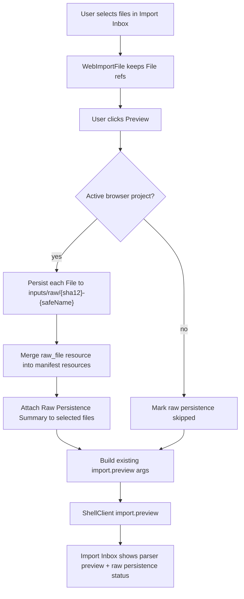

# Web Raw Input Persistence

## 0. 术语约定

- **Browser Raw Input Object**：Browser Project Repository 中 `inputs/raw/{sha12}-{safeName}` 路径下的原始计算输出 bytes object，metadata `kind=raw_file`。
- **Browser Raw Resource**：`.rxnflow/manifest.json` 中与 Browser Raw Input Object 对应的 `ProjectResource`，`kind="raw_file"`，id 为 `raw-{sha12}`。
- **Raw Persistence Summary**：Import Inbox 里对每个 selected file 的 browser-local 保存结果摘要，显示 persisted/skipped/error、raw resource id/path/checksum。
- **Import Preview Storage Mode**：本 feature 内部对 preview 准备流程的口径区分：没有 active browser project 时是 `inline_preview_only`；有 active browser project 时优先 `persist_raw_then_inline_preview`。
- **Inline Preview Payload**：local-http 模式下继续用于 `import.preview` 的 `sources[].kind="inline_bytes"` payload；它不等同于 raw persistence。

## 1. 决策与约束

### 需求摘要

当前 Import Inbox 能接收浏览器 `File` 并在 local-http 下把小文件转成 `inline_bytes` 发给 `import.preview`，但这些文件不会长期保存到 active browser project。用户即使已经创建了 browser-local project，后续导出 `.rxnflow.zip` 时也缺少 `inputs/raw/...`，manifest 也没有 raw resource anchor。

本 feature 做最小闭环：当用户选择文件并点击 Preview 时，如果左侧已有 active browser-local project，则 Web 先把可读取的小文件 bytes 写入 Browser Project Repository 的 `inputs/raw/{sha12}-{safeName}`，再把对应 raw resource 合并进 `.rxnflow/manifest.json`。随后 preview 仍按现有 runtime 走 fixture/path 或 local-http inline bytes，不改变 parser/registry 行为。Import Inbox 展示每个文件是否 browser-local persisted，以及 raw id/path/checksum。

### 明确不做

- 不实现 `.rxnflow.zip` import/export；本 feature 只为后续 bundle 提供 raw input anchor。
- 不实现 OPFS、chunking、Worker pool、大文件持久化、StorageManager.persist 权限 UI 或云上传。
- 不让 Python local bridge 直接读取 Browser Project Repository / IndexedDB；preview 仍用现有 inline bytes/path payload。
- 不在前端解析 Gaussian/ORCA/MAPLE/XYZ/extxyz，不复制 parser 或 import workflow。
- 不自动确认 import，不登记 ChemicalObject，不修改 `import.register_all` 语义。
- 不把 raw persistence failure 伪装成 preview success；也不因为 raw persistence unavailable 就阻止 inline preview。
- 不删除 stale raw input objects，不实现 raw file cleanup/rename/replace UI。
- 不改变 Project Manifest schema、Project Content schema、Browser Project Repository interface 或 core `ProjectStore.add_raw_file`。
- 不自动调用 Open Bridge / Save Bridge Session。

### 复杂度档位

Frontend orchestration = L3：改动集中在 Import Inbox state、WorkbenchShell import preview 编排、Project Content/Manifest helper 和 i18n/CSS/test。

Persistence semantics = L3：要维护 repository bytes object 与 manifest resources 的幂等一致性，但不新增 schema。

Core integration = L1：不改 Python core；只对齐既有 `ProjectResource` 和 `ProjectStore.add_raw_file` 命名/路径语义。

### 关键决策

1. **raw persistence 是 preview 前的 best-effort project-side effect**：有 active browser project 时先写 raw object/manifest；没有 active project 时继续 inline preview 并提示未持久化。
2. **raw id/path 与 Python 对齐**：checksum 使用 SHA-256，resource id 为 `raw-{sha12}`，path 为 `inputs/raw/{sha12}-{safeName}`，metadata 记录 source name、byte size、mime type 和 last modified。
3. **manifest merge 幂等**：同 checksum raw resource 已存在时不重复追加；同 path object 已存在时可覆盖同 bytes，保证 repository state 可恢复。
4. **preview payload 不改 authority**：local-http 仍发 `inline_bytes` 给 parser；Browser Raw Input Object 是备份/后续 bundle anchor，不是 Python parser 的读取入口。
5. **错误可见但不扩大阻断面**：raw persistence 失败时 Import Inbox 显示 repository error；用户仍可在无 active project 或失败后走 inline preview，避免把本地存储问题误当 parser 问题。

### 前置依赖

roadmap `rxnflow-web-project-portability` 已建立；Web 已有 Browser Project Repository、Project Content Bridge、Import Inbox inline bytes preview、Project Sidebar active project state 和 Project Manifest 空文件生成。

## 2. 名词与编排

### 2.1 名词层：值对象 / 实体 / 接口契约

**现状**

- Browser Project Repository 已支持 `readObject/writeObject/listObjects` 和安全 path 校验；测试已覆盖 `inputs/raw/demo.log` 这类 path。
- `projectContentBridge.ts` 能生成空 `.rxnflow/manifest.json`，但 manifest `resources` 当前为空，缺少读写 raw resource helper。
- `importInboxState.ts` 的 `WebImportFile` 保存 name/size/mime/lastModified/File/sourceKind，但没有 raw persistence status。
- `importPreviewArgsFromFiles` 只负责构造 fixture `source_paths` 或 local-http `inline_bytes`，遇到超限返回 `payload_too_large`。
- `ImportInbox.tsx` 已展示 selected files 和 preview item `raw_resource`，但 selected file 阶段没有 browser-local raw 保存结果。

**变化**

新增 Web UI/helper 类型：

```ts
type RawPersistenceState =
  | { state: "idle" }
  | { state: "persisted"; resource: BrowserRawResource }
  | { state: "skipped"; reason: "no_active_project" | "path_source" | "oversized_inline_file" }
  | { state: "error"; error: BrowserProjectRepositoryErrorPayload }

type WebImportFile = {
  name: string
  size: number
  mimeType?: string
  lastModified?: number
  storagePath: string
  file?: File
  sourceKind?: ImportPreviewSourceKind
  rawPersistence?: RawPersistenceState
}
```

新增 manifest/raw helper 契约：

```ts
type BrowserRawResource = {
  id: string
  kind: "raw_file"
  path: string
  checksum: string
  metadata: {
    source_name: string
    byte_size: number
    mime_type?: string | null
    last_modified?: number | null
  }
}

type PersistRawInputResult =
  | { ok: true; fileName: string; resource: BrowserRawResource; receipt: BrowserWriteReceipt; manifestReceipt: BrowserWriteReceipt }
  | { ok: false; fileName: string; error: BrowserProjectRepositoryErrorPayload }
```

边界：

- `BrowserRawResource` shape 必须与 core `ProjectResource` JSON shape 兼容。
- `rawPersistence` 是 UI projection；长期状态只在 repository bytes object 与 manifest resources 中。
- `ProjectContentIndex` 不记录 raw input；raw resource anchor 属于 manifest。
- `checksum` / `id` / `path` / `error.code` 原样显示，不进入翻译。

### 2.2 编排层：主流程与控制流



**现状**

- `WorkbenchShell.runImportPreview` 调用 `importPreviewArgsFromFiles` 后直接发 `import.preview`。
- Project Sidebar active project 只影响 project open/save bridge 和 export artifact persistence。
- Browser Project Repository 写文件失败会通过 sidebar 或 export warning 方式展示，但 Import Inbox preview 阶段没有 repository side effect。

**变化**

- `WorkbenchShell.runImportPreview` 在构造 preview args 前调用 raw persistence helper：当 `projectSidebarState.activeProject` 存在且 selected file 有 `File` 引用时，写 raw object 并更新 manifest。
- raw persistence helper 使用 `checksumBrowserStorageBytes(fileBytes)`，生成 `inputs/raw/{sha12}-{safeName}` object，metadata `kind=raw_file`。
- helper 读取现有 `.rxnflow/manifest.json`，merge raw resource；同 checksum resource 已存在则保持幂等，不重复追加。
- Import Inbox selected file list 显示 raw persistence status：persisted 显示 raw id/path/checksum；skipped 显示没有 active project 或非 File/path source；error 显示 repository error code/target。
- raw persistence 结果更新回 `ImportInboxState.selectedFiles`，preview response 仍按现有 `ImportBatchSummary` / parser preview 展示。

**跨层纪律**

- Shell authority：parser preview 和 register result 仍以 ShellResponse 为准；raw persistence 不能伪造 ImportItem 或 ChemicalObject。
- Manifest compatibility：manifest resource 使用 `project-v1` 现有 resources shape，不新增 schema version。
- Repository authority：browser-local raw object 只经 Browser Project Repository 写入，不用 localStorage 或 DOM URL 作为持久状态。
- Error separation：raw persistence error 和 parser preview error 分开展示，避免把 repository 问题误判为 parser 支持问题。
- Idempotency：同 checksum 多次 preview 不重复 manifest resource；重复写同 path bytes 允许覆盖。
- Responsive/i18n：新增静态文案进入 zh-CN/en-US；动态 filename/path/checksum/error code 原样显示；桌面/窄屏 selected file list 不水平溢出。

### 2.3 挂载点清单

- Import Inbox selected file list：展示 raw persistence status、raw id/path/checksum 和 error/skipped reason。
- WorkbenchShell import preview orchestration：preview 前执行 active browser project raw persistence，结果回写 ImportInboxState。
- Project Content/Manifest helper：新增 raw resource 读取、merge、manifest bytes 写回 helper，复用 Browser Project Repository。
- Web i18n/CSS/tests：新增 raw persistence 静态文案、状态样式和 component/browser QA。

不新增 Python core、Shell command、Project Content schema、Browser Project Repository interface、Project Bundle IO 或 parser adapter 挂载点。

### 2.4 推进策略

1. **Raw resource helper 契约**：实现 checksum、safe name、raw object path、manifest parse/merge 和 deterministic manifest bytes helper。
   - 退出信号：helper tests 覆盖 id/path/checksum、同 checksum 幂等、manifest resource 保留和坏 manifest error。
2. **Import preview orchestration**：在 `runImportPreview` 中接入 active project raw persistence，并把结果写回 selected files。
   - 退出信号：component test 证明 active project + selected File 会写 `inputs/raw/...` 和 manifest resource；无 active project 时 preview 仍可执行且状态 skipped。
3. **Import Inbox status UI**：展示 persisted/skipped/error 摘要和 raw id/path/checksum。
   - 退出信号：中英文静态文案可见；动态 path/checksum 原样显示。
4. **Error/idempotency coverage**：覆盖 repository write failure、manifest missing/bad shape、重复 preview 同文件和 oversized file。
   - 退出信号：raw persistence error 不伪造成 parser error；重复 preview manifest resources 不重复。
5. **Responsive/browser QA**：桌面/窄屏运行 Fixture 或选择小文件 preview，确认 Import Inbox status 不重叠、不水平溢出。
   - 退出信号：`npm run test`、`npm run build` 通过；浏览器桌面/窄屏 QA 通过。

## 3. 验收契约

### 关键场景清单

1. 有 active browser project 时，选择 `water.xyz` 并点击 Preview，会在 Browser Project Repository 写入 `inputs/raw/{sha12}-water.xyz`。
2. 同一流程会更新 `.rxnflow/manifest.json`，追加 `kind=raw_file` resource，id 为 `raw-{sha12}`，path/checksum/metadata 与 raw object 对齐。
3. 同一文件重复 Preview 不重复追加 manifest resource。
4. 没有 active browser project 时，Preview 仍按现有 inline/path 行为运行，selected file 显示 raw persistence skipped。
5. raw persistence 成功但 parser preview 返回 warning/error 时，raw status 仍显示 persisted，parser error 仍来自 ShellResponse。
6. raw object 写入失败或 manifest 写回失败时，Import Inbox 显示 raw persistence error code/target；不能显示为 parser warning。
7. oversized inline file 仍在前端返回 `payload_too_large`，不读取 bytes 写 raw object。
8. selected file list 显示 persisted raw id/path/checksum；动态 filename/path/checksum 不翻译。
9. 中文 locale 下 raw persistence 静态文案为简体中文，英文 locale 下为英文。
10. 桌面浏览器下 Import Inbox selected file list、raw status 和 preview results 无文字重叠。
11. 窄屏浏览器下 raw status 不造成页面整体水平溢出。

### 明确不做的反向核对项

- 不新增 Shell command、Project Content schema、Browser Project Repository interface 或 Project Bundle IO。
- 不在 Web 代码里 import Python parser/core 或解析 Gaussian/ORCA/MAPLE/XYZ/extxyz。
- 不让 local-http bridge 读取 Browser Project Repository / IndexedDB。
- 不自动确认 import、登记 ChemicalObject 或修改 `import.register_all`。
- 不使用 localStorage 保存 raw bytes 或 raw persistence state。
- 不实现 raw cleanup、overwrite confirmation、OPFS/chunking/cloud sync。

## 4. 与项目级架构文档的关系

Acceptance 阶段需要更新：

- `codestable/architecture/web-workbench.md`：记录 Import Inbox raw persistence、Browser Raw Input Object、manifest raw resource merge、UI-only status 与 inline preview 的区别。
- `codestable/architecture/ARCHITECTURE.md`：补 Web Raw Input Object / Browser Raw Resource 术语和 Web 项目可携带性最小闭环。
- `codestable/requirements/web-workbench-shell.md`：补用户故事和边界，说明 active browser project 下导入文件会保存为 raw input anchor，但不会自动登记对象或云同步。
- roadmap items/main doc：`web-raw-input-persistence` 验收时标记 done。

不更新 core-platform；本 feature 不改变 Python ProjectStore、ProjectBundleService、ParserRegistry 或 Platform Shell。
