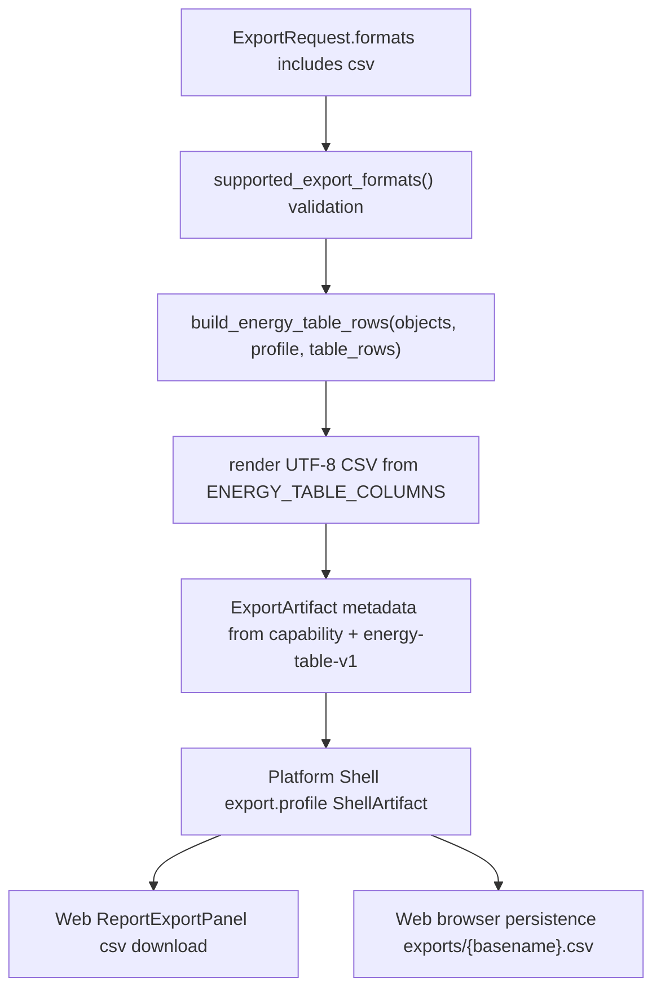

# export-csv-energy-table design

## 0. 术语约定

- CSV Energy Table：由 `ENERGY_TABLE_COLUMNS` / `EnergyTableRow` 生成的 UTF-8 CSV artifact；不是用户私有 Excel 模板导入，也不是新字段清单。
- Energy Table Contract：当前 `energy-table-v1` 列定义，第一列固定为 `structure_name`，XLSX 和 CSV 必须共用。
- CSV ExportFormat：`csv` 从 Export Format Capability 的 unsupported 变成 supported 后进入 core/Web 可执行格式集合。
- CSV Browser Persistence：Web 把 Shell 返回的 csv inline artifact 写入 `exports/{basename}.csv` 并登记 `export-artifacts-v1`，不在浏览器里生成 CSV bytes。

## 1. 决策与约束

### 需求摘要

把 `csv` 从“能力矩阵中已知但不可执行”的格式推进到可导出格式。核心层用现有 Energy Table Contract 渲染 UTF-8 CSV；Platform Shell 继续复用 `export.profile` 和 ShellArtifact；Web Report Export Panel 增加 CSV checkbox、download MIME 和 browser-local persistence。成功标准是 `csv` 可和 `xlsx` 一样从同一 rows 生成表格 artifact，空值保持空 cell，unsupported 格式语义不被放宽。

### 复杂度档位

走小型跨层 contract 变更档位。偏离点是 core/Web 双端格式集合同步：必须同时更新 core capability、Web helper、types、fixture、persistence、docs 和 tests。

### 关键决策

- CSV writer 只消费 `build_energy_table_rows()` 的结果，不读 workbook、不调用 parser/registry/energy engine、不重新计算 relative energy。
- CSV header 使用 `ENERGY_TABLE_COLUMNS[*].label`；列顺序完全复用 `ENERGY_TABLE_COLUMNS`。
- 数字格式使用稳定十进制字符串，不受系统 locale 影响；`None` / 缺失值写为空 cell，不写 `0`、`NA` 或 guessed text。
- `export-artifacts-v1` 不升级 schema，只允许新增合法 format=`csv` 记录。
- Web 只把 Shell inline bytes 下载/持久化，不在前端生成 CSV。

### 明确不做

- 不新增或重排 Energy Table 字段，不改变 `energy-table-v1` schema version。
- 不实现 CSV import、Excel 模板读取、公式、分组表头、多 sheet 或 warnings sidecar 文件。
- 不开放 SVG/PDF/PPTX/CDX writer 或 Web checkbox。
- 不新增 Shell command、HTTP route、Project Content schema 或 Web 前端 CSV bytes 生成逻辑。

## 2. 名词与编排

### 2.1 名词层：值对象 / 接口契约

**现状**

- `rxnflow.export.ExportFormat = Literal["png", "cdxml", "xlsx"]`，`csv` 在 `EXPORT_FORMAT_CAPABILITIES` 中为 `unsupported`，`writer_id=None`，`supports_browser_persistence=False`，`web_default_enabled=False`。
- `_render_format()` 只有 PNG/CDXML/XLSX 三个 writer；XLSX 使用 `build_energy_table_rows()` 和 `ENERGY_TABLE_COLUMNS`。
- `ExportArtifactRecord` / `export-artifacts-v1` 的 format 校验来自 `ALLOWED_EXPORT_FORMATS`，因此 CSV supported 后可自然进入现有 schema。
- Web `ExportFormat` type、`exportFormatCapabilities.ts`、fixture transport 和 persistence allowlist 当前只把 `png/cdxml/xlsx` 视为 supported。

**变化**

- core `ExportFormat` / Web `ExportFormat` 增加 `csv`。
- core capability 中 `csv` 变为：

```python
ExportFormatCapability(
    "csv",
    "csv",
    "text/csv",
    "python-csv-energy-table-v1",
    "energy_table",
    True,
    True,
    True,
    "supported",
)
```

- 新增 CSV 渲染 helper，等价输入输出示例：

```python
artifact = ReportExportService().export(
    "project-a",
    ExportRequest(formats=("csv",), profile=profile, objects=objects),
).value[0]

assert artifact.format == "csv"
assert artifact.metadata["energy_table_schema_version"] == "energy-table-v1"
assert artifact.bytes.decode("utf-8").splitlines()[0].startswith("Structure,Egas")
```

- CSV artifact metadata 复用 `extension`、`mime_type`、`artifact_kind`、`format_status`，并与 XLSX 一样补 `energy_table_schema_version`、`energy_table_column_count` 和 `energy_table_row_count`。
- Web helper 把 `csv` 纳入 `supportedExportFormats()` / `reportExportFormats()` / browser persistence；download file name 和 path suffix 使用 `.csv`。

### 2.2 编排层：主流程与控制流



**现状**

CSV 请求在 validation 阶段被拒绝；Web 不显示 csv checkbox，fixture transport 会过滤 csv，browser persistence 会 skip csv。

**变化**

- core validation 允许 `csv`，并沿用 XLSX 的“需要 profile、objects 或 table_rows 至少一种”的输入要求。
- `_render_format("csv")` 与 `_render_format("xlsx")` 共用 rows 和 `_energy_table_warnings()`，只替换 bytes writer 和 writer id。
- Platform Shell 不新增命令；`export.profile` 透传 csv artifact。
- Web ReportExportPanel 的 checkbox 从 `reportExportFormats()` 自动包含 csv；fixture transport 可返回 csv artifact metadata；persistence guard 允许 csv 并写 `exports/{basename}.csv`。

**跨层纪律**

- 错误语义：缺少 table 来源时 csv 与 xlsx 一样返回 `invalid_input target=request`；未知格式仍 `invalid_input target=formats`。
- 幂等性：同 basename 重复持久化 csv 按 artifact id/path upsert，不创建历史版本。
- 顺序约束：先 core writer/capability，再 Web helper/types/persistence，最后 docs/QA。
- 扩展点：后续 HTML/PDF/PPTX 不直接复用 CSV writer；它们应消费 Report Composer Manifest 或各自 asset contract。
- 可观测点：artifact metadata、Web download MIME、browser persisted path/checksum、docs format table。

### 2.3 挂载点清单

- Core report export：`rxnflow.export` — CSV supported capability、writer、validation 和 artifact metadata。
- Project content export artifact codec：`rxnflow.export_artifact_codec` — 通过 `ALLOWED_EXPORT_FORMATS` 接受 csv records，不升级 schema。
- Web export format helper：`web/src/app/exportFormatCapabilities.ts` — CSV supported/default/persistence 口径。
- Web Report Export surface：`ReportExportPanel` / fixture transport / export artifact persistence — CSV checkbox、fixture artifact、download MIME、browser-local `exports/...` 保存。
- Public docs：用户/开发者导出指南和 CodeStable architecture/roadmap 回写。

### 2.4 推进策略

1. Core CSV writer：更新 core ExportFormat/capability/validation/rendering/metadata，CSV 复用 `ENERGY_TABLE_COLUMNS` 与 `build_energy_table_rows()`。
   退出信号：Python 单测可导出 csv，header/空值/数字格式/metadata/destination path 均可断言。
2. Project content 与 Shell 投影：验证 `export.profile` 和 `export-artifacts-v1` 可接受 csv runtime/persisted artifact。
   退出信号：Platform shell / export artifact codec tests 覆盖 csv bytes_base64、metadata、record encode/decode。
3. Web helper/UI/persistence：更新 Web `ExportFormat`、capability helper、fixture、ReportExportPanel 和 persistence tests。
   退出信号：Web tests 看到 csv checkbox、CSV data URL MIME、fixture metadata 和 `exports/{basename}.csv` persistence。
4. 文档与架构回写：更新用户/开发者指南、architecture、roadmap item。
   退出信号：docs 不再说 CSV unsupported，边界仍排除 SVG/PDF/PPTX/CDX。
5. 验证收口：运行 Python/Web 单测、build、浏览器 desktop/narrow smoke、YAML 和 diff 检查。
   退出信号：关键验证命令通过，未新增 schema/route/frontend CSV writer。

## 3. 验收契约

### 关键场景清单

- 触发：core 查询 supported formats → 期望包含 `csv`，但 SVG/PDF/PPTX/CDX 仍不 supported。
- 触发：core 导出 `formats=("csv",)` 且有 objects/profile/table_rows → 期望 UTF-8 CSV bytes 第一行为 `ENERGY_TABLE_COLUMNS` labels，第一列为结构名称，空值为空 cell。
- 触发：CSV rows 含 float/string/None/missing profile → 期望数字稳定、字符串按 CSV quoting 转义、缺失字段不补 0。
- 触发：core 同时导出 `("csv", "xlsx")` → 期望两者共用 row count 和 energy table metadata，顺序保持请求顺序。
- 触发：Platform Shell `export.profile` formats 包含 csv 且 include_bytes=true → 期望 ShellArtifact 带 csv format、base64 bytes、writer/mime/extension metadata。
- 触发：Web Report Export Panel 渲染默认 formats → 期望 checkbox 包含 `png/cdxml/xlsx/csv`，CSV download href 为 `data:text/csv;base64,...`。
- 触发：active browser project 下导出 CSV → 期望写入 `exports/{basename}.csv`，`export-artifacts-v1` record format/path/checksum 正确。

### 明确不做的反向核对项

- 不应新增或重排 `ENERGY_TABLE_COLUMNS`，不应升级 `energy-table-v1`。
- 不应新增 SVG/PDF/PPTX/CDX supported set、writer 分支或 Web checkbox。
- 不应新增 Shell command、HTTP route、Project Content schema 或 Web 前端 CSV bytes 生成逻辑。
- 不应读取用户 Excel/CSV 模板或用 CSV writer 反向导入数据。

## 4. 与项目级架构文档的关系

Acceptance 阶段需要回写：

- `core-platform.md`：Report Export supported set 增加 CSV，记录 CSV writer 复用 Energy Table Contract。
- `web-workbench.md`：Report Export Panel / export persistence 当前 supported formats 增加 CSV，Web 仍不生成 CSV bytes。
- `ARCHITECTURE.md`：术语和约束中把 CSV 从 unsupported 调整为 supported；SVG/PDF/PPTX/CDX 仍未支持。
- `codestable/requirements/web-workbench-shell.md` 与 `project-content-persistence.md`：若验收确认用户可见 CSV 导出和持久化，需要补用户故事/边界。
