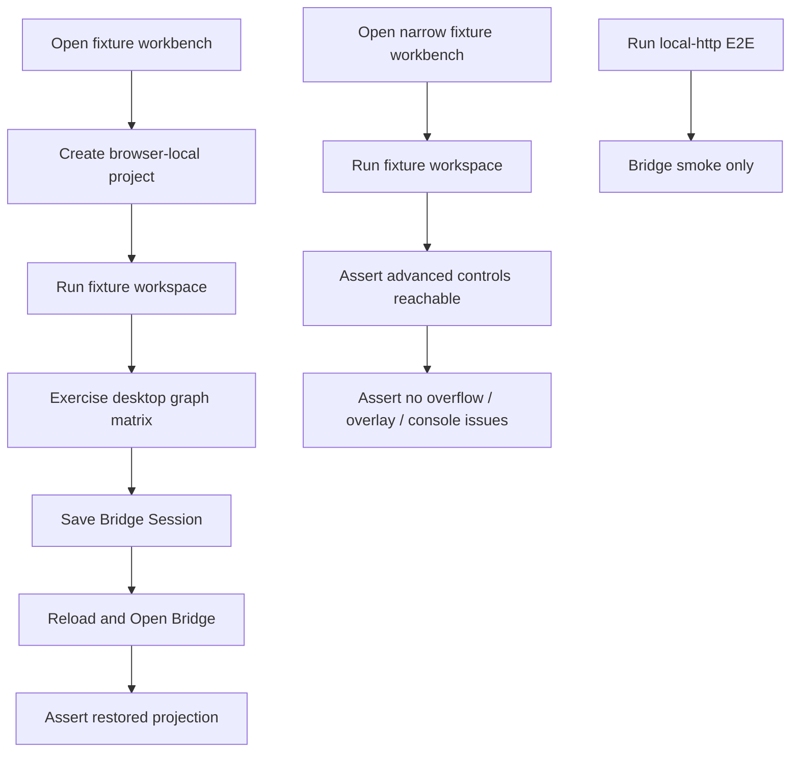

# graph-editor-advanced-e2e-qa design

## 0. 术语约定

| 术语 | 定义 | 防冲突结论 |
|---|---|---|
| Advanced Graph Editor QA Harness | 高级图谱编辑的真实浏览器回归覆盖集合 | 是 E2E / 文档 / 验收矩阵，不是生产 runtime 模块 |
| Desktop Graph Matrix | `1280x720` 下覆盖复杂图谱编辑手势和保存恢复边界的 fixture E2E | 承接现有 `desktop graph editor matrix`，补齐高级交互 |
| Narrow Graph Matrix | `390x840` 下覆盖高级控制入口可达、无水平溢出和文字不重叠的 fixture E2E | 不复制所有复杂 gesture，只验证窄屏可用性 |
| Local HTTP Smoke Boundary | 真实 Python local-http bridge 的主链路 smoke | 不承载复杂图谱手势矩阵 |
| QA Output Boundary | Playwright screenshot、trace、HTML report 和 test-results 目录 | gitignored 测试产物，不进入 Project Content 或 Browser Project Repository |

术语 grep 结果：现有代码已有 `workbench-journey.spec.ts`、`workbench-helpers.ts`、`local-http-bridge.spec.ts`、默认 fixture Playwright config 和 local-http Playwright config；架构文档已经描述 E2E QA Harness，但当前 desktop graph matrix 只覆盖 drag、path reorder、edge delete、viewport controls 和 bridge restore，尚未覆盖 auto layout、path delete、edge label、free edge drawing、multi-select/nudge/history 的完整矩阵。

## 1. 决策与约束

### 需求摘要

本 feature 目标是把高级图谱编辑 roadmap 已落地的能力收束成可重复 QA：

1. 默认 fixture E2E 在 `1280x720` 覆盖 auto layout、path delete、edge label edit、free edge drawing、multi-select / rubber-band、keyboard delete / nudge、wheel / minimap、limited undo / redo 和 Save / Open Bridge restore。
2. 默认 fixture E2E 在 `390x840` 覆盖高级图谱编辑控制入口可见、可操作、无水平溢出、无 framework overlay、console clean。
3. local-http E2E 仍只验证真实 Python bridge 主链路，不复制复杂 gesture matrix。
4. E2E helper 尽量复用用户可访问入口；只有 pointer/wheel/drag 这类浏览器自动化难稳定触发的输入使用局部 DOM event helper。
5. 文档说明开发者应运行哪些命令、默认 fixture 与 local-http smoke 分别证明什么，以及测试产物边界。

### 明确不做

- 不新增生产 UI、Python core command、Platform Shell command、Project Content schema、Browser Project Repository API 或 localStorage 行为。
- 不用 E2E 测试承担领域正确性证明；parser、energy、export 的领域算法仍由单元测试 / integration 测试负责。
- 不把复杂图谱 gesture 加进 local-http bridge smoke；local-http 只守真实 bridge 主链路，避免把浏览器手势波动和 Python bridge dependency 绑死。
- 不引入新的浏览器测试框架、视觉 diff 服务、云端浏览器矩阵、截图基线库或 CI 配置。
- 不提交 Playwright screenshot、trace、HTML report、test-results 或 downloaded bundle 临时文件。
- 不用测试 helper 绕过 ShellClient 直接改 `WorkbenchDomainState`、IndexedDB bytes 或 React internal state。

### 复杂度档位

- E2E helper 扩展：L2。主要是把现有可访问操作封装为稳定 helpers。
- Desktop Graph Matrix：L3。多个高级交互存在顺序依赖，需要避免前一段破坏后一段状态。
- Narrow Graph Matrix：L2。偏布局和控制可达性，不做完整复杂手势复制。
- Dev guide / acceptance 回写：L1。只记录现状命令和边界。

### 关键决策

1. **默认 fixture 承担复杂手势矩阵**：fixture transport 稳定、无需真实 Python bridge，适合覆盖 UI 编排和浏览器输入。
2. **local-http 只做主链路 smoke**：继续验证 Python bridge、Project Content bridge、import preview、energy compute 和 export projection，不追加高级 graph gesture。
3. **矩阵按用户动作组织**：auto layout、path delete、edge label、free edge、multi-select、viewport/history、save/restore，而不是按内部函数名组织。
4. **状态恢复只验证持久化 contract**：Save/Open Bridge 应恢复 node position、edge label、viewport、selection 和 active path；Graph Editor History 不恢复。
5. **QA 文档放开发者指南**：用户不需要知道 Playwright 矩阵细节；开发者需要知道命令、边界和输出目录。

## 2. 名词与编排

### 2.1 名词层：值对象 / 实体 / 接口契约

**现状**：

- `web/e2e/workbench-journey.spec.ts` 已有 desktop workbench journey、desktop graph editor matrix、bundle QA、narrow bundle、narrow workbench flow。
- `web/e2e/workbench-helpers.ts` 已有 graph drag、object drop、viewport controls、path reorder、edge delete 和 save/reload/open bridge helpers。
- `web/e2e/local-http-bridge.spec.ts` 已独立覆盖 local-http bridge smoke 与 bundle roundtrip。
- Playwright output 目录由 `web/playwright.config.ts` 和 `web/playwright.local-http.config.ts` 分开配置。

**变化**：

新增或扩展 fixture E2E helpers，形成以下可观察矩阵：

```ts
type AdvancedGraphEditorE2eMatrix = {
  desktop: [
    "auto-layout-apply",
    "path-delete",
    "edge-label-edit",
    "free-edge-drawing",
    "multi-select-rubber-band-delete",
    "keyboard-nudge",
    "wheel-minimap-navigation",
    "limited-undo-redo",
    "save-open-restore"
  ]
  narrow: [
    "advanced-controls-visible",
    "toolbar-and-preview-reachable",
    "minimap-history-visible",
    "no-horizontal-overflow",
    "console-clean"
  ]
  localHttp: ["main-bridge-smoke-only"]
}
```

稳定规则：

- Desktop matrix 所有 graph 结构变化必须经 UI 触发 Shell command，再用 UI projection 断言。
- Edge label edit 只断言 label 可见、hitbox accessible name 更新和 Save/Open Bridge 后恢复；不验证 molecule-level ChemDraw 语义。
- Free edge drawing 只验证从 Edge Connect Handle 到合法 target 创建 edge；同 node / 空白 release 的 no-op 已由 component/helper tests 覆盖。
- Multi-select / keyboard 只移动 selected nodes；edge/path 不产生 position。
- Narrow matrix 只验证可达性和布局健康，不要求完成完整 desktop 操作链。

### 2.2 编排层：主流程与控制流



**现状**：

- `desktop graph editor matrix` 已串起 project、fixture、object drop、node drag、path reorder、edge delete、viewport controls 和 bridge restore。
- `narrow workbench layout` 已覆盖基础 graph/energy/export flow，但没有专门检查高级 graph controls。
- local-http smoke 已覆盖真实 bridge 主链路和 bundle roundtrip。

**变化**：

- Desktop graph matrix 扩展为高级矩阵：在同一 fixture session 中依次验证 layout、path 删除、label 编辑、free edge、multi-select/nudge/delete、viewport/history 和 save/open restore。
- 对会破坏后续状态的操作采用独立 helper 顺序：先用新增节点构造可删 path / edge，再保留 fixture 主 path 供 energy/profile 与 restore 断言。
- Narrow 新增 graph-specific matrix 或扩展现有 narrow flow，检查 Apply Layout、Undo/Redo、Pan/Zoom/Fit/Reset、minimap、Edge Label Editor、Path list 和 Network Preview 在窄屏可达。
- Dev guide 补充命令：`npm run test:e2e`、`npm run test:e2e:local-http`、`npm run test -- --run`、`npm run build`，并说明默认 fixture 与 local-http 的边界。
- CodeStable acceptance 阶段回写 architecture / requirement / roadmap item。

**跨层纪律**：

- Authority：E2E 只从 DOM 与 ShellResponse projection 后的 UI 观察结果断言，不直接写 domain state。
- Failure semantics：console error/warning、framework overlay、水平溢出是全局失败信号。
- Scope：fixture E2E 证明 Web UI 编排；local-http E2E 证明真实 bridge 主链路；两者不可互相替代。
- Output：trace、screenshot、report、test-results 只留在 gitignored output 目录。
- Maintainability：helper 名称描述用户动作，不暴露内部 component 函数名。

### 2.3 挂载点清单

- Playwright fixture spec：desktop/narrow 高级图谱编辑矩阵。
- Playwright helpers：graph canvas pointer、wheel、keyboard、edge label、selection、history 和 restore 操作 helper。
- Dev guide：Web graph editor QA 命令、覆盖范围和产物边界。
- CodeStable 回写：architecture、requirement、roadmap item、acceptance 报告。

本 feature 不挂入生产 runtime、Python core、Platform Shell、Project Content Store、Browser Project Repository、i18n message catalog、report export writer 或 ChemDraw/CDXML 生成器。

### 2.4 推进策略

1. **Design / Checklist Setup**：从 roadmap item 创建 approved design 和 checklist，回写 item 为 in-progress。
   - 退出信号：YAML 校验通过，roadmap item 指向 feature 目录。
2. **Fixture E2E Helper Matrix**：扩展 `workbench-helpers.ts` 的高级 graph editor helpers，优先复用可访问 UI。
   - 退出信号：helpers 能独立驱动 layout、path delete、edge label、free edge、multi-select/nudge/history/restore。
3. **Desktop / Narrow Spec Coverage**：扩展 fixture Playwright spec，补 desktop matrix 与 narrow graph controls matrix。
   - 退出信号：默认 fixture E2E 覆盖 roadmap 4.8 所列 desktop/narrow 场景。
4. **Developer QA Guide**：补开发者说明，明确 fixture/local-http 命令、覆盖边界和输出目录。
   - 退出信号：指南能让后续开发者知道改图谱编辑后该跑什么。
5. **Verification / Acceptance**：运行单测、构建、E2E、必要浏览器验证，并回写 CodeStable acceptance。
   - 退出信号：测试通过，architecture/requirement/roadmap/acceptance 与现状一致。

## 3. 验收契约

### 关键场景清单

1. `1280x720` fixture E2E 触发 Apply Layout 后，可见节点位置 / viewport projection 发生预期变化，且没有 console issue。
2. `1280x720` fixture E2E 可选中并删除 path，删除后 path list / active path / network preview 跟随 workspace projection。
3. `1280x720` fixture E2E 可选中 edge、编辑 label、应用后 SVG/edge hitbox/selected detail 显示新 label。
4. `1280x720` fixture E2E 可从节点 Edge Connect Handle 拖到另一个节点创建 edge，且 disconnected diagnostics 更新。
5. `1280x720` fixture E2E 可通过 Shift-click 或 rubber-band 形成多选，并用 Delete 删除当前选择。
6. `1280x720` fixture E2E 可用方向键 nudge selected nodes，并可 Undo / Redo 恢复移动。
7. `1280x720` fixture E2E 覆盖 wheel zoom、minimap click/drag、Undo/Redo controls，验证 viewport projection 变化。
8. Save Bridge Session 后 reload + Open Bridge 可恢复 node position、edge label、viewport、selected node/edge/path 或 active path；Graph Editor History 不要求恢复。
9. `390x840` fixture E2E 可看到并操作 graph advanced controls，Network Preview、Path list、Edge Label Editor、Minimap 和 Undo/Redo controls 不重叠、不造成水平溢出。
10. 默认 fixture E2E 检查 framework overlay absent、console clean、no horizontal overflow。
11. local-http E2E 仍只覆盖 Python bridge 主链路，不加入复杂 graph gesture matrix。
12. Playwright output 只写入 gitignored `web/test-results*/` / `web/playwright-report*/`。
13. QA helper 不直接 mutate React state、Browser Project Repository bytes、Project Content files 或 ShellResponse。
14. 不新增生产 dependency、shell command、Project Content schema、Browser Project Repository API 或 localStorage graph persistence。

### 反向核对项

- 不因为 E2E 需要而给 UI 加测试专用生产按钮。
- 不把 local-http smoke 变成又慢又脆的完整交互套件。
- 不提交 Playwright 产物。
- 不把 graph history、hover、pending edge、rubber-band draft、minimap draft 写入持久化。
- 不把 CDXML / ChemDraw 导出能力混进本 QA feature。

## 4. 验收与回写

- 更新 `web/e2e` 默认 fixture 矩阵与 helper。
- 保持 `web/e2e/local-http-bridge.spec.ts` 语义为 bridge smoke。
- 新增或更新 `docs/dev` 中 Web Graph Editor QA 说明。
- 验收阶段回写 `codestable/architecture/web-workbench.md`、`codestable/requirements/web-workbench-shell.md` 和 `codestable/roadmap/rxnflow-web-graph-editor-advanced/rxnflow-web-graph-editor-advanced-items.yaml`。
- 最终产出 `graph-editor-advanced-e2e-qa-acceptance.md`。
