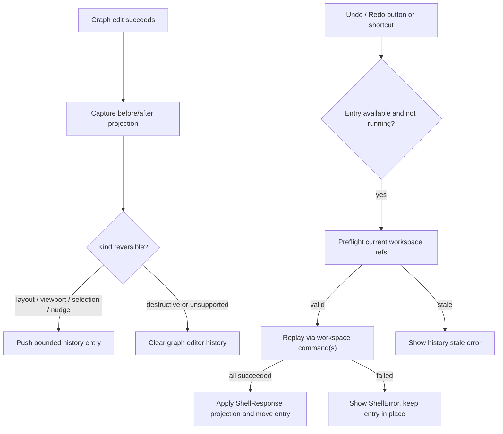

# graph-editor-lightweight-history design

## 0. 术语约定

| 术语 | 定义 | 防冲突结论 |
|---|---|---|
| Graph Editor History | Web Graph Canvas 当前 workspace 内的有限 undo/redo runtime stack | 不是 Project Content history，不保存到浏览器仓储 |
| History Entry | 一次可逆操作的 before/after 快照 | 首轮只允许 layout、viewport、selection、nudge 四类 |
| History Replay | 用户点击 Undo/Redo 或按快捷键后重放 before/after 的动作 | 必须通过既有 shell command 生效，不直接 patch domain state |
| Runtime-only Stack | 存在于 React state 内的 history undo/redo 数组 | workspace/session 切换后清空，不写 ShellResponse/localStorage |
| Stale Entry | entry 引用的 node/edge/path 已不存在 | replay 前本地预检失败，显示错误，不发送部分 command |
| Destructive Edit | node/edge/path delete 等没有可靠 inverse 的结构修改 | 首轮不入栈，并清空已有 history |

术语 grep 结果：当前代码没有 Graph Editor history 实现；`workspace.select`、`workspace.set_viewport` 和 `workspace.move_node` 已是 selection、viewport、nudge/layout 的权威写入路径。`web-workbench-shell` 需求文档已把撤销/重做列为当前不支持能力，本 feature 完成后 acceptance 阶段需要回写该边界。

## 1. 决策与约束

### 需求摘要

本 feature 目标是在不引入持久化操作日志的前提下，为高频图谱编辑提供轻量撤销/重做：

1. 用户可用 Graph Canvas 内的 Undo / Redo buttons 撤销或重做最近一次可逆编辑。
2. 用户可用 graph focus scope 内的 `Ctrl/Cmd+Z`、`Ctrl/Cmd+Shift+Z` 和 `Ctrl+Y` 触发同一套 undo/redo。
3. History stack 最多保留 20 条 undo entries；新 entry 入栈时清空 redo stack。
4. 首轮只记录成功完成的 layout、viewport、selection 和 selected node nudge。
5. Undo/redo layout 或 nudge 时，通过稳定 node id 顺序调用 `workspace.move_node`；成功后只用 ShellResponse projection 更新可见节点位置。
6. Undo/redo viewport 时，通过 `workspace.set_viewport` 恢复 before/after viewport。
7. Undo/redo selection 时，通过 `workspace.select` 恢复 before/after selection。
8. 删除 node/edge/path、add node、connect、path order、edge label、node composition、energy compute 和 report export 不入 history；会清空 graph editor history，避免 inverse 不完整。
9. session/project/workspace 切换、Fixture Run、Open Bridge 后 history 清空。
10. History stack 不参与 Save Bridge Session，不出现在 Project Content、Browser Project Repository、ShellResponse 或 localStorage。

### 明确不做

- 不新增 Python core / Platform Shell command、Project Content schema、Browser Project Repository write、localStorage persistence、autosave 或持久化 operation log。
- 不实现 node/edge/path delete、add node、connect edge、path order、edge label、node composition、correction、energy compute、report export 的 undo/redo。
- 不实现跨 workspace、跨 session、跨 reload 或跨浏览器 tab 的 history。
- 不做 collaborative undo、CRDT、branching timeline、history inspection drawer 或历史记录导出。
- 不合并 wheel 连续输入、不实现时间窗 coalescing；首轮每次成功 `workspace.set_viewport` 最多产生一条 bounded entry。
- 不直接修改 `WorkbenchDomainState.workspace`、`GraphEditorInteractionState.selection`、Project Sidebar state 或 repository bytes 来伪造回滚结果。

### 复杂度档位

- History model helper：L2。需要 typed entry、bounded push、redo 清理、stale preflight 和 no-op 判断。
- WorkbenchShell orchestration：L3。layout/nudge 是多 command replay，必须处理成功入栈、失败不入栈、replay running guard 和结构编辑清空。
- GraphCanvas UI / keyboard：L2。新增 Undo/Redo buttons 与 scoped keyboard shortcuts，必须避开输入框原生撤销。
- Tests / browser QA：tested。需要 helper tests、component tests、build 和真实浏览器 desktop/narrow 验证。

### 关键决策

1. **History 放在 WorkbenchShell UI state**：它靠当前 ShellResponse projection 抓 before/after，不进入 core 或 repository。
2. **只在命令成功后入栈**：command 失败或 layout no-op 不产生 history entry。
3. **Replay 仍走 shell command**：undo/redo 不 patch React domain state；失败时显示错误并保持 history entry 不移动。
4. **结构修改清空 history**：对首轮 inverse 不可靠的 graph edits，宁愿让 Undo disabled，也不生成半真半假的反向操作。
5. **entry 做类型化快照**：避免 `unknown` 在实现里扩散；layout/nudge 用 node position list，viewport 用 `GraphViewport`，selection 用 id arrays。
6. **按钮是主 fallback，快捷键是增量**：Undo/Redo buttons 保持可访问和可测；快捷键只在 graph scope 生效。

## 2. 名词与编排

### 2.1 名词层：值对象 / 实体 / 接口契约

**现状**：

- `WorkbenchShell` 维护 `workbenchState`、`graphEditorInteraction`、`autoLayoutStatus` 和各类 UI draft。
- `GraphCanvas` 通过 callbacks 触发 `workspace.move_node`、`workspace.set_viewport`、`workspace.select`、`workspace.remove` 等 command。
- selection 和 viewport 的 authority 已在 `WorkspaceSummary.selection` / `WorkspaceSummary.viewport`。
- node position authority 是 `WorkspaceSummary.graph.nodes[].position`。

**变化**：

新增 Web-only history helper，建议落在 `web/src/app/graphEditorHistory.ts`：

```ts
type GraphEditorHistoryKind = "layout" | "viewport" | "selection" | "nudge"

type GraphEditorNodePositionSnapshot = {
  nodeId: string
  position: [number, number]
}

type GraphEditorSelectionSnapshot = {
  nodeIds: string[]
  edgeIds: string[]
  pathIds: string[]
}

type GraphEditorHistoryEntry =
  | {
      id: string
      kind: "layout" | "nudge"
      label: string
      before: GraphEditorNodePositionSnapshot[]
      after: GraphEditorNodePositionSnapshot[]
      beforeViewport?: GraphViewport | null
      afterViewport?: GraphViewport | null
      createdAt: string
    }
  | {
      id: string
      kind: "viewport"
      label: string
      before: GraphViewport
      after: GraphViewport
      createdAt: string
    }
  | {
      id: string
      kind: "selection"
      label: string
      before: GraphEditorSelectionSnapshot
      after: GraphEditorSelectionSnapshot
      createdAt: string
    }

type GraphEditorHistoryState = {
  undo: GraphEditorHistoryEntry[]
  redo: GraphEditorHistoryEntry[]
  running: "undo" | "redo" | null
  error?: ShellError | null
  limit: 20
}
```

稳定规则：

- `undo` 栈尾是下一次 Undo 的目标；`redo` 栈尾是下一次 Redo 的目标。
- Push entry 时若 before/after 等价则跳过；若入栈则清空 redo。
- Push 后只保留最近 20 条 undo entries。
- Replay 前根据当前 workspace graph 验证引用仍存在；stale entry 不发送 command。
- Replay 成功后，Undo 会把 entry 从 undo 移到 redo；Redo 会把 entry 从 redo 移回 undo。
- session id、workspace id 或 graph id 发生变化时清空 history。

### 2.2 编排层：主流程与控制流



**现状**：

- `setGraphViewport` 每次只发送一个 `workspace.set_viewport`。
- `selectGraphItems` 每次只发送一个 `workspace.select`，但调用来源包括 GraphCanvas 和 Energy Profile。
- `nudgeGraphNodes` 对 selected nodes 顺序发送多个 `workspace.move_node`。
- `applyGraphAutoLayout` 对 `plan.changedNodeIds` 顺序发送多个 `workspace.move_node`，成功后可选 `workspace.set_viewport`。
- `removeGraphItems`、`addObjectNode`、`connectGraphNodes`、`applyPathOrderDraft`、`applyGraphEdgeLabelDraft`、`applyNodeCompositionDraft` 改变 graph 结构或语义，但没有可靠 inverse。

**变化**：

- `WorkbenchShell` 新增 `graphEditorHistory` state 和 `historyStateRef` / `workbenchStateRef` 这类必要 refs，避免 async command replay 捕获旧 projection。
- `setGraphViewport` 在成功后比较 before/after viewport，并 push `kind="viewport"` entry。
- GraphCanvas selection 调用路径为 `selectGraphItems` 增加可选 history options；Energy Profile point selection 不记录 history，并清空 graph editor history，避免外部联动选择后 Undo 回滚到用户没意识到的旧图谱选择。
- `nudgeGraphNodes` 在成功移动所有 nodes 后 push `kind="nudge"` entry；before/after 来自命令前节点位置和最终 workspace projection。
- `applyGraphAutoLayout` 在所有 node moves 与可选 viewport fit 均成功后 push `kind="layout"` entry；layout no-op 不入栈。
- destructive / unsupported graph edits 成功后调用 `clearGraphEditorHistory`。
- Undo/Redo replay 复用现有 shell commands；multi-node replay 按 entry snapshot 中稳定 node id 顺序执行。
- `GraphCanvas` 新增 Undo/Redo controls，显示当前可撤销/可重做 label 或 disabled state，并把 keyboard intent 交给 `WorkbenchShell`。

**跨层纪律**：

- Authority：history 只记录 projection snapshot；可见回滚结果仍来自 ShellResponse。
- Failure semantics：replay 失败不移动 history entry；stale preflight 不发送部分 command。
- Scope：history 只属于当前 Web Graph Canvas runtime；不影响 Project Sidebar dirty/persisted 判定。
- Idempotency：before/after 相同的 viewport、selection、nudge/layout 不入栈。
- Ordering：layout/nudge replay 是顺序命令；任一失败停止后续命令。
- Accessibility：buttons 始终存在，快捷键只在 graph keyboard scope 内生效，input/textarea/select/contenteditable 保留浏览器原生 undo。

### 2.3 挂载点清单

- History helper：typed entries、bounded push、redo transfer、snapshot equality、stale preflight helper。
- WorkbenchShell orchestration：history state、success push、unsupported edit clear、undo/redo replay、running/error 状态。
- GraphCanvas UI / keyboard：Undo/Redo buttons、scoped keyboard intent、status output 和 i18n labels。
- Tests / browser QA：helper tests、WorkbenchShell component tests、desktop/narrow browser validation。

本 feature 不挂入 Python core、Platform Shell、Project Content Store、Browser Project Repository、EnergyProfileEngine、ReportExportService、localStorage 或 third-party history library。

### 2.4 推进策略

1. **History Model Helper**：新增 Web-only history types 与纯函数，覆盖 bounded push、redo 清理、entry transfer、no-op equality 和 stale preflight。
   - 退出信号：helper tests 证明 stack limit、redo 清理、same snapshot no-op 和 stale detection 稳定。
2. **WorkbenchShell Recording / Replay**：接入 viewport、selection、nudge、layout 的成功入栈；unsupported graph edits 清空；Undo/Redo 通过 shell command replay。
   - 退出信号：component tests 证明四类 entry 可 undo/redo，失败或 stale 不直接 patch state。
3. **GraphCanvas Controls / Shortcuts**：新增 Undo/Redo buttons、状态文案、scoped keyboard shortcuts 和双语 i18n。
   - 退出信号：buttons disabled/enabled、label、`Ctrl/Cmd+Z` / redo shortcuts、输入框内不触发 graph undo 均有测试。
4. **Verification And Scope Guard**：跑 Web tests/build、必要 Python tests、浏览器 desktop/narrow 验证。
   - 退出信号：history UI 可用，layout/viewport/selection/nudge 可逆，delete 等 unsupported 操作不入栈且不持久化 history。

## 3. 验收契约

### 关键场景清单

1. History helper push entry 后 undo stack 最多 20 条，redo stack 被清空。
2. before/after 等价的 viewport、selection、node positions 不产生 entry。
3. Undo/Redo viewport 发送 `workspace.set_viewport`，可见 zoom/transform 来自 ShellResponse projection。
4. Undo/Redo selection 发送 `workspace.select`，node/edge/path selected state 跟随 ShellResponse projection。
5. Selected node nudge 成功后产生 `kind=nudge` entry；Undo/Redo 按稳定 node id 顺序发送 `workspace.move_node`。
6. Auto layout 成功后产生 `kind=layout` entry；Undo/Redo 恢复节点位置，并在 entry 带 viewport 时恢复 viewport。
7. Auto layout no-op、失败的 move 或失败的 viewport fit 不产生 history entry。
8. Delete selected node/edge/path 成功后不产生 undo entry，并清空已有 history。
9. Add node、connect edge、path order apply、edge label apply、node composition apply 和 Energy Profile point selection 成功后清空 history 或保持不入栈，不提供误导性 undo。
10. session/project/workspace 切换、Fixture Run 或 Open Bridge 后 history 清空。
11. Undo/Redo replay 前发现 entry 引用 stale node/edge/path 时，不发送 shell command，显示 history stale error，entry 保持在原 stack。
12. Replay 期间 Undo/Redo buttons disabled；replay 成功才移动 entry 到 opposite stack。
13. Graph Canvas 内 `Ctrl/Cmd+Z` 触发 Undo，`Ctrl/Cmd+Shift+Z` 或 `Ctrl+Y` 触发 Redo。
14. 输入框、textarea、select、contenteditable 内的 undo/redo 快捷键不触发 graph history。
15. Undo/Redo buttons 在 desktop 和 narrow 布局可见且文字不重叠。
16. Save Bridge Session / Export Bundle / localStorage 中不包含 history stack。
17. 不新增 Python core / Platform Shell command、Project Content schema、Browser Project Repository write、autosave 或 third-party history dependency。
18. `cd web && npm run test -- --run` 通过。
19. `cd web && npm run build` 通过。
20. 浏览器验证开发服务页面非空白、无 framework overlay、console clean；desktop/narrow 验证 history controls 无明显重叠或水平溢出。

### 反向检查

- 不把 history entry 写进 ShellResponse、Project Content、Browser Project Repository 或 localStorage。
- 不把 undo/redo 做成直接修改 `WorkbenchDomainState.workspace` 的本地 patch。
- 不为 destructive delete、connect、add node、composition、edge label、path order 编造 inverse command。
- 不新增 `workspace.undo`、`workspace.redo` 或 batch history shell command。
- 不让 graph scope 之外的 keyboard shortcut 劫持输入框原生撤销。

## 4. 与项目级架构文档的关系

- acceptance 阶段应更新 `codestable/architecture/web-workbench.md`：记录 Graph Editor Lightweight History、runtime-only stack、四类可逆 entry、unsupported edit clear、ShellResponse authority 和测试覆盖。
- acceptance 阶段应更新 `codestable/requirements/web-workbench-shell.md`：用户可在当前 Web Graph Canvas runtime 中撤销/重做 layout、viewport、selection 和 nudge；仍不支持持久化 history、删除撤销或跨 reload undo。
- core / platform 架构通常不需要更新，因为本 feature 复用既有 `workspace.move_node`、`workspace.set_viewport` 和 `workspace.select`；如果实现中发现必须改 shell contract，需先回 roadmap/design。
- roadmap acceptance 阶段把 `graph-editor-lightweight-history` 标为 `done`；后续 `graph-editor-advanced-e2e-qa` 可把 history 纳入真实浏览器矩阵。
