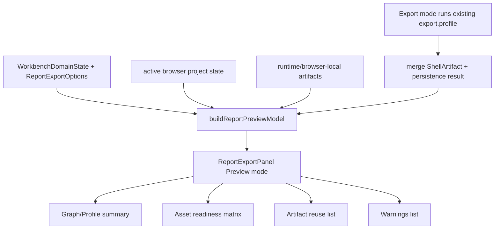

# web-report-preview-panel design

## 0. 术语约定

- Report Preview Mode：`ReportExportPanel` 内的预览视图，用来在导出前/导出后扫描 profile、graph、energy table、graph snapshot、artifacts 和 warnings；不是新的报告 writer。
- Report Preview Model：Web 侧 UI-only 派生模型，由 `WorkbenchDomainState`、`ReportExportOptions`、active browser project state 和已有 `WorkbenchArtifactSummary` 组装。
- Asset Readiness：按报告资产类型显示 ready / pending / warning / unavailable；只解释已有 projection，不触发 shell command。
- Artifact Match：从 runtime/browser-local artifacts 中按 format、artifact kind、metadata 和 basename 找到当前预览可复用的导出资产。
- Preview/Export Segmented Control：`ReportExportPanel` 内部的两段式视图切换；`Preview` 用于扫描报告状态，`Export` 保留现有格式选择、导出按钮和 artifact 列表。

## 1. 决策与约束

### 需求摘要

实现 roadmap item `web-report-preview-panel`：在 Web 工作台右侧报告区域提供一个可扫描的报告预览模式，汇总 graph/profile/table/artifact readiness 与 warnings，并覆盖桌面/窄屏布局。成功标准是用户在导出前能看到当前 profile 是否可用、graph snapshot 是否已有、energy table artifact 是否已有、哪些格式已 inline/persisted、哪些 warning 需要注意；导出后预览能复用新 artifacts 更新 readiness。

### 复杂度档位

走 Web UI 编排中等档。偏离点是预览横跨 `workspace/profile/artifacts/projectSidebar/warnings/exportOptions`，但它不需要 core contract 变更。方案采用纯前端 helper 生成 `ReportPreviewModel`，让组件只渲染模型，避免在 JSX 里散落 readiness 推导。

### 关键决策

- 预览形态采用 `ReportExportPanel` 内的 Preview/Export 两个模式，不新增独立 inspector 大面板。
- `ReportPreviewModel` 只从当前 Web projection 派生：`WorkbenchDomainState.workspace`、`profile`、`artifacts`、`warnings`、`ReportExportOptions` 和 active browser project 布尔值。
- energy table readiness 只读取现有 `xlsx/csv` artifact metadata 中的 `energy_table_schema_version`、row/column count；没有 artifact 时显示 pending export，不在前端重算 CSV rows。
- graph snapshot readiness 只读取现有 `svg` artifact metadata 中的 `artifact_kind=graph_snapshot`、graph/workspace/counts/viewport；没有 artifact 时显示 pending export，不做 DOM/canvas capture。
- UI 文案进入 i18n catalogs；artifact id、format、path、checksum、metadata key、warning code/target 原样显示，不翻译。
- 视觉方向保持工作台式、低装饰、高信息密度：使用紧凑 status matrix、格式 readiness 列表、warnings 列表和 preview summary，避免营销式 hero 或大卡片堆叠。

### 明确不做

- 不新增 core `ReportDocument` / `ReportComposerManifest`、Shell command、HTTP route 或 Project Content schema。
- 不生成或修改 PNG/CDXML/XLSX/CSV/SVG bytes；Web 仍只消费 `ShellArtifact.bytes_base64`。
- 不实现 PDF/PPTX/CDX/HTML report、ChemDraw 编辑器、file picker、云同步或分享链接。
- 不把 Report Preview Model 写入 Project Content、Browser Project Repository、localStorage 或 ShellResponse。
- 不在预览中重算相对能量、校正项、CSV rows、graph layout 或 graph snapshot。
- 不把 GraphCanvas hover、pending edge、rubber-band draft、minimap draft、history stack 或 DOM transform 纳入预览。

### 前置依赖

- `export-csv-energy-table` 已 done：XLSX/CSV artifact metadata 可表达 `energy-table-v1` readiness。
- `export-graph-snapshot-svg` 已 done：SVG graph snapshot artifact 可表达 graph snapshot readiness。
- 当前工作区中上述 SVG feature 尚未提交；实现阶段如果要提交，需先按用户确认做 scoped commit，避免新旧 feature 混在一个 commit 里。

## 2. 名词与编排

### 2.1 名词层：值对象 / 接口契约

**现状**

- `WorkbenchDomainState` 已保存 `workspace`、`profile`、`artifacts`、`warnings`、`counts` 和 active ids。
- `WorkbenchArtifactSummary` 已有 `id`、`format`、`path`、`bytes_base64`、`checksum`、`metadata`、`persisted`、`has_inline_bytes`。
- `ReportExportPanel` 当前直接接收 artifacts/profile/options/warnings/active browser project，并渲染 format checkboxes、Export Readiness、artifact list 和 warnings。
- `Export Readiness` 只是局部摘要：profile/missing/corrections/include bytes/browser project/CDXML-only；没有组合 graph/profile/table/snapshot/artifacts 的报告级视图。

**变化**

- 新增 Web UI-only 类型：

```ts
type ReportPreviewModel = {
  project: {
    hasActiveBrowserProject: boolean
    persistenceLabel: "browser-local" | "download-only"
  }
  graph?: {
    graphId: string
    nodeCount: number
    edgeCount: number
    pathCount: number
    activePathId?: string | null
    snapshotArtifactId?: string | null
  }
  profile?: {
    profileId: string
    pointCount: number
    missingPointCount: number
    correctionPointCount: number
    outputUnit: string
  }
  energyTable?: {
    schemaVersion: "energy-table-v1"
    columnCount: number
    rowCount?: number | null
    artifactId: string
    format: "xlsx" | "csv"
  }
  assets: Array<{
    key: "energy_diagram" | "energy_table" | "graph_snapshot"
    labelKey: string
    status: "ready" | "pending" | "warning" | "unavailable"
    artifactIds: string[]
    formats: string[]
  }>
  artifacts: Array<{
    id: string
    format: string
    persisted: boolean
    hasInlineBytes: boolean
    checksum?: string | null
    path?: string | null
  }>
  warnings: Array<{ code: string; message: string; target?: string | null }>
}
```

- 新增纯 helper：`buildReportPreviewModel(input)`，输入为 Web 当前 projection，输出 JSON-safe view model。
- `ReportExportPanel` 增加 `viewMode: "preview" | "export"` 的组件内部 state 或由父组件持有的 UI-only state；默认进入 `preview`，保留现有 export 操作。
- `ReportPreviewPanel` 或 `ReportPreviewSection` 只接收 `ReportPreviewModel` 渲染，不直接读取 shell/client/repository。

### 2.2 编排层：主流程与控制流



**现状**

右侧 inspector 顺序为 Object Registry、Command、Energy Profile、Report Export、Command Status。`ReportExportPanel` 已经可以显示 artifact cards 和 readiness，但用户要从 cards/metadata 中自己判断“报告当前是否完整”。窄屏下 artifact metadata 很长，扫描成本高。

**变化**

- 在 `ReportExportPanel` 顶部新增 Preview/Export segmented control。
- Preview mode 渲染：
  - report headline：profile id / output unit / point count / missing count / correction count；
  - graph summary：graph id、node/edge/path count、active path、snapshot artifact readiness；
  - asset readiness matrix：energy diagram、energy table、graph snapshot 三类资产的 ready/pending/warning；
  - artifact reuse list：当前可复用 artifacts 的 format、inline/persisted、path/checksum；
  - warning list：合并 shell/profile/artifact persistence warnings，保持 code/target 原样。
- Export mode 保留现有 checkboxes、basename/title/include bytes、Export button、artifact list 和 metadata 展示；Export 成功后 Preview mode 自动从 state.artifacts 更新。
- 窄屏下 Preview mode 使用单列、固定行高约束和 `overflow-wrap:anywhere`，长 checksum/path/code 不撑出横向滚动。

**跨层纪律**

- 错误语义：预览不新增 Shell error；缺 profile/graph/artifact 只映射为 readiness status 和说明文案。
- 幂等性：同一 state/options 输入得到稳定 `ReportPreviewModel`；重复导出后 artifacts 按既有 merge/upsert 行为刷新。
- 顺序约束：先抽纯 helper 和单测，再接组件视图，再补 i18n/CSS，最后浏览器桌面/窄屏验证。
- 扩展点：后续 `ReportComposerManifest` 可以消费同类 asset readiness，但本 feature 不定义 core manifest。
- 可观测点：component test 可断言 preview sections、asset statuses、artifact ids、warnings、i18n；browser test 可断言桌面/窄屏无溢出。

### 2.3 挂载点清单

- Web preview model helper：新增或扩展 `web/src/app/reportPreviewModel.ts`，集中派生 `ReportPreviewModel`。
- Web Report Export surface：`ReportExportPanel.tsx` 接入 Preview/Export segmented control 和 preview rendering。
- Web workbench integration：`WorkbenchShell.tsx` 仅传入 helper 所需的 workspace/project 状态，不新增 shell command。
- Web i18n / CSS / tests：`messages.ts`、`workbench.css`、component/helper tests 和浏览器 QA。
- CodeStable / docs：acceptance 阶段回写 `web-workbench.md`、`web-workbench-shell.md` 和 report export 用户/开发者指南中的预览说明。

### 2.4 推进策略

1. Report preview model helper：定义 `ReportPreviewModel` 和 `buildReportPreviewModel`，覆盖 profile/graph/table/snapshot/artifact/warning 推导。
   退出信号：helper tests 可断言缺 profile、已有 CSV/XLSX table、已有 SVG snapshot、inline/persisted artifacts 和 warnings。
2. ReportExportPanel Preview mode：加入 segmented control 和 preview view，保留 Export mode 现有行为。
   退出信号：component tests 能看到 Preview/Export 切换、asset readiness、artifact reuse list，且现有 export tests 不退化。
3. i18n 与 responsive CSS：补中英文文案、紧凑 preview matrix、窄屏单列和长文本 wrap。
   退出信号：`zh-CN` / `en-US` key 对齐，桌面与 390px 宽度无水平溢出。
4. 集成验证：运行 Web targeted tests/build，必要时更新 WorkbenchShell tests 的 report export section。
   退出信号：Web tests/build 通过，未新增 core/Shell/schema 变化。
5. 浏览器验收：从 `web/` 启动 Vite，桌面和窄屏运行 Fixture -> Compute -> Preview/Export。
   退出信号：Preview 初始 pending、Export 后 ready 状态可观察，console clean，无 overlay、无水平溢出。

## 3. 验收契约

### 关键场景清单

- 触发：有 workspace 和 profile、但还没有导出 artifacts → 期望 Preview 显示 graph/profile summary，energy table 和 graph snapshot 为 pending export，不显示假 ready。
- 触发：profile 含 missing point 和 corrections → 期望 Preview 显示 missing count、correction count 和对应 warning/readiness 状态，不把 missing point 当作 0。
- 触发：已有 CSV/XLSX artifact metadata 含 `energy_table_schema_version=energy-table-v1` → 期望 energy table asset 为 ready，并显示 row/column count 与 artifact id。
- 触发：已有 SVG artifact metadata 含 `artifact_kind=graph_snapshot` → 期望 graph snapshot asset 为 ready，并显示 graph/workspace/counts 或 snapshot artifact id。
- 触发：artifact 缺 inline bytes 或 include bytes 关闭 → 期望 Preview 的 artifact reuse list 显示 hasInlineBytes=false，不写 browser persistence。
- 触发：active browser project 下导出 artifacts 后 → 期望 Preview 显示 persisted path/checksum，Export mode 的现有 artifact list 仍可下载。
- 触发：warnings 中有 `chemdraw_cdxml_only` 或 persistence warning → 期望 Preview warning list 保留 code、message、target 原样。
- 触发：切换 Preview/Export mode → 期望格式选择、basename/title/include bytes 不丢失，Export button 行为不变。
- 触发：窄屏 `390x840` 打开 Preview/Export → 期望 preview matrix、artifact ids、checksum、warnings 不重叠、不产生水平滚动。

### 明确不做的反向核对项

- 不应新增 core report composer、Shell command、HTTP route、Project Content schema 或 persistence section。
- 不应在 Web 生成 PNG/CDXML/XLSX/CSV/SVG bytes、DOM screenshot、canvas capture、Blob SVG builder 或 graph layout。
- 不应新增 PDF/PPTX/CDX/HTML report supported set、file picker、云分享或账号相关 UI。
- 不应把 Report Preview Model、view mode、readiness 或 warnings 写入 Project Content、Browser Project Repository、localStorage 或 ShellResponse。

## 4. 与项目级架构文档的关系

Acceptance 阶段需要回写：

- `codestable/architecture/web-workbench.md`：记录 Report Preview Mode、Report Preview Model 的 UI-only 派生边界、Preview/Export segmented control 和桌面/窄屏 QA。
- `codestable/architecture/ARCHITECTURE.md`：术语表补 Web Report Preview / Report Preview Model，说明它不是 core report composer。
- `codestable/requirements/web-workbench-shell.md`：补用户故事与边界：用户可在导出前扫描报告 readiness，但预览不保存、不生成 artifact bytes。
- `docs/user/report-export-artifacts.md`：补用户操作说明：如何查看 Preview、哪些 pending/ready 状态代表什么。
- `docs/dev/report-export-artifacts.md` 或 `docs/dev/web-runtime-boundary.md`：补开发者边界：Preview helper 只消费 Web projection，不调用 Shell writer。
