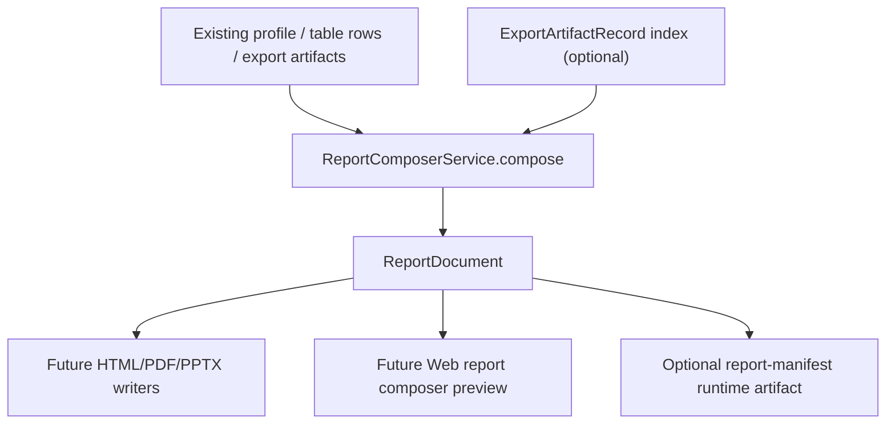

# report-composer-manifest design

## 0. 术语约定

- Report Composer Manifest：core 侧组合报告中间层，描述一份报告由哪些 section、asset reference、metadata 和 warnings 组成；它不是 PDF/PPTX/HTML writer。
- ReportDocument：单份组合报告的 JSON-safe manifest，包含 id、project id、title、created_at、sections、assets、metadata 和 warnings。
- ReportSection：ReportDocument 内的章节描述，当前限定 summary、graph、energy_profile、energy_table、artifacts、warnings 六类。
- ReportAsset：ReportDocument 内的 JSON-safe artifact 引用，指向已有 `ExportArtifact` / `ExportArtifactRecord` / `ShellArtifact` 的 id、format、kind、path/checksum/metadata；不持有 bytes。
- Report Composer：把已有 profile、table rows、graph snapshot artifact 和 export artifacts 归并为 ReportDocument 的纯 core helper / service。
- Report Manifest Artifact：可选 runtime artifact，format 可先使用 `json` 或内部 artifact kind `report_manifest` 表达；本 feature 只定义 manifest 数据与 core service，是否进入 Web checkbox 另起 feature。

> 命名收敛：roadmap 中曾把 `ReportAsset` 写成带 `bytes` 的运行时资产；本设计将 `ExportArtifact` 继续作为 bytes/runtime 资产，将 `ReportAsset` 收敛为 JSON-safe manifest 引用。acceptance 阶段会回写 roadmap 口径。

## 1. 决策与约束

### 需求摘要

实现 roadmap item `report-composer-manifest`：在 core export 层定义一份可序列化的报告 manifest，把当前已经能生成或投影的 energy diagram、energy table、graph snapshot 和 artifact metadata 组合成统一 `ReportDocument`。后续 HTML/PDF/PPTX/CDX 或分享 UI 必须先消费这份 manifest，而不是直接读取 Web component state、Project Sidebar state 或各自重新理解 artifacts。

### 复杂度档位

走 core contract 中等档。它新增的是组合报告契约和纯构建服务，不是新 writer；风险在于命名要和现有 `ExportArtifact`、`ExportArtifactRecord`、Web Report Preview Model 区分清楚，并且不能把 bytes 或 Python object 偷塞进 manifest。

### 关键决策

- `ReportDocument` / `ReportSection` / `ReportAsset` 放在 report export 子域的独立 core module 中，保持 core 可测试、无 UI 依赖，并避免继续膨胀现有 writer module。
- `ReportAsset` 只保存 JSON-safe 引用信息，不持有 `bytes`；bytes 仍由 `ExportArtifact.bytes` 或项目 `exports/...` 文件承载。
- 首轮 composer 只消费已有数据：`EnergyProfile`、`EnergyTableRow` / `build_energy_table_rows()`、`ExportArtifact`、可选 `ExportArtifactRecord`、graph/workspace-derived artifact metadata 和 warnings。
- 首轮不新增 Web UI，不新增 checkbox，不新增 PDF/PPTX/HTML/CDX writer，不把 manifest 写入 Project Content 长期 section。
- manifest id、section id 和 asset id 必须稳定、可测试；重复构建同一输入时除了显式 created_at 外结构稳定。
- 本 feature 不新增 Shell command；Web/CLI 直接获取 manifest 的入口等后续 writer 或 UI 需要时另起 feature。

### 明确不做

- 不生成 PDF、PPTX、HTML、DOCX、CDX 或完整可视化报告文件。
- 不修改 PNG/CDXML/XLSX/CSV/SVG writer 的 bytes 生成逻辑。
- 不新增 Web report composer UI、分享链接、账号、云存储或模板编辑器。
- 不把 ReportDocument 写入 Project Content 新 section、Browser Project Repository 或 localStorage。
- 不读取 Web DOM、React state、Browser Blob、GraphCanvas transient state 或 Project Sidebar state。
- 不重新计算 energy profile、校正项、energy table rows 或 graph layout；只消费调用方传入的现有数据。

### 前置依赖

- `export-csv-energy-table` 已 done：energy table contract 与 row/column metadata 已可复用。
- `export-graph-snapshot-svg` 已 done：graph snapshot artifact 与 metadata 已可作为 manifest asset。
- `web-report-preview-panel` 已 done：Web preview 只是 UI projection，不替代 core manifest。

## 2. 名词与编排

### 2.1 名词层：值对象 / 接口契约

**现状**

- `ExportArtifact` 是 core runtime export result，可带 bytes/path/metadata。
- `ExportArtifactRecord` 是 Project Content 长期索引，记录 `exports/...` path、checksum、metadata，不保存 bytes。
- `ExportRequest` 能同时接收 profile、graph/workspace、objects 和 table_rows，但 `ReportExportService.export()` 当前只返回各格式独立 artifact tuple。
- Web Report Preview Model 是 UI-only readiness view model，不进入 core，不是 writer 输入。

**变化**

新增 JSON-safe dataclass 契约：

```python
ReportSectionKind = Literal["summary", "graph", "energy_profile", "energy_table", "artifacts", "warnings"]

@dataclass(frozen=True)
class ReportAsset:
    id: str
    kind: str
    format: str
    source_artifact_id: str
    path: str | None = None
    checksum: str | None = None
    metadata: dict[str, JsonValue] = field(default_factory=dict)

@dataclass(frozen=True)
class ReportSection:
    id: str
    title: str
    kind: ReportSectionKind
    asset_ids: tuple[str, ...] = ()
    data: dict[str, JsonValue] = field(default_factory=dict)

@dataclass(frozen=True)
class ReportDocument:
    id: str
    project_id: str
    title: str
    created_at: str
    sections: tuple[ReportSection, ...]
    assets: tuple[ReportAsset, ...]
    metadata: dict[str, JsonValue] = field(default_factory=dict)
    warnings: tuple[RxnFlowWarning, ...] = ()
```

新增纯构建入口：

```python
@dataclass(frozen=True)
class ReportComposerRequest:
    project_id: str
    title: str | None = None
    profile: EnergyProfile | None = None
    table_rows: tuple[EnergyTableRow, ...] = ()
    artifacts: tuple[ExportArtifact, ...] = ()
    artifact_records: tuple[ExportArtifactRecord, ...] = ()
    metadata: dict[str, JsonValue] = field(default_factory=dict)

class ReportComposerService:
    def compose(self, request: ReportComposerRequest) -> Result[ReportDocument]:
        ...
```

示例输入 → 输出：

```python
document = ReportComposerService().compose(
    ReportComposerRequest(
        project_id="project-fixture-minimal-reaction",
        title="Relative energy report",
        profile=profile,
        artifacts=(png_artifact, csv_artifact, svg_artifact),
    )
).value

assert [section.kind for section in document.sections] == [
    "summary",
    "graph",
    "energy_profile",
    "energy_table",
    "artifacts",
    "warnings",
]
assert document.assets[0].source_artifact_id == png_artifact.id
```

### 2.2 编排层：主流程与控制流



**现状**

`ReportExportService.export()` 以格式为中心输出 artifacts。Web 预览可以扫描这些 artifacts，但没有 core 级“这一份报告包含哪些 section 与 asset”的稳定中间层。后续 PDF/PPTX/HTML 如果直接各自读 profile/artifacts，会重复定义 section 顺序、warning 语义和 asset 匹配。

**变化**

- 新增 composer service，把已有 profile/table rows/artifacts/records 归并成 `ReportDocument`。
- section 顺序首轮固定：summary → graph → energy_profile → energy_table → artifacts → warnings；缺少输入时 section 仍保留，并在 `data.status="unavailable"` 与 warning 中说明原因，不省略 section。
- asset matching 只从已有 artifact / record metadata 读取 `artifact_kind`、`energy_table_schema_version`、graph/workspace counts、path/checksum 等，不生成新 bytes；`ExportArtifactRecord` 与 runtime artifact 同 id 时优先补充项目相对 path/checksum。
- warnings 合并来自 profile warnings、artifact metadata warnings 和 composer 自身 warning，并去重。
- 后续 writer 只能消费 `ReportDocument`，不得直接读取 Web state。

**跨层纪律**

- 错误语义：缺 `project_id` / 非 JSON-safe metadata 返回 `invalid_input`，不静默过滤；缺 profile、缺 table、缺 graph snapshot 等报告完整性问题优先进入 warning，不让 compose 失败。
- 幂等性：同一 request 输入得到稳定 section ids、asset ids 和 metadata；created_at 使用现有 export 常量或 request 注入值以便测试。
- 顺序约束：先定义 dataclasses 与 serializer-friendly helpers，再实现 compose，再接测试和 docs；不先接 Web。
- 扩展点：未来 delivery writer 挂在 `ReportDocument` 后面；未来 Project Content section 需另起 feature。
- 可观测点：unit tests 断言 document shape、section order、asset refs、warnings、JSON-safe dump 和 no-bytes boundary。

### 2.3 挂载点清单

- Core report manifest contract：新增 `ReportDocument`、`ReportSection`、`ReportAsset`、`ReportComposerRequest`、`ReportComposerService`。
- Core export integration：仅复用 `ExportArtifact`、`ExportArtifactRecord`、`EnergyProfile`、`EnergyTableRow` 和 metadata helpers，不改现有 writer bytes。
- Tests：新增 core unit tests 覆盖正常、缺输入、asset matching、warning merge、JSON-safe 和 no-bytes。
- Docs / CodeStable：acceptance 阶段回写 `core-platform.md`、`ARCHITECTURE.md`、`docs/dev/report-export-artifacts.md` 和 roadmap 中 ReportAsset 命名收敛。

### 2.4 推进策略

1. Manifest contracts：定义 ReportDocument / ReportSection / ReportAsset / ReportComposerRequest，并保证字段 JSON-safe。
   退出信号：类型可 import，bytes / Path / Python object 不进入 dataclass 字段。
2. Composer service：实现从 profile/table rows/artifacts/records 到 ReportDocument 的纯构建逻辑。
   退出信号：正常输入生成固定 section 顺序、asset refs 和 warning list。
3. Edge cases：处理缺 profile、缺 graph snapshot、重复 artifact、artifact record path/checksum merge 和 metadata 非 JSON-safe。
   退出信号：错误/警告语义可由单测断言，缺输入不伪造成 ready asset。
4. Tests and docs：补 core unit tests 与开发者文档，确认未新增 writer/UI/schema。
   退出信号：Python targeted tests、`python3 -m unittest discover` 相关子集、YAML 校验通过。

## 3. 验收契约

### 关键场景清单

- 触发：profile + PNG/CDXML + CSV/XLSX + SVG artifacts → 期望 ReportDocument 含 summary、graph、energy_profile、energy_table、artifacts、warnings sections，assets 指向已有 artifact ids。
- 触发：artifact 同时有 runtime path 和 `ExportArtifactRecord` checksum → 期望 ReportAsset 合并 path/checksum/metadata，不复制 bytes。
- 触发：只有 profile、没有 table/snapshot artifacts → 期望 compose 成功，缺失资产进入 warning 或 unavailable data，不生成假 asset。
- 触发：profile 含 warnings、artifact metadata 含 warnings → 期望 document warnings 去重并保留 code/message/target。
- 触发：metadata 中出现非 JSON-safe 值 → 期望返回 `invalid_input target=metadata`，不能过滤或让 dataclass 带不可序列化对象。
- 触发：重复 compose 同一输入 → 期望 section ids、asset ids、section order 稳定。
- 触发：future writer 只拿 ReportDocument → 期望它不需要访问 EnergyProfile / ExportArtifact bytes / Web state 才能知道报告结构。

### 明确不做的反向核对项

- 不新增 PDF/PPTX/HTML/CDX writer 或 supported format。
- 不新增 Web UI、Shell command、HTTP route、Project Content section 或 Browser Repository writer。
- 不把 bytes、Blob、Path、React state、DOM node、GraphCanvas transient state 放进 ReportDocument。
- 不重新计算 energy profile、CSV rows、graph layout 或 graph snapshot。

## 4. 与项目级架构文档的关系

Acceptance 阶段需要回写：

- `codestable/architecture/core-platform.md`：记录 Report Composer Manifest 在 core export 层的位置、dataclass contract、JSON-safe / no-bytes 边界。
- `codestable/architecture/ARCHITECTURE.md`：术语表补 Report Composer Manifest / ReportDocument / ReportAsset，说明它是后续 delivery writer 的共同输入。
- `docs/dev/report-export-artifacts.md`：补开发者使用方式和当前不生成 PDF/PPTX/HTML/CDX 的边界。
- `codestable/roadmap/rxnflow-report-preview-delivery/rxnflow-report-preview-delivery-roadmap.md`：确认 `ReportAsset` 命名收敛为 manifest 引用，runtime bytes 仍叫 `ExportArtifact`。
