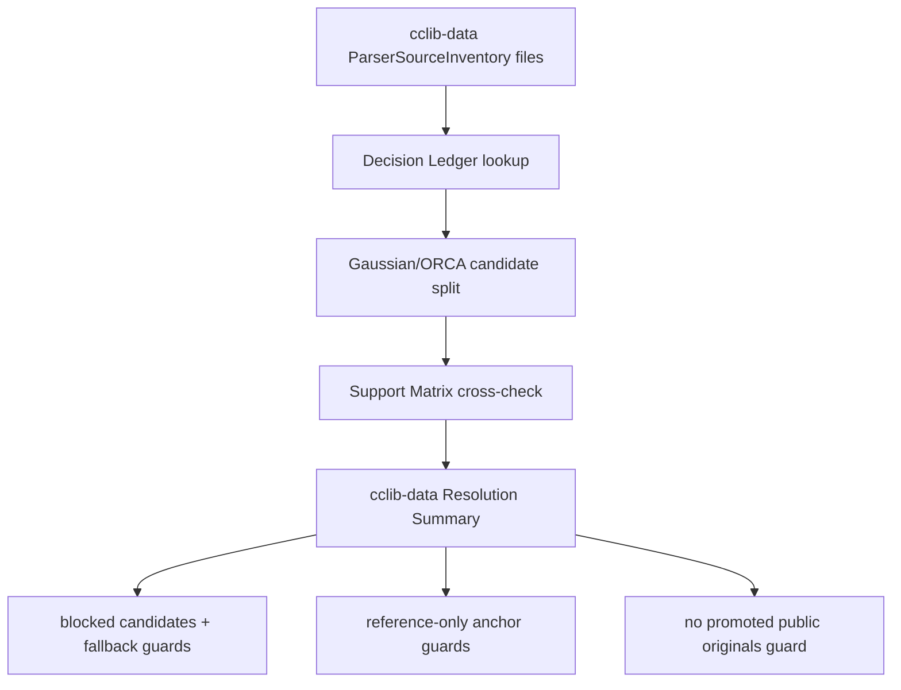

# cclib-public-candidate-resolution design

## 0. 术语约定

- **cclib-data Candidate Resolution**：对 `cclib-data-gaussian-orca` source 下的 Gaussian/ORCA source files 做可复核归档：能不能 promotion、为什么不能、用哪个 fallback 或 reference anchor 继续证明边界。
- **cclib-data Resolution Summary**：从 `ParserSourceInventory`、`Public Fixture Decision Ledger`、`Parser Support Matrix` 和 Candidate Fetch Verify contract 派生出的测试侧汇总，列出 Gaussian candidates、ORCA candidates、reference-only files、promoted files、blocked candidates、fallback fixtures 和 unresolved files。
- **Blocked cclib-data Candidate**：`fixture_policy: candidate` 但 decision 不是 `allowed/promoted` 的 cclib-data source file；当前应保持 `needs-permission/blocked` 并带项目内 fallback fixture。
- **cclib-data Reference Anchor**：`fixture_policy: reference-only` 的 cclib-data source file；当前只用于 optional/large-output reference link，不进入 executable fixtures。
- **cclib-data Fallback Fixture**：项目内 synthetic 或 synthetic-derived Gaussian/ORCA fixture，用于在不能 vendor cclib-data original 时固定 cclib adapter projection。
- **cclib-data Promotion Outcome**：cclib-data source file 的当前 promotion 结果；只有 `decision: allowed` 且 `promotion: promoted` 才能进入 `files/`。本 feature 当前预期无 promoted cclib-data originals。

术语 grep 结论：当前已有 cclib adapter、Gaussian/ORCA synthetic-derived fixtures、source inventory、decision ledger、Candidate Fetch Verify 和 MAPLE resolution summary。本 feature 复用这些概念，不新增 runtime parser 概念，不扩展 thermochemistry、NBO、SCF convergence 或真实版本认证。

## 1. 决策与约束

### 需求摘要

public fixture intake roadmap 的下一步是 cclib-data candidate resolution。当前 `sources.yaml` 中 `cclib-data-gaussian-orca` 有 4 个 candidate files 和 2 个 reference-only files：

- Gaussian candidates：`cclib-gaussian16-water-log`、`cclib-gaussian16-co-pbe-log`
- ORCA candidates：`cclib-orca50-1038-output`、`cclib-orca60-1618-output`
- Reference-only：`cclib-gaussian16-water-nbo-out`、`cclib-orca50-benzene-opt-log`

当前 `public-fixture-decisions.yaml` 已把 4 个 candidates 记录为 `needs-permission/blocked`，把 2 个 reference-only files 记录为 `reference-only/not-applicable`。外部复核结论也支持继续谨慎处理：cclib 官方安装文档说明若要安装测试与 logfiles，需要从 non-free repository 安装 `cclib-data` package（https://cclib.github.io/how_to_install.html）；Debian package search 和 package detail 也把 `cclib-data` 放在 non-free（https://packages.debian.org/cclib、https://packages.debian.org/bullseye/cclib-data）；Debian source copyright 进一步说明 cclib-data package/source 被放入 non-free（https://sources.debian.org/src/cclib-data/1.6.2-2/debian/copyright）。该证据不足以把 cclib-data originals 视为可再分发 fixture。

本 feature 的目标不是改变 cclib adapter runtime，也不是 vendor cclib-data 原始输出，而是把 cclib-data resolution 变成可机检、可验收状态：所有 cclib-data source file 都必须被 resolution summary 覆盖；所有 cclib-data public originals 当前不得 promoted；candidate 必须有 fallback fixture；reference-only 必须有 reference anchor；support matrix 不得把 cclib-data public originals 加进 executable fixture ids。

### 明确不做

- 不 vendor cclib-data Gaussian/ORCA public originals，不新增 cclib-data third-party file 到 `tests/fixtures/parsers/files/`。
- 不把 cclib-data candidate decision 改成 `allowed/promoted`，除非用户后续提供明确授权或可再分发证据。
- 不修改 cclib adapter runtime，不新增 NBO、frequency、thermochemistry、SCF convergence、population analysis 或 deep parser fields。
- 不新增真实 Gaussian/ORCA 版本认证，不把 cclib-data candidates 描述成真实版本完整支持。
- 不修改 import workflow、Platform Shell、Web UI 或 report export。
- 不运行 Gaussian、ORCA、cclib regression suite 或任何外部计算任务。
- 不让普通 unit tests 访问网络或 GitHub clone。
- 不把 `reference-only` 文件描述成 supported/executable fixture。

### 复杂度档位

测试侧/dev tooling feature，默认低复杂度。偏离点：

- cclib-data source 同时覆盖 Gaussian 和 ORCA，resolution summary 必须区分 Gaussian candidates 与 ORCA candidates，避免把两个 adapter projection 混成单一格式。
- license evidence 当前指向 non-free/review-required，不应因为 fetch/hash 可验证就自动 promotion。
- 当前 support matrix 已有 Gaussian/ORCA synthetic-derived executable coverage，但 cclib reference-only files 需要明确保持 reference-only，不进入 NBO/optimization/SCF deep field 支持声明。

### 关键决策

1. **resolution summary 派生而非新事实源**：cclib-data Resolution Summary 从现有 source inventory、decision ledger 和 support matrix 派生，不新建第二份 cclib-data 决策 YAML。
2. **无授权则不 promotion**：当前 cclib-data candidates 保持 `needs-permission/blocked`，不把 fetch/hash verify 成功等同为可再分发。
3. **按 adapter family 分类**：summary 必须分别列出 Gaussian candidates 与 ORCA candidates，避免一个 fallback 或 support entry 覆盖另一类。
4. **reference-only 保持 reference-only**：NBO/large opt output 只作为 reference anchor，不进入 manifest fixture ids 或 supported fields。
5. **fallback 是项目内 fixture**：candidate fallback 只能指向 manifest 中已有 synthetic / synthetic-derived executable fixtures。
6. **parser runtime 不变**：本 feature 只增强 fixture intake 的可审计性，不扩展 `rxnflow.parsers.cclib_adapter`。

## 2. 名词与编排

### 2.1 名词层：值对象 / 接口契约

**现状**

- `ParserSourceInventory` 能读取 `cclib-data-gaussian-orca` 下所有 source files，并按 `fixture_policy` 区分 candidate / reference-only。
- `ParserPublicFixtureDecisionLedger` 能按 `source_id + file_id` 查询 decision、promotion、fallback 和 reference anchors。
- `ParserSupportMatrix` 记录 `gaussian-log-cclib-synthetic` 和 `orca-output-cclib-synthetic` 两个 synthetic-derived fallback entries，当前 executable fixture ids 均指向项目内 fixtures。
- Candidate Fetch Verify helper 能从 source inventory 构造 request 并校验调用方提供的 bytes，但普通 tests 不访问网络。
- 当前没有 cclib-data-specific summary 把 Gaussian/ORCA candidate、reference-only、fallback 和 unresolved 状态聚合起来。

**变化**

新增测试侧派生契约：

```python
@dataclass(frozen=True)
class ParserCclibPublicResolutionSummary:
    source_id: str
    gaussian_candidate_file_ids: tuple[str, ...]
    orca_candidate_file_ids: tuple[str, ...]
    reference_file_ids: tuple[str, ...]
    promoted_file_ids: tuple[str, ...]
    blocked_candidate_file_ids: tuple[str, ...]
    fallback_fixture_ids: tuple[str, ...]
    unresolved_file_ids: tuple[str, ...]
```

最小 helper shape：

```python
def summarize_cclib_public_candidate_resolution(
    source_inventory: ParserSourceInventory,
    decision_ledger: ParserPublicFixtureDecisionLedger,
    support_matrix: ParserSupportMatrix,
    *,
    source_id: str = "cclib-data-gaussian-orca",
) -> ParserCclibPublicResolutionSummary:
    ...
```

约束：

- `source_id` 必须存在且 `program == "cclib-data"`。
- summary 必须覆盖该 source 下所有 file ids。
- `gaussian_candidate_file_ids` 来自 source inventory 中 `fixture_policy: candidate` 且 `format == "gaussian-log"` 的 files。
- `orca_candidate_file_ids` 来自 source inventory 中 `fixture_policy: candidate` 且 `format == "orca-output"` 的 files。
- `reference_file_ids` 来自 source inventory 中 `fixture_policy: reference-only`。
- `promoted_file_ids` 只能来自 decision `allowed/promoted`；当前预期为空。
- `blocked_candidate_file_ids` 必须覆盖所有未 promoted candidates，且每个都必须有 fallback fixture。
- `unresolved_file_ids` 必须为空；出现未知 policy、未知 candidate format、缺 decision、candidate 无 fallback、reference-only 无 self reference anchor 或 support matrix 漏挂 source file 时应由 helper/test guard 暴露。

### 2.2 编排层：主流程与控制流



**现状**

cclib-data source inventory、decision ledger 和 support matrix 已分别记录事实，但没有 cclib-data-specific resolution summary 证明三者对齐。开发者需要人工比对 2 个 Gaussian candidates、2 个 ORCA candidates、2 个 reference-only files、fallback fixtures 和 support matrix entries。

**变化**

- 增加测试侧 cclib-data resolution summary helper。
- 增加 focused tests 证明当前 cclib-data source file ids 全覆盖、Gaussian/ORCA candidates 全 blocked、有 fallback、reference-only 有 self anchors、promoted originals 为空。
- 增加 support matrix guard，证明 cclib-data public candidate originals 不进入 `fixture_ids`，executable coverage 仍只指向项目内 Gaussian/ORCA synthetic-derived fixtures。
- 增加 fetch request readiness guard，证明 4 个 cclib-data candidates 都能从 source inventory 构造 Candidate Fetch Verify request；该 guard 不 fetch、不访问网络。
- 更新 developer guide，说明 cclib-data 当前 resolution 结论、non-free/review-required evidence 和后续需要用户授权时如何推进。

**跨层纪律**

- 错误语义：resolution guard 继续用 `AssertionError` 或 `unresolved_file_ids` 暴露不一致；不静默修正 ledger 或 support matrix。
- 幂等性：同一 inventory/ledger/matrix 派生同一 summary；helper 不写文件。
- 许可证纪律：cclib-data source 可 hash verify 不等于 redistributable；无授权时 promoted set 必须为空。
- 领域语义纪律：NBO/large opt reference anchors 不升级为 parser supported fields。
- adapter 边界：Gaussian/ORCA cclib adapter projection 仍只覆盖 method、charge/spin、last geometry、electronic energy 和 provenance/warnings。
- 可观测点：focused tests、YAML validation、scope diff、developer guide 和 acceptance 报告。

### 2.3 挂载点清单

- `tests/parser_fixture_harness.py`：新增 cclib-data resolution summary dataclass/helper。
- `tests/test_parser_fixture_harness.py`：新增 cclib-data resolution focused tests、fetch request readiness guard 和 support matrix guards。
- `docs/dev/parser-fixture-corpus.md`：新增 cclib-data Candidate Resolution 维护说明。
- `tests/fixtures/parsers/support-matrix.yaml`：如当前 reference-only files 未被 matrix 覆盖，新增 cclib-data reference-only entry；不得新增 executable fixture ids。
- CodeStable 回写：roadmap item in-progress，acceptance 归并 architecture/roadmap。

不挂入 parser runtime、ImportRegistryWorkflow、Platform Shell、Web UI、manifest fixture files、snapshots 或 report export。

### 2.4 推进策略

1. **Resolution summary contract**：定义 cclib-data resolution summary dataclass/helper，从 inventory + decision ledger + support matrix 派生当前状态。
   - 退出信号：summary 覆盖 `cclib-data-gaussian-orca` 全部 source file ids，并正确分类 2 个 Gaussian candidate、2 个 ORCA candidate 与 2 个 reference-only files。
2. **cclib-data resolution guards**：补 focused tests，证明 candidates blocked with fallback、reference-only self anchors、promoted originals empty、candidate fetch request 可构造但不 fetch。
   - 退出信号：缺 decision、candidate fallback 缺失、reference-only anchor 缺失、未知 candidate format 或非 cclib-data source 会被拒绝/暴露。
3. **Support matrix and docs guard**：补 support matrix consistency tests 和 developer guide。
   - 退出信号：cclib-data public originals 未进入 executable fixture ids；docs 明确当前无 promoted cclib-data originals、Gaussian/ORCA candidates blocked pending permission、NBO/large opt remain reference-only；focused tests 和 `git diff --check` 通过。

## 3. 验收契约

### 关键场景清单

1. 能从当前 `sources.yaml` / `public-fixture-decisions.yaml` / `support-matrix.yaml` 派生 `ParserCclibPublicResolutionSummary`。
2. summary 覆盖 `cclib-data-gaussian-orca` 的全部 6 个 source file ids，无 missing/extra/unresolved。
3. summary 中 Gaussian candidate file ids 精确为 `cclib-gaussian16-water-log`、`cclib-gaussian16-co-pbe-log`。
4. summary 中 ORCA candidate file ids 精确为 `cclib-orca50-1038-output`、`cclib-orca60-1618-output`。
5. summary 中 reference-only file ids 精确为 `cclib-gaussian16-water-nbo-out`、`cclib-orca50-benzene-opt-log`。
6. summary 中 promoted file ids 为空。
7. 每个 cclib-data candidate 当前都是 `needs-permission/blocked`，并带至少一个 fallback fixture。
8. 每个 cclib-data candidate fallback fixture 存在于 manifest，且 source.kind 为 `synthetic`。
9. 每个 cclib-data reference-only file 保持 `reference-only/not-applicable`，并以自身 file id 作为 reference anchor。
10. Candidate Fetch Verify 能为 4 个 cclib-data candidates 构造 request，包含 URL、upstream path、commit tracking info、expected sha256 和 size；普通 tests 不 fetch。
11. support matrix 中 Gaussian/ORCA cclib executable coverage 仍只指向项目内 synthetic / synthetic-derived fallback fixtures，不 vendor originals。
12. support matrix 中 cclib-data reference-only files 不进入 executable `fixture_ids`，且不得被描述为 NBO/optimization/deep-field support。
13. Docs 明确 cclib-data resolution 当前结论：无 promoted public originals；Gaussian/ORCA candidates blocked pending permission；NBO/large opt remain reference-only；cclib-data non-free/review-required evidence 不能自动 promotion。
14. Scope guard 证明未新增 cclib-data third-party files，未改 cclib adapter runtime、Import Workflow、Platform Shell、Web UI 或 report export。

### 明确不做的反向核对项

- 不 vendor cclib-data Gaussian/ORCA public originals。
- 不把任何 cclib-data source file 改成 `allowed/promoted`。
- 不新增 executable fixture、golden snapshot 或 support matrix `fixture_ids` 指向 cclib-data original。
- 不修改 `rxnflow.parsers.cclib_adapter`。
- 不把 NBO、frequency、thermochemistry、SCF convergence 或 large opt reference-only 文件声明为 supported。
- 不运行 Gaussian、ORCA、cclib regression suite 或外部计算任务。
- 不让普通 tests 访问网络。
- 不修改 import workflow、Platform Shell、Web UI 或 report export。

## 4. 与项目级架构文档的关系

Acceptance 阶段需要更新：

- `codestable/architecture/ARCHITECTURE.md`：在 Parser Fixture Corpus / Parser Fixture Harness 当前边界中补 cclib-data Candidate Resolution summary/guards。
- `codestable/architecture/core-platform.md`：在 Parser Fixture Harness 当前能力和 Gaussian/ORCA cclib fixture coverage 边界中补 cclib-data resolution summary，强调 cclib-data originals 仍未 vendor。
- `docs/dev/parser-fixture-corpus.md`：补 cclib-data Candidate Resolution 维护入口、non-free/review-required evidence 和当前 blocked/reference-only 口径。
- `codestable/roadmap/rxnflow-parser-public-fixture-intake/*`：验收时把 `cclib-public-candidate-resolution` 标为 done，并同步主文档。
