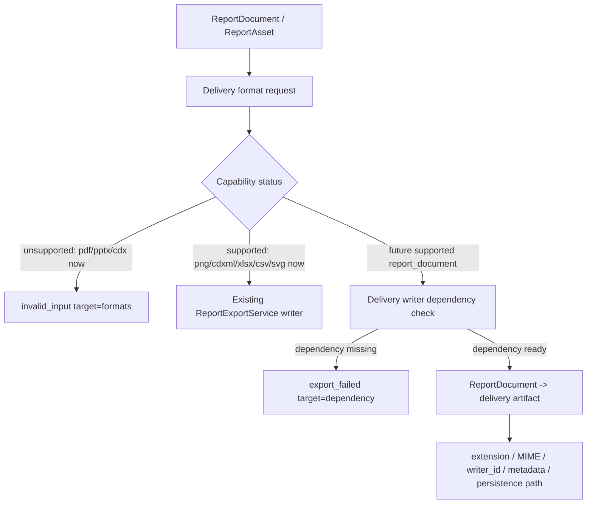

# delivery-format-boundary-spike design

## 0. 术语约定

- Delivery Format Boundary：`ReportDocument` / `ReportAsset` 进入用户可下载交付文件前必须满足的格式、依赖、运行位置、错误码和 QA 边界。
- Delivery Writer：未来从 `ReportDocument` 生成 PDF、PPTX、HTML 等完整报告文件的 writer；它不是当前 `ReportExportService` 的 PNG/CDXML/XLSX/CSV/SVG 单文件 writer。
- Unsupported Capability：格式存在于 capability table 中，但 `status="unsupported"`，不进入 `ALLOWED_EXPORT_FORMATS`、Shell/Web `ExportFormat`、Web 默认 checkbox 或 browser persistence allowlist。
- Dependency Failure：未来 writer 已经 supported，但运行时依赖缺失或不可用；应返回 `export_failed target=dependency`，不同于当前未开放格式的 `invalid_input target=formats`。
- SVG Asset Reuse：已落地的 projection-based `svg` graph snapshot 可作为组合报告矢量资产引用；复用时仍禁止远程资源、script、`foreignObject` 和 Web transient state。

## 1. 决策与约束

### 需求摘要

实现 roadmap item `delivery-format-boundary-spike`：在不开放 PDF/PPTX/CDX writer 的前提下，把这三种格式的依赖候选、运行位置、进入 supported set 的条件、错误码和 Web unsupported 口径固定下来；同时明确已支持的 SVG graph snapshot 如何被后续组合报告 writer 复用。成功标准不是“能导出 PDF/PPTX/CDX”，而是后续要开放任一格式时有可测试的准入门槛，当前用户界面和 core API 不会误导用户。

### 外部调研结论

| 格式 | 可参考依赖 | 调研事实 | 本 feature 结论 |
|---|---|---|---|
| PDF | Playwright / WeasyPrint / ReportLab | Playwright `page.pdf()` 可返回 PDF buffer，并按 print CSS media 生成页面 PDF；WeasyPrint 是 HTML/CSS 到 PDF 的渲染引擎；两者都意味着需要先定义 HTML/print layout 或渲染运行时。 | 保持 unsupported；未来 PDF writer 必须先定义 `ReportDocument -> paged layout`，并声明本地/CI/Vercel 中浏览器或 Python renderer 的可用策略。 |
| PPTX | python-pptx | python-pptx 文档展示了创建 `.pptx`、保存文件、插入图片和插入表格的 API；这支持它作为候选 writer，但不等于 RxnFlow 已有 slide contract。 | 保持 unsupported；未来 PPTX writer 可优先评估 python-pptx，但必须定义 slide size、表格/图片/图谱对象策略，不能把 HTML screenshot 当作 editable PPTX。 |
| CDX | Open Babel / ChemDraw ecosystem | Open Babel 文档显示 CDXML 只有 minimal chemical structure support，CDX 是 read-only format，且许多 CDX reaction 可能无法被完整解释。 | 保持 unsupported；当前 ChemDraw 交付路径仍是 CDXML。CDX 只有在可靠 writer/converter、license、平台和回归测试都明确后才能进入 supported。 |

参考来源：

- Playwright Python `page.pdf()` API: <https://playwright.dev/python/docs/api/class-page#page-pdf>
- WeasyPrint documentation: <https://doc.courtbouillon.org/weasyprint/stable/>
- python-pptx documentation: <https://python-pptx.readthedocs.io/_/downloads/en/stable/pdf/>
- Open Babel CDXML format documentation: <https://openbabel.org/docs/FileFormats/ChemDraw_CDXML_format.html>
- Open Babel CDX format documentation: <https://openbabel.org/docs/FileFormats/ChemDraw_binary_format.html>

### 复杂度档位

走 boundary / spike 中等档。它不新增 writer 和 UI 交互，但会影响长期格式准入规则、错误语义和文档口径；如果写得过松，后续容易把浏览器截图、平台专属转换器或不可验证依赖包装成“支持 PDF/PPTX/CDX”。

### 关键决策

- `pdf`、`pptx`、`cdx` 本轮继续保持 `status="unsupported"`，不加入 core/Web supported `ExportFormat` union，不进入 Web 默认 checkbox，不写 browser-local export artifacts。
- 当前请求 `formats=("pdf",)`、`("pptx",)` 或 `("cdx",)` 仍返回 `invalid_input target=formats`，`details.supported` 只列当前可执行格式。
- 未来当某个 delivery writer 已 supported 但依赖缺失时，才使用 `export_failed target=dependency`；这条语义不用于当前未开放格式。
- PDF 的推荐后续路线暂不拍板。可选方向是 `ReportDocument -> HTML/print layout -> Playwright/WeasyPrint` 或 `ReportDocument -> direct PDF layout -> ReportLab`；进入实现前必须先选定运行位置和视觉/结构回归策略。
- PPTX 的推荐后续候选是 `python-pptx`，但只有在 table、image、chart/diagram、slide size、SVG rasterization 或 embedding 策略明确后才开放。
- CDX 不以 Open Babel/RDKit 作为当前输出链；它们的公开文档更支持“解析/基础化学结构能力有限”的谨慎判断，不能证明 RxnFlow 可稳定写 ChemDraw binary CDX。
- CDXML 继续作为当前 ChemDraw 首选交付格式；它已经是 supported energy diagram writer，不因 CDX unsupported 而降级。
- SVG graph snapshot 已是 supported artifact，可被 future PDF/PPTX/HTML writer 作为 `ReportAsset` 引用；writer 复用前必须验证 XML/SVG 安全边界，不读取 Web DOM/canvas。

### 明确不做

- 不新增 PDF、PPTX、CDX、HTML、DOCX 或完整报告 writer。
- 不把 `pdf`、`pptx`、`cdx` 加入 `ALLOWED_EXPORT_FORMATS`、Shell/Web `ExportFormat`、Web checkbox、download link 或 browser persistence allowlist。
- 不引入 Playwright、WeasyPrint、ReportLab、python-pptx、Open Babel、RDKit、ChemScript、ChemDraw 或 Revvity 作为运行时依赖。
- 不实现 HTML preview screenshot 到 PDF/PPTX 的捷径。
- 不把 CDXML 自动转换成 CDX，不要求用户安装 ChemDraw，也不写平台专属转换脚本。
- 不改变现有 PNG/CDXML/XLSX/CSV/SVG writer bytes 生成逻辑。

### 前置依赖

- `report-composer-manifest` 已 done：后续 delivery writer 的共同输入是 `ReportDocument` / `ReportAsset`，不是 Web UI state。
- `export-graph-snapshot-svg` 已 done：SVG graph snapshot 已具备 projection-based writer 和 artifact metadata。
- `export-format-capability-matrix` 已 done：`pdf/pptx/cdx` 已存在 unsupported capability 记录。

## 2. 名词与编排

### 2.1 名词层：值对象 / 接口契约

**现状**

- `rxnflow.export.ExportFormat` 当前只包含 `png/cdxml/xlsx/csv/svg`，`ALLOWED_EXPORT_FORMATS` 从 capability table 的 supported set 派生。
- `EXPORT_FORMAT_CAPABILITIES` 已记录 `pdf/pptx/cdx` 的 extension、MIME、artifact kind、unsupported reason；它们没有 `writer_id`。
- Web `exportFormatCapabilities` 镜像 core 口径，`reportExportFormats()` 只返回 supported + web default enabled 的格式。
- `ReportDocument` / `ReportAsset` 已提供 JSON-safe manifest 引用，但尚无 delivery writer contract。

**变化**

新增一份文档化的 boundary matrix，作为未来 writer feature 的准入契约。它不必马上变成运行时代码，但字段含义必须能映射回现有 capability table：

```text
format: pdf | pptx | cdx | svg
current_status: supported | unsupported
current_role: graph_snapshot_asset | future_report_document | external_conversion
runtime_location: core_python | platform_shell | web_browser | external_tool | undecided
dependency_strategy: none | optional_python_package | browser_runtime | external_converter
entry_conditions: list[str]
unsupported_error: invalid_input target=formats
dependency_error_when_supported: export_failed target=dependency
web_visibility: default_checkbox | disabled_capability_message | docs_only
```

格式边界表：

| format | current status | runtime / dependency boundary | entry conditions |
|---|---|---|---|
| `svg` | supported | core Python projection renderer；无浏览器运行时依赖 | valid XML/SVG；无 remote resource/script/foreignObject；metadata 标明 `artifact_kind=graph_snapshot`；可作为 `ReportAsset` 被 writer 引用。 |
| `pdf` | unsupported | 运行位置未定；候选为 browser runtime 或 Python PDF renderer | 先定义 `ReportDocument -> page layout`；固定 paper size、分页、字体/颜色、asset embedding；dependency missing 返回 `export_failed target=dependency`；本地/CI/Vercel 可验证或稳定 skip。 |
| `pptx` | unsupported | 候选为 optional Python package；不能依赖 Web screenshot | 先定义 slide size、slide sequence、editable table/image/chart strategy、SVG embedding/rasterization、metadata/warnings；dependency missing 返回 `export_failed target=dependency`。 |
| `cdx` | unsupported | 需要可靠 writer/converter 或 ChemDraw/Revvity 相关链路；当前无依赖 | 先记录第三方 dependency、license、平台可用性、conversion input/output、失败 fallback 和 ChemDraw 兼容回归；否则 CDXML 继续是 ChemDraw 交付格式。 |

### 2.2 编排层：主流程与控制流



**现状**

`ReportExportService.export()` 在 `_validate_export_request()` 中先校验 `ALLOWED_EXPORT_FORMATS`，不支持格式直接返回 `invalid_input target=formats`。已支持 writer 在 `_render_format()` 中遇到缺失依赖时返回 `export_failed target=dependency`。Web 端不会把 unsupported format 放进默认导出表单，也不会持久化 unsupported artifact。

**变化**

- 设计层固定当前状态：PDF/PPTX/CDX 保持 unsupported，SVG 保持 supported graph snapshot asset。
- 文档和测试要明确区分两种失败：未开放格式是 `invalid_input target=formats`；已开放 writer 的运行时依赖缺失才是 `export_failed target=dependency`。
- Web unsupported 口径只来自 capability table / docs，不新增可点击导出入口；如果后续 UI 要展示 disabled format，也必须显示 `unsupportedReason`，不能让用户点出一个必失败 command。
- 后续 writer feature 必须先消费 `ReportDocument`，再决定是否生成 `ExportArtifact(kind="report_document")` 或单独 delivery artifact；不得直接从 Web preview DOM、React state 或 browser-local Blob 取数。

**跨层纪律**

- 错误语义：unsupported request 保持 `invalid_input target=formats`；supported writer dependency failure 使用 `export_failed target=dependency`；conversion failure 使用 `export_failed target=<format>` 并带 warnings/fallback metadata。
- 幂等性：delivery writer 一旦 supported，其 output metadata 必须包含 extension、MIME、writer_id、format_status、report manifest schema/version、asset ids 和 warnings。
- 运行位置：core Python writer、Platform Shell adapter、Web browser renderer、external tool converter 必须明确归属；不能把依赖散落在 UI component 内。
- 可观测点：tests/docs 需要能证明 `pdf/pptx/cdx` 没进入 supported set、Web default set 或 persistence allowlist；SVG 仍满足 XML/SVG 安全复用边界。

### 2.3 挂载点清单

- Delivery boundary design：新增本 design，固定 `pdf/pptx/cdx/svg` 格式边界和后续准入条件。
- Roadmap item linkage：把 `delivery-format-boundary-spike` 标为 in-progress 并指向本 feature 目录。
- Future implementation docs/tests：确认后补开发者/用户指南与 core/Web tests，锁定 unsupported 与 dependency error 语义。
- Architecture notes：acceptance 阶段回写 core-platform / ARCHITECTURE 中的 delivery writer boundary。

### 2.4 推进策略

1. Boundary design：落设计稿并和用户确认 PDF/PPTX/CDX 继续 unsupported、SVG 只作为 graph snapshot asset 复用。
   退出信号：设计中列出每个格式的 runtime/dependency/error/web visibility 边界。
2. Capability/doc contract：实现阶段只补 capability reason、developer/user docs 和 architecture 文案，不开放新 writer。
   退出信号：文档能回答“为什么当前不能导 PDF/PPTX/CDX”和“以后开放要满足什么”。
3. Guard tests：补 core/Web tests，固定 supported set、unsupported request error、Web default formats 和 persistence skip。
   退出信号：请求 `pdf/pptx/cdx` 仍为 `invalid_input target=formats`；Web helper 不把它们列入默认或 persistence。
4. SVG reuse checks：补文档或测试确认 SVG graph snapshot 不含 remote resource/script/foreignObject，未来 writer 只引用 artifact。
   退出信号：已有 SVG XML/security 边界在 delivery 文档中可追溯。
5. Acceptance sync：回写 architecture、roadmap 和 acceptance report。
   退出信号：roadmap item done、YAML 校验和相关 tests 通过。

## 3. 验收契约

### 关键场景清单

- 触发：core 查询 capability table → 期望包含 `pdf/pptx/cdx` 记录，但 `supported_export_formats()` 仍只包含 `png/cdxml/xlsx/csv/svg`。
- 触发：core 请求 `formats=("pdf",)`、`("pptx",)` 或 `("cdx",)` → 期望返回 `invalid_input target=formats`，`details.supported` 不包含它们。
- 触发：Web `reportExportFormats()` → 期望默认只返回 supported + web default enabled 格式，不包含 `pdf/pptx/cdx`。
- 触发：Web persistence 收到 unsupported `pdf/pptx/cdx` artifact projection → 期望不写 `exports/...`，不写 `export-artifacts-v1` record。
- 触发：开发者阅读 docs → 期望能看到 PDF、PPTX、CDX 的候选依赖、当前不支持原因、未来进入条件和 dependency error 语义。
- 触发：用户阅读 docs FAQ → 期望知道当前可导出 PNG/CDXML/XLSX/CSV/SVG，CDXML 是当前 ChemDraw 路径，PDF/PPTX/CDX 暂不可下载。
- 触发：后续 writer feature 设计 → 期望必须从 `ReportDocument` / `ReportAsset` 输入开始，并定义 extension、MIME、writer_id、metadata、persistence path 和 warning semantics。

### 明确不做的反向核对项

- 不新增任何 PDF/PPTX/CDX bytes writer。
- 不新增 PDF/PPTX/CDX Web checkbox、download link 或 browser persistence。
- 不引入新的运行时依赖或外部转换工具。
- 不把 HTML preview screenshot 当作 PDF/PPTX 的正式报告输出。
- 不降低或替换现有 CDXML writer；CDXML 仍是 ChemDraw 当前可用交付格式。

## 4. 与项目级架构文档的关系

Acceptance 阶段需要回写：

- `codestable/architecture/core-platform.md`：记录 delivery writer 当前边界、unsupported/dependency error 分界和 PDF/PPTX/CDX 准入条件。
- `codestable/architecture/ARCHITECTURE.md`：术语表补 Delivery Format Boundary / Delivery Writer。
- `docs/dev/report-export-artifacts.md`：补 PDF/PPTX/CDX 依赖边界、SVG 复用边界和未来 writer 准入 checklist。
- `docs/user/report-export-artifacts.md`：FAQ 更新为当前可导格式与暂不可导格式。
- `codestable/roadmap/rxnflow-report-preview-delivery/rxnflow-report-preview-delivery-roadmap.md`：验收时把该 item 标为 done，并保留下一步 QA/guides。
