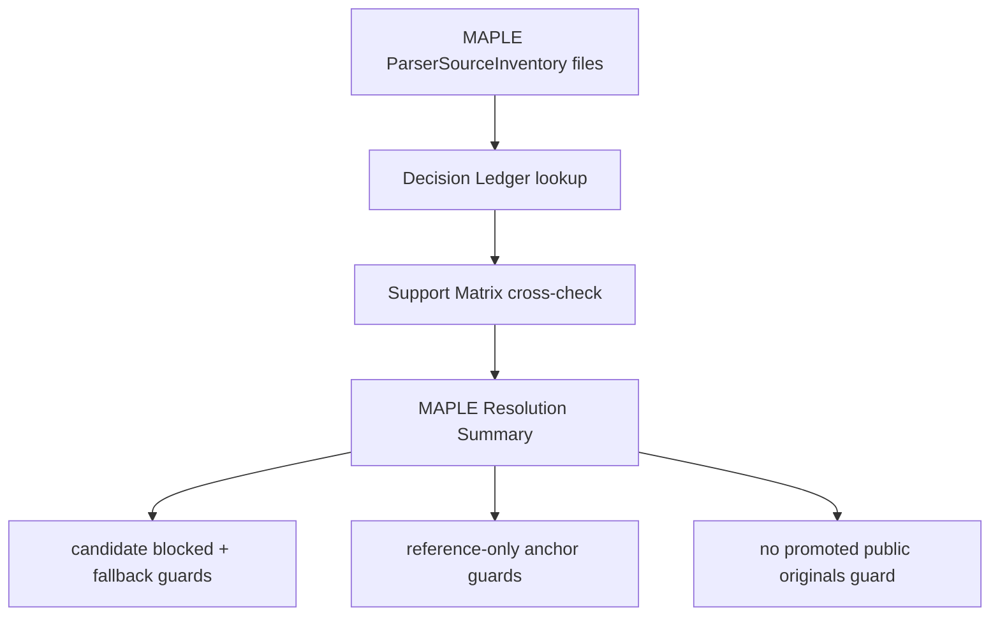

# maple-public-candidate-resolution design

## 0. 术语约定

- **MAPLE Candidate Resolution**：对 `maple-dev-example` source 下每个 source file 的当前 intake 结论做可复核归档：能不能 promotion、为什么不能、用哪个 fallback 或 reference anchor 继续证明边界。
- **MAPLE Resolution Summary**：从 `ParserSourceInventory`、`Public Fixture Decision Ledger` 和 `Parser Support Matrix` 派生出的测试侧汇总，列出 MAPLE candidate files、reference-only files、promoted files、blocked candidates、fallback fixtures 和 unresolved files。
- **Blocked MAPLE Candidate**：`fixture_policy: candidate` 但 decision 不是 `allowed/promoted` 的 MAPLE source file；当前应保持 `needs-permission/blocked` 并带 fallback fixture。
- **MAPLE Reference Anchor**：`fixture_policy: reference-only` 的 MAPLE source file；当前只用于 support matrix 和 decision ledger 的 reference link，不进入 executable fixtures。
- **MAPLE Fallback Fixture**：项目内 synthetic 或 synthetic-derived fixture，用于在不能 vendor MAPLE original 时固定 parser shape / frame shape 行为。
- **MAPLE Promotion Outcome**：MAPLE source file 的当前 promotion 结果；只有 `decision: allowed` 且 `promotion: promoted` 才能进入 `files/`。本 feature 当前预期无 promoted MAPLE originals。

术语 grep 结论：当前已有 `Parser Source Inventory`、`Public Fixture Decision Ledger`、`Parser Support Matrix`、`Candidate Fetch Verify` 和 MAPLE synthetic-derived fixtures。本 feature 不新增 runtime parser 概念，不把 MAPLE path/frequency/MD/scan 语义引入 core。

## 1. 决策与约束

### 需求摘要

public fixture intake roadmap 的下一步是 MAPLE candidate resolution。当前 `sources.yaml` 中 `maple-dev-example` 有 3 个 candidate files 和 14 个 reference-only files；`public-fixture-decisions.yaml` 已经把 3 个 candidate 记录为 `needs-permission/blocked`，并把 path/scan/MD/frequency 等文件记录为 `reference-only/not-applicable`。

本 feature 的目标不是改变这些文件的版权/授权结论，而是把 MAPLE resolution 变成可机检、可验收的状态：所有 MAPLE source file 都必须被 resolution summary 覆盖；所有 MAPLE public originals 当前不得 promoted；candidate 必须有 fallback fixture；reference-only 必须有 reference anchor；support matrix 不得把 MAPLE public originals 加进 executable fixture ids。

### 明确不做

- 不 vendor ClickFF/MAPLE public originals，不新增 MAPLE third-party file 到 `tests/fixtures/parsers/files/`。
- 不把 MAPLE candidate decision 改成 `allowed/promoted`，除非用户后续提供明确授权证据。
- 不修改 MAPLE parser runtime，不新增 `.sum`、scan、MD、frequency、AutoNEB tree 或 path topology 解析。
- 不生成 ReactionPath、TS candidate、direction/topology、energy profile 或 graph object。
- 不修改 import workflow、Platform Shell、Web UI 或 report export。
- 不运行 MAPLE 或任何外部计算任务。
- 不让普通 unit tests 访问网络或 GitHub clone。
- 不把 `reference-only` 文件描述成 supported/executable fixture。

### 复杂度档位

测试侧/dev tooling feature，默认低复杂度。偏离点：

- MAPLE source file 类型跨度大，candidate 和 reference-only 必须分开处理，避免把 path/frequency/MD/scan 领域语义塞进 parser。
- 当前没有用户授权证据，resolution 需要明确“无 promoted MAPLE originals”也是一个有效结论。
- 支持矩阵、decision ledger 和 fallback fixtures 三者需要交叉校验，防止一个文件在某处被标成 candidate、另一处被误当 supported。

### 关键决策

1. **resolution summary 派生而非新事实源**：MAPLE Resolution Summary 从现有 source inventory、decision ledger 和 support matrix 派生，不新建第二份 MAPLE 决策 YAML。
2. **无授权则不 promotion**：当前 MAPLE candidates 保持 `needs-permission/blocked`，不把 fetch/hash verify 成功等同为可再分发。
3. **reference-only 保持 reference-only**：scan/path/MD/frequency `.out` / `.xyz` / `.sum` / JSON 只作为 reference anchor，不进入 manifest fixture ids。
4. **fallback 是项目内 fixture**：candidate fallback 只能指向 manifest 中已有 synthetic / synthetic-derived executable fixtures。
5. **parser runtime 不变**：本 feature 只增强 fixture intake 的可审计性，不扩展 `rxnflow.parsers.maple`。

## 2. 名词与编排

### 2.1 名词层：值对象 / 接口契约

**现状**

- `ParserSourceInventory` 能读取 `maple-dev-example` 下所有 source files，并按 `fixture_policy` 区分 candidate / reference-only。
- `ParserPublicFixtureDecisionLedger` 能按 `source_id + file_id` 查询 decision、promotion、fallback 和 reference anchors。
- `ParserSupportMatrix` 能记录 MAPLE candidate entries、synthetic-derived fallback entries 和 reference-only entries。
- 当前没有一个测试侧 summary 把 MAPLE candidate/reference/promoted/unresolved 状态聚合起来。

**变化**

新增测试侧派生契约：

```python
@dataclass(frozen=True)
class ParserMaplePublicResolutionSummary:
    source_id: str
    candidate_file_ids: tuple[str, ...]
    reference_file_ids: tuple[str, ...]
    promoted_file_ids: tuple[str, ...]
    blocked_candidate_file_ids: tuple[str, ...]
    fallback_fixture_ids: tuple[str, ...]
    unresolved_file_ids: tuple[str, ...]
```

最小 helper shape：

```python
def summarize_maple_public_candidate_resolution(
    source_inventory: ParserSourceInventory,
    decision_ledger: ParserPublicFixtureDecisionLedger,
    support_matrix: ParserSupportMatrix,
    *,
    source_id: str = "maple-dev-example",
) -> ParserMaplePublicResolutionSummary:
    ...
```

约束：

- `source_id` 必须存在且 `program == "maple"`。
- summary 必须覆盖该 source 下所有 file ids。
- `candidate_file_ids` 来自 source inventory 中 `fixture_policy: candidate`。
- `reference_file_ids` 来自 source inventory 中 `fixture_policy: reference-only`。
- `promoted_file_ids` 只能来自 decision `allowed/promoted`；当前预期为空。
- `blocked_candidate_file_ids` 必须覆盖所有未 promoted candidates，且每个都必须有 fallback fixture。
- `unresolved_file_ids` 必须为空；出现未知 policy、缺 decision、candidate 无 fallback、reference-only 无 self reference anchor 或 support matrix 误挂 executable fixture 时应由 helper/test guard 暴露。

### 2.2 编排层：主流程与控制流



**现状**

MAPLE source inventory、decision ledger 和 support matrix 已分别记录事实，但没有 MAPLE-specific resolution summary 证明三者对齐。开发者需要人工比对 3 个 candidates、14 个 reference-only files、fallback fixtures 和 support matrix entries。

**变化**

- 增加测试侧 MAPLE resolution summary helper。
- 增加 focused tests 证明当前 MAPLE source file ids 全覆盖、candidate 全 blocked、有 fallback、reference-only 有 reference anchors、promoted originals 为空。
- 增加 support matrix guard，证明 MAPLE public candidate originals 不进入 `fixture_ids`，reference-only files 只进入 `reference_file_ids`。
- 更新 developer guide，说明 MAPLE 当前 resolution 结论和后续需要用户授权时如何推进。

**跨层纪律**

- 错误语义：resolution guard 继续用 `AssertionError` 暴露不一致；不静默修正 ledger 或 support matrix。
- 幂等性：同一 inventory/ledger/matrix 派生同一 summary；helper 不写文件。
- 许可证纪律：fetch/hash verify 或 candidate 存在不等于 redistributable；无授权时 promoted set 必须为空。
- 领域语义纪律：path/frequency/MD/scan reference anchors 不升级为 parser 支持声明。
- 可观测点：focused tests、YAML validation、scope diff、developer guide 和 acceptance 报告。

### 2.3 挂载点清单

- `tests/parser_fixture_harness.py`：新增 MAPLE resolution summary dataclass/helper。
- `tests/test_parser_fixture_harness.py`：新增 MAPLE resolution focused tests 和 support matrix guards。
- `docs/dev/parser-fixture-corpus.md`：新增 MAPLE Candidate Resolution 维护说明。
- CodeStable 回写：roadmap item in-progress，acceptance 归并 architecture/roadmap。

不挂入 parser runtime、ImportRegistryWorkflow、Platform Shell、Web UI、manifest fixture files、snapshots 或 report export。

### 2.4 推进策略

1. **Resolution summary contract**：定义 MAPLE resolution summary dataclass/helper，从 inventory + decision ledger + support matrix 派生当前状态。
   - 退出信号：summary 能覆盖 `maple-dev-example` 全部 source file ids，并正确分类 3 个 candidate 与 14 个 reference-only files。
2. **MAPLE resolution guards**：补 focused tests，证明 candidates blocked with fallback、reference-only self anchors、promoted originals empty。
   - 退出信号：缺 decision、candidate fallback 缺失、reference-only anchor 缺失或非 MAPLE source 会被拒绝/暴露。
3. **Support matrix and docs guard**：补 support matrix consistency tests 和 developer guide。
   - 退出信号：MAPLE public originals 未进入 executable fixture ids；docs 明确当前无 promoted MAPLE originals、path/frequency/MD/scan 仍 reference-only；focused tests 和 `git diff --check` 通过。

## 3. 验收契约

### 关键场景清单

1. 能从当前 `sources.yaml` / `public-fixture-decisions.yaml` / `support-matrix.yaml` 派生 `ParserMaplePublicResolutionSummary`。
2. summary 覆盖 `maple-dev-example` 的全部 17 个 source file ids，无 missing/extra/unresolved。
3. summary 中 candidate file ids 精确为 `maple-sp-output-example`、`maple-opt-output-example`、`maple-opt-final-xyz-example`。
4. summary 中 promoted file ids 为空。
5. 每个 MAPLE candidate 当前都是 `needs-permission/blocked`，并带至少一个 fallback fixture。
6. 每个 MAPLE candidate fallback fixture 存在于 manifest，且 source.kind 为 `synthetic`。
7. 每个 MAPLE reference-only file 保持 `reference-only/not-applicable`，并以自身 file id 作为 reference anchor。
8. path-family reference files 可以有 `maple-path-family-synthetic-derived` fallback，但不得被描述为 ReactionPath/topology support。
9. support matrix 中 `maple-output-public-candidates` 仍为 `candidate`，`fixture_ids` 为空。
10. support matrix 中 MAPLE reference entries 仍为 `reference-only`，`fixture_ids` 为空，reference file ids 与 source inventory 对齐。
11. MAPLE public-shape executable coverage 仍只指向项目内 synthetic-derived fallback fixtures，不 vendor originals。
12. Docs 明确 MAPLE resolution 当前结论：无 promoted public originals；candidate blocked pending permission；scan/path/MD/frequency remain reference-only。
13. Scope guard 证明未新增 MAPLE third-party files，未改 MAPLE parser runtime、Import Workflow、Platform Shell、Web UI 或 report export。

### 明确不做的反向核对项

- 不 vendor ClickFF/MAPLE public originals。
- 不把任何 MAPLE source file 改成 `allowed/promoted`。
- 不新增 executable fixture、golden snapshot 或 support matrix `fixture_ids` 指向 MAPLE original。
- 不修改 `rxnflow.parsers.maple`。
- 不把 path/frequency/MD/scan reference-only 文件声明为 supported。
- 不运行外部 MAPLE 计算任务。
- 不让普通 tests 访问网络。
- 不修改 import workflow、Platform Shell、Web UI 或 report export。

## 4. 与项目级架构文档的关系

Acceptance 阶段需要更新：

- `codestable/architecture/ARCHITECTURE.md`：在 Parser Fixture Corpus / Parser Fixture Harness 当前边界中补 MAPLE Candidate Resolution summary/guards。
- `codestable/architecture/core-platform.md`：在 Parser Fixture Harness 当前能力和 MAPLE fixture coverage 边界中补 resolution summary，强调 MAPLE originals 仍未 vendor。
- `docs/dev/parser-fixture-corpus.md`：补 MAPLE Candidate Resolution 维护入口和当前 blocked/reference-only 口径。
- `codestable/roadmap/rxnflow-parser-public-fixture-intake/*`：验收时把 `maple-public-candidate-resolution` 标为 done，并同步主文档。
