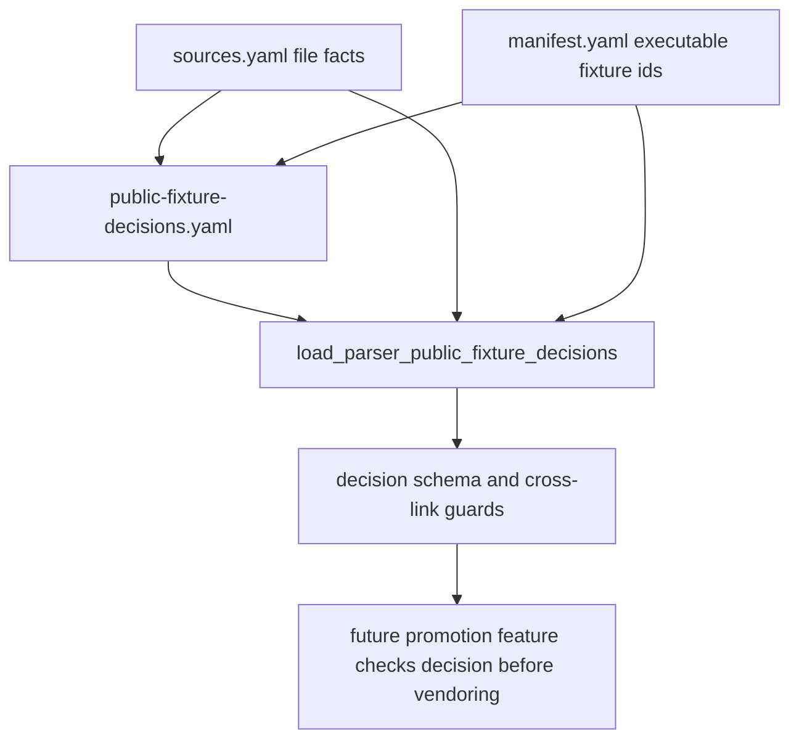

# parser-public-fixture-decision-ledger design

## 0. 术语约定

- **Public Fixture Decision Ledger**：`tests/fixtures/parsers/public-fixture-decisions.yaml`，记录 source inventory 中候选/引用文件能否进入 executable fixture corpus 的机器可读决策清单。
- **Public Fixture Decision**：针对一个 `source_id + file_id` 的单条决策，包含 evidence、decision、promotion、reason、fallback 和 reviewer。
- **Decision Evidence**：支持决策的证据项，可以是 license URL、本地 doc/source inventory、用户授权说明或人工复核备注。
- **Decision State**：`allowed`、`needs-permission`、`rejected`、`synthetic-only`、`reference-only` 之一，表示再分发/进入 corpus 的决策结论。
- **Promotion State**：`promoted`、`blocked`、`not-applicable` 之一，表示该 source file 是否进入 executable fixture corpus。
- **Fallback Fixture**：当 public original 不能 vendor 时继续承担 parser 行为回归的项目内 synthetic / synthetic-derived fixture。

术语 grep 结论：现有 `Parser Source Inventory`、`Fixture Manifest`、`Parser Support Matrix` 已落地；本 feature 在 source inventory 和后续 promotion 之间新增 decision ledger，不替代三者，也不进入 runtime parser API。

## 1. 决策与约束

### 需求摘要

`rxnflow-parser-public-fixture-intake` 的最小闭环是建立 gate，避免 MAPLE/cclib-data 等 `review-required` source 被误复制进 executable fixture corpus。当前 `sources.yaml` 已登记 MAPLE/cclib-data candidates 和 reference-only files，也已记录 ASE extxyz project-authored vendored fixtures，但没有逐文件“是否能 promotion、为什么不能、用哪个 fallback”的机器可读结论。

本 feature 新增 decision ledger 和 loader/schema guard，让后续 MAPLE/cclib/extxyz promotion feature 必须先查 decision。首轮 ledger 会覆盖当前所有 candidate/reference-only source files，并把 project-authored extxyz vendored fixtures标为 allowed/promoted 或 not-applicable，形成可审计入口。

### 明确不做

- 不 vendor MAPLE、cclib-data 或任何新的第三方 public output 文件。
- 不新增 executable fixture、golden snapshot 或 parser support matrix `fixture_ids`。
- 不修改 parser runtime、ImportRegistryWorkflow、Platform Shell、Web UI 或报告导出。
- 不运行 Gaussian、ORCA、MAPLE、ASE 或任何外部计算任务。
- 不自动判断许可证；只记录 evidence 与保守决策。
- 不把 `needs-permission`、`reference-only`、`synthetic-only` 或 `rejected` 文件描述为 supported fixture。
- 不改变 `parser-source-inventory-v1` / `parser-fixtures-v1` / `parser-support-matrix-v1` schema version。
- 不让普通 tests 访问网络或外部 clone。

### 复杂度档位

测试侧数据契约 feature。偏离点：

- 决策清单要绑定 `sources.yaml` 的 `source_id/file_id`，同时又不能要求每个 future source 立即有 decision。
- 当前首轮只应覆盖已知 candidate/reference-only/vendored source files，保持 loader 可复用。
- MAPLE/cclib-data 的 license evidence 仍不稳定，因此首轮决策必须保守，不能把 review-required 自动提升为 allowed。

### 关键决策

1. **新增独立 YAML，而不是把 decision 塞进 `sources.yaml`**：source inventory 记录来源事实；decision ledger 记录项目选择。二者分开便于后续 source facts 更新时保留历史决策。
2. **首轮覆盖当前 source inventory 全部 file ids**：这样后续 promotion feature 能直接看到所有当前 candidate/reference/vendored 文件的决策状态。
3. **allowed/promoted 是唯一可 vendor 原件的组合**：后续 manifest 中 `vendored-third-party` 若加 `decision_id`，必须能追溯到该组合。
4. **blocked 决策必须有 fallback 或 reference-only 说明**：不能只写“不行”，要说明后续 parser 行为如何继续被证明。
5. **不扩展 runtime**：loader/dataclass 仍只在 `tests/parser_fixture_harness.py`，和现有 manifest/source/support matrix loader 同一边界。

## 2. 名词与编排

### 2.1 名词层：值对象 / 接口契约

**现状**

- `tests/fixtures/parsers/sources.yaml` 记录 source 和 file facts，包括 `fixture_policy`、license、hash、size 和 notes。
- `manifest.yaml` 只记录 executable fixture；`vendored-third-party` source 已有 upstream path/hash/size guard，但当前没有第三方 original fixture。
- `support-matrix.yaml` 用 `candidate_file_ids` / `reference_file_ids` 指向 source inventory，但没有 promotion decision。
- `tests/parser_fixture_harness.py` 没有 decision ledger dataclass、loader 或 cross-check。

**变化**

新增 `tests/fixtures/parsers/public-fixture-decisions.yaml`：

```yaml
schema_version: parser-public-fixture-decisions-v1
decisions:
  - id: maple-dev-example:maple-sp-output-example
    source_id: maple-dev-example
    file_id: maple-sp-output-example
    checked_at: "2026-06-02"
    evidence:
      - kind: source-inventory
        ref: tests/fixtures/parsers/sources.yaml
        note: "Source redistributable_default is review-required."
      - kind: license-url
        ref: https://github.com/ClickFF/MAPLE
        note: "License page includes BSD 3-Clause text plus academic/commercial notice."
    decision: needs-permission
    promotion: blocked
    reason: "Redistribution boundary is not clear enough to vendor original output."
    fallback_fixture_ids:
      - maple-sp-public-shape-synthetic-derived
    reference_file_ids: []
    reviewer: agent
```

新增测试侧契约：

```python
PARSER_PUBLIC_FIXTURE_DECISIONS_SCHEMA_VERSION = "parser-public-fixture-decisions-v1"
PUBLIC_FIXTURE_DECISIONS = {
    "allowed",
    "needs-permission",
    "rejected",
    "synthetic-only",
    "reference-only",
}
PUBLIC_FIXTURE_PROMOTIONS = {"promoted", "blocked", "not-applicable"}

@dataclass(frozen=True)
class ParserPublicFixtureDecisionEvidence:
    kind: str
    ref: str
    note: str

@dataclass(frozen=True)
class ParserPublicFixtureDecision:
    id: str
    source_id: str
    file_id: str
    checked_at: str
    evidence: tuple[ParserPublicFixtureDecisionEvidence, ...]
    decision: str
    promotion: str
    reason: str
    fallback_fixture_ids: tuple[str, ...]
    reference_file_ids: tuple[str, ...]
    reviewer: str

@dataclass(frozen=True)
class ParserPublicFixtureDecisionLedger:
    root: Path
    decisions: tuple[ParserPublicFixtureDecision, ...]
```

Loader shape:

```python
def load_parser_public_fixture_decisions(
    path: Path,
    *,
    source_inventory: ParserSourceInventory | None = None,
    manifest: ParserFixtureManifest | None = None,
) -> ParserPublicFixtureDecisionLedger:
    ...
```

约束：

- `id` 推荐格式 `{source_id}:{file_id}`，loader 要求唯一。
- `source_inventory` 传入时，`source_id/file_id` 必须存在且属于同一 source。
- `manifest` 传入时，`fallback_fixture_ids` 必须存在于 manifest。
- `reference_file_ids` 必须存在于 source inventory，且对应 file `fixture_policy=reference-only`。
- `promotion=promoted` 只允许 `decision=allowed`。
- `promotion=blocked` 时必须有非空 `reason`，且至少有 fallback fixture 或 reference file。
- `decision=reference-only` 必须 `promotion=not-applicable` 或 `blocked`，并且 reference path 可追溯。
- `decision=synthetic-only` 必须带 fallback fixture。

### 2.2 编排层：主流程与控制流



**现状**

Public candidates 的状态只能从 `sources.yaml` 和 support matrix known limits 读出，缺少单文件 decision。

**变化**

- decision ledger 明确记录每个当前 source file 的 promotion 决策。
- loader 负责基础 schema、状态枚举、source/file/fallback/reference cross-check。
- focused tests 证明 review-required candidates 不能被误标 promoted，且 blocked 状态必须有 fallback/reference。

**跨层纪律**

- 错误语义：沿用 parser fixture harness 的 `AssertionError`，错误消息应指出 ledger field 或 source/file id。
- 幂等性：loader 只读 YAML，不写文件、不访问网络。
- 扩展点：future promotion feature 可以读取 ledger 并要求 `allowed/promoted` before vendoring。
- 可观测点：YAML validation、`tests.test_parser_fixture_harness` focused tests、scope grep 证明没有新增第三方 files。

### 2.3 挂载点清单

- `tests/fixtures/parsers/public-fixture-decisions.yaml`：新增 decision ledger 数据。
- `tests/parser_fixture_harness.py`：decision ledger dataclass、loader、state/cross-link guard。
- `tests/test_parser_fixture_harness.py`：正向加载和拒绝分支测试。
- `docs/dev/parser-fixture-corpus.md`：新增 public fixture decision ledger 维护说明。
- CodeStable 回写：roadmap item in-progress、后续 acceptance 归并 architecture/roadmap。

不挂入 parser runtime、import workflow、Project Content、Web UI、report export、fixture files 或 snapshots。

### 2.4 推进策略

1. **Ledger schema design**：定义 YAML shape、decision/promotion enum 和 cross-link 规则。
   - 退出信号：design/checklist 和 roadmap item 已建立，YAML 校验通过。
2. **Decision data**：新增 `public-fixture-decisions.yaml`，覆盖当前 source inventory 中的 MAPLE/cclib-data candidates/reference files 和 ASE project-authored vendored files。
   - 退出信号：每个当前 source file id 都有一条 decision，blocked/reference-only/synthetic-only 都有 reason 和 fallback/reference。
3. **Harness loader**：实现 dataclass/loader/cross-check。
   - 退出信号：正向加载通过，未知 source/file、bad enum、promoted without allowed、blocked without fallback/reference、unknown fallback/reference file 均被拒绝。
4. **Docs and validation**：更新 developer guide，运行 focused tests 和 YAML checks。
   - 退出信号：`tests.test_parser_fixture_harness`、source/decision YAML validation、`git diff --check` 通过。

## 3. 验收契约

### 关键场景清单

1. `tests/fixtures/parsers/public-fixture-decisions.yaml` 存在，schema version 为 `parser-public-fixture-decisions-v1`。
2. Decision ledger 覆盖当前 `sources.yaml` 的全部 file ids，至少包括 MAPLE candidates/reference files、cclib-data candidates/reference files 和 ASE extxyz project-authored vendored files。
3. MAPLE `candidate` files 的 decision 不为 `allowed/promoted`；它们应是 `needs-permission` 或 `synthetic-only`，并带 fallback fixture 或 reason。
4. cclib-data `candidate` files 的 decision 不为 `allowed/promoted`；它们应保留 review-required/needs-permission 边界。
5. MAPLE path/frequency/MD/scan reference-only files 保持 reference-only/not-applicable 或 blocked/reference-only，不进入 fallback fixture ids 除非已有 synthetic-derived fixture 明确覆盖 shape。
6. ASE project-authored vendored files 可记录为 `allowed/promoted` 或 `allowed/not-applicable`，但必须说明它们不是第三方 public original。
7. Loader 能加载 current ledger，并按 source id / file id 查询 decision。
8. Loader 在传入 source inventory 时拒绝未知 source id、未知 file id、file 不属于 source。
9. Loader 在传入 manifest 时拒绝未知 fallback fixture id。
10. Loader 拒绝 unknown decision / promotion enum。
11. Loader 拒绝 `promotion=promoted` 且 `decision!=allowed`。
12. Loader 拒绝 `promotion=blocked` 但缺 reason 且没有 fallback/reference anchor。
13. Docs 明确 decision ledger 不 vendor 文件、不新增 runtime parser 支持、普通 tests 不访问网络。
14. Scope grep 证明未新增 MAPLE/cclib-data third-party files、未新增 manifest `vendored-third-party` source。

### 明确不做的反向核对项

- 不 vendor MAPLE、cclib-data 或任何新的第三方 public output 文件。
- 不新增 executable fixture、golden snapshot 或 support matrix `fixture_ids`。
- 不修改 parser runtime、ImportRegistryWorkflow、Platform Shell、Web UI 或报告导出。
- 不运行外部计算任务。
- 不把 review-required candidate 标成 allowed/promoted。
- 不改变现有 parser/source/support matrix schema version。
- 不让普通 tests 访问网络或外部 clone。

## 4. 与项目级架构文档的关系

Acceptance 阶段需要更新：

- `codestable/architecture/ARCHITECTURE.md`：在 Parser Fixture Corpus 术语中补 Public Fixture Decision Ledger 的测试侧边界。
- `codestable/architecture/core-platform.md`：在 Parser Fixture Harness 当前能力中补 decision ledger loader/guard，强调 runtime 不变。
- `docs/dev/parser-fixture-corpus.md`：补 decision ledger 维护入口、状态枚举和 promotion guard。
- `codestable/roadmap/rxnflow-parser-public-fixture-intake/*`：验收时把 `parser-public-fixture-decision-ledger` 标为 done，并同步主文档。
