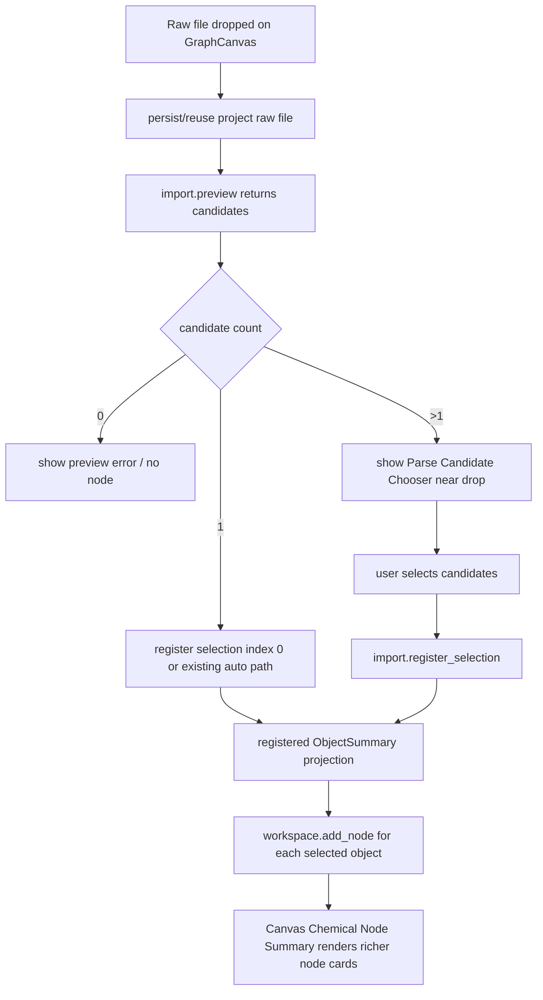

# canvas-chemical-node-card design

## 0. 术语约定

| 术语 | 定义 | 防冲突结论 |
|---|---|---|
| Parse Candidate Summary | `import.preview` 中每个 `ChemicalObjectDraft` 的 JSON-safe UI 摘要 | 不等同于已登记 `ObjectSummary` |
| Parse Candidate Chooser | Raw File Drop 遇到多对象 / 多帧 preview 时出现在画布落点附近的选择器 | 不写 Project Content，不自动登记 |
| Import Register Selection | 按用户选择的 object index 确认登记的 Shell command | 复用 core `confirm_import(object_indices)` |
| Canvas Chemical Node Summary | Graph node + Object summaries 派生的 Web 节点展示模型 | 不新增 core graph schema |
| Coordinate Preview Summary | 几何数据的轻量摘要：atom count、是否有 3D、前几个元素 | 不做 2D 布局 / 3D viewer |

术语 grep 结果：已有 `ImportParsePreviewSummary`、`ObjectSummary`、`GraphNodeSummary`、`GraphCanvas`、`NodeCompositionEditor` 和 `import.register_all`；没有 `ParseCandidateSummary` / `ParseCandidateChooser` / `import.register_selection` / `CanvasChemicalNodeSummary`。本 feature 用这些新名词表达下一层 workspace-first UI，不复用旧 Object Registry 术语。

## 1. 决策与约束

### 需求摘要

上一条 `workspace-file-drop-minimal-loop` 已让单对象 raw file drop 自动进入项目、preview/register 并创建画布节点。但多帧 extxyz、MAPLE path-family xyz、优化轨迹或多对象输出目前只能显示 `candidate_selection_required`，节点卡片也只展示 label/id/composition/formula，用户无法在画布上快速判断结构、能量和解析摘要。

本 feature 要补两件事：一是让 `import.preview` 暴露候选摘要，并在 raw file drop 落点附近让用户选择要登记的 candidate；二是让画布节点直接显示结构名称、来源文件/对象、方法、电荷自旋、可用能量、warning 和轻量坐标摘要。产品未上线，不做旧 UI 兼容承诺；旧三栏入口如果阻碍 workspace-first 主流程，可以隐藏、降级或改写。

### 明确不做

- 不实现 2D ChemDraw-like molecule preview、3D viewer、WebGL、OpenBabel/Mol* 布局或截图。
- 不实现 CDXML/CDX 导出、PES preview、path authoring 新能力或 `energy.compute` 变更。
- 不让 Web 解析 Gaussian/ORCA/MAPLE/XYZ/extxyz；candidate 和 node 数据必须来自 Shell/Core projection。
- 不自动把多对象 / 多帧 preview 全部创建成 graph nodes；必须经过用户选择。
- 不新增 Project Content schema、Browser Project Repository interface、云存储、directory watcher 或 browser directory handle authority。
- 不做真实化学角色判定；`roleHint=final` 只有 parser/core 明确提供时才显示，Web 不凭文件名把候选标成 TS/final。

### 复杂度档位

- Shell projection = L3：需要把 existing core `confirm_import(object_indices)` 通过新 command 暴露给 Web，并扩展 preview DTO。
- Frontend orchestration = L4：raw drop 多对象路径从 error 状态变成 candidate chooser state，再根据选择 register + add nodes。
- Canvas UI = L3：节点卡片信息密度提高，同时要守住画布可读性和窄屏布局。
- Core parser/runtime = L1：不改 parser 行为，只把已有 draft 信息投影出来。

### 关键决策

1. **候选摘要来自 core draft，不在 Web 推断**：`ParseCandidateSummary` 由 `ChemicalObjectDraft` 派生，Web 只展示。
2. **选择登记使用独立 command**：新增 `import.register_selection`，参数是 `session_id`、`batch_id`、`item_id`、`object_indices`；它复用 `ImportRegistryWorkflow.confirm_import()`。
3. **single-object auto path 仍保留**：`object_count === 1` 可继续直接 register + add node；多对象 / 多帧进入 chooser。
4. **多选创建多个节点，但必须用户确认**：用户可选择一个或多个 candidates；确认后登记选择对象，并把节点按 drop position 附近 stack 布局创建。
5. **节点卡片是展示投影**：`CanvasChemicalNodeSummary` 从 `GraphNodeSummary` + `ObjectSummary[]` 派生，不写 core graph schema，不改 Project Content。
6. **轻量结构预览只做摘要**：显示 atom count、元素预览、has3d；不做分子图、键推断或 3D 交互。
7. **不兼容旧 UI 作为目标**：Object Registry / Import Inbox 可继续作为调试与详情入口，但新主流程优先服务 Project Files Panel + Graph Canvas。

### 前置依赖

Roadmap item `workspace-file-drop-minimal-loop` 已 done。现有 core 已有 `ImportSelection.object_indices` 和 `confirm_import()`，Web 已有 raw file drop pipeline、GraphCanvas、ObjectSummary、GraphNodeSummary 和 Object Registry detail。

## 2. 名词与编排

### 2.1 名词层：值对象 / 实体 / 接口契约

**现状**

- `ImportParsePreviewSummary` 只有 `raw_resource_id/parser_id/parser_version/object_count/warnings`，没有 object draft 摘要。
- `ObjectSummary` 有 label/formula/charge/spin/method/energy keys/energy channels/provenance/warnings，但没有坐标摘要。
- `GraphNodeSummary` 有 label、composition、chemical_object_ids、position；GraphCanvas 通过第一个 object id 找单个 object，只显示 label/id/composition/formula。
- Platform Shell 只有 `import.register_all`，但 core `ImportRegistryWorkflow.confirm_import()` 已支持 `ImportSelection(object_indices=...)`。

**变化**

扩展 preview candidate DTO：

```ts
type CoordinatePreviewSummary = {
  atomCount: number
  has3d: boolean
  elements: string[]
  previewKind: "text" | "unavailable"
}

type ParseCandidateSummary = {
  candidateId: string
  objectIndex: number
  label: string
  formula?: string | null
  charge?: number | null
  spinMultiplicity?: number | null
  method?: string | null
  displayEnergy?: { key: string; source: "energies" | "thermochemistry"; value: number; unit: string } | null
  coordinatePreview: CoordinatePreviewSummary
  roleHint?: "final" | "intermediate" | "path-point" | "unknown"
  warnings: ShellWarning[]
}

type ImportParsePreviewSummary = {
  raw_resource_id: string
  parser_id: string
  parser_version: string
  object_count: number
  candidates: ParseCandidateSummary[]
  warnings: ShellWarning[]
}
```

新增 selection command：

```ts
type ImportRegisterSelectionData = {
  command: "import.register_selection"
  session_id: string
  batch: ImportBatchSummary
  registered_object_ids: string[]
  objects: ObjectSummary[]
}
```

GraphCanvas 多候选 pending state：

```ts
type ParseCandidateChooserState = {
  projectFileId: string
  rawFilePath: string
  batchId: string
  itemId: string
  candidates: ParseCandidateSummary[]
  selectedCandidateIds: string[]
  position: [number, number]
  status: "choosing" | "registering" | "adding-nodes" | "error"
  error?: ShellError | null
}
```

节点展示投影：

```ts
type CanvasChemicalNodeSummary = {
  nodeId: string
  structureName: string
  objectLabels: string[]
  formula?: string | null
  charge?: number | null
  spinMultiplicity?: number | null
  method?: string | null
  displayEnergy?: { key: string; source: "energies" | "thermochemistry"; value: number; unit: string } | null
  coordinatePreview: CoordinatePreviewSummary
  warnings: ShellWarning[]
}
```

接口示例：

```ts
// 来源：PlatformShell import.preview projection
candidate = {
  candidateId: "import-item-maple-path:2",
  objectIndex: 2,
  label: "Frame 3",
  displayEnergy: { key: "electronic", source: "energies", value: -212.3, unit: "hartree" },
  coordinatePreview: { atomCount: 42, has3d: true, elements: ["Pd", "C", "H"], previewKind: "text" },
  warnings: [],
}

// 来源：用户在 chooser 中确认
shellClient.run({
  command: "import.register_selection",
  args: { session_id, batch_id, item_id, object_indices: [2] },
})
```

### 2.2 编排层：主流程与控制流



**现状**

- Raw drop pipeline 遇到 `object_count !== 1` 直接报 `candidate_selection_required`。
- `import.register_all` 会登记 batch 里所有 preview items 的全部 objects，无法选择某几个 object draft。
- GraphCanvas node card 只消费一个 object 的 formula；多对象 composition、method、charge/spin、energy、warning 和 coordinates 没有统一展示投影。

**变化**

- Platform Shell `_parse_preview_summary()` 增加 candidate summaries，并在 `ObjectSummary` 增加 `coordinate_preview`。
- Platform Shell 新增 `import.register_selection`，只登记指定 item 的指定 object indices；fixture transport 同步支持 selection path。
- WorkbenchShell raw drop pipeline 看到多候选时创建 `ParseCandidateChooserState`，不再把它当错误。
- 用户确认 chooser 后，WorkbenchShell 调用 `import.register_selection`，merge 返回 objects，再按 selected object 顺序调用 `workspace.add_node`；多个节点使用 drop position 附近 stack offset，避免完全重叠。
- GraphCanvas 用 `CanvasChemicalNodeSummary` helper 渲染节点卡片；组合节点显示多个 object labels / composition summary，单对象优先显示结构名称、formula、charge/spin、method、displayEnergy、atom count 和 warnings。

**跨层纪律**

- 顺序约束：candidate chooser 只在 preview 成功且 candidate count > 1 时出现；未确认前不登记、不 add node。
- 错误语义：register selection 或任一 add-node 失败后停止后续 add-node；已成功登记的 objects 保留在 Object Registry，未成功创建的 node 不伪造。
- 权威来源：candidate 来自 preview projection；registered object 和 graph node 来自 ShellResponse；node card 只派生展示，不写 Project Content。
- 幂等性：重复确认同一 registered item 复用 core confirm idempotency；重复添加节点可以创建新 graph nodes，但不重复 raw object。
- 可观测点：chooser 显示 parser、candidate count、warnings、selection/error；Project Files Panel status 从 previewed/registered/used-in-graph 更新。

### 2.3 挂载点清单

- Platform Shell import projection：`import.preview` 增加 candidate summaries，新增 `import.register_selection` command。
- Web Shell DTO / fixture transport：新增 candidate、coordinate preview 和 selection register types/fixture behavior。
- WorkbenchShell raw drop pipeline：多候选 pending chooser state、selection register、multi-node add 编排。
- GraphCanvas：Parse Candidate Chooser overlay 和 richer Canvas Chemical Node card rendering。
- i18n/CSS/tests：候选选择、节点字段、warning/error、窄屏布局文案和样式。

本 feature 不挂入 parser plugins、Project Content schema、Browser Project Repository interface、Energy Engine、Report Export、CDXML writer、cloud storage 或 local directory watcher。

### 2.4 推进策略

1. **Shell Candidate Projection**：扩展 core shell preview/object summary DTO，新增 `import.register_selection` 并补 fixture transport。
   - 退出信号：Python shell tests 和 Web shell tests 能看到 candidates、coordinate preview，并能按 object_indices 登记。
2. **Candidate Chooser State**：把 raw drop 多对象路径从 error 改为 chooser pending state。
   - 退出信号：多候选 preview 不创建 node，GraphCanvas 显示 chooser，取消/错误路径可见。
3. **Selection Register And Node Creation**：确认候选后 register selection，并按 drop 位置创建一个或多个 graph nodes。
   - 退出信号：选择一个 candidate 创建一个 node；选择多个 candidates 创建 stack nodes；失败不伪造 node。
4. **Canvas Chemical Node Summary**：用 helper 派生节点展示模型并渲染结构名称、方法、电荷自旋、能量、atom count、warnings。
   - 退出信号：fixture/imported objects 节点卡片信息更完整，组合节点仍可读。
5. **UX / I18n / Responsive**：补 zh-CN/en-US 文案、候选列表、按钮、窄屏/长文本样式。
   - 退出信号：桌面和 390px 窄屏 chooser/node card 无重叠、无水平溢出。
6. **Verification And Scope Guard**：跑 Python/Web tests/build/browser smoke，确认无 parser runtime、energy、CDXML、cloud 越界。
   - 退出信号：测试通过；scope grep 无违规依赖；browser smoke 覆盖多候选选择与节点卡片。

## 3. 验收契约

### 关键场景清单

1. `import.preview` 对多对象 / 多帧文件返回 `preview.candidates[]`，candidate count 与 `object_count` 一致。
2. Candidate summary 包含 label、objectIndex、formula/charge/spin/method、displayEnergy、coordinatePreview、warnings；缺失字段为 null/空，不编造。
3. `import.register_selection` 按 `batch_id + item_id + object_indices` 登记选择对象，并返回 objects 与 registered ids。
4. 非法 item id、空 selection、越界 object index 返回 structured `invalid_input`，不登记对象。
5. Raw file drop 多候选 preview 后显示 chooser，不自动 register、不自动 add node。
6. 用户取消 chooser 后不登记、不建节点，Project File 保持 previewed 或等价状态。
7. 用户选择一个 candidate 后创建一个 graph node，位置接近 drop point。
8. 用户选择多个 candidates 后创建多个 graph nodes，节点不完全重叠。
9. register selection 成功但 add-node 失败时，不伪造 node，UI 显示 workspace error；已登记 object 仍可在 Object Registry 看到。
10. 单对象 raw file drop 仍直接创建节点，不需要 chooser。
11. Canvas node card 显示结构名称、object ids/composition、formula、charge/spin、method、display energy、atom count 和 warning marker。
12. 多对象 composition node card 不只显示第一个 object；必须能看出 composition 里有多个 object。
13. 没有 geometry 或 energy 的对象显示 unavailable/missing 状态，不把缺失能量当 0。
14. zh-CN / en-US 文案完整；candidate id、object id、warning/error code 原样显示。
15. 桌面 viewport 下 chooser、node card、Network Preview 不重叠。
16. 390px 窄屏下候选列表、节点卡片和画布 controls 不造成水平溢出。

### 明确不做的反向核对项

- 不新增 2D/3D molecule renderer、OpenBabel/Mol*、CDXML/CDX、PES preview 或 energy.compute 新逻辑。
- Web 不 import Python parser/core，不解析 Gaussian/ORCA/MAPLE/XYZ/extxyz。
- 不新增 Project Content schema、Browser Project Repository interface、cloud storage、directory watcher 或 browser directory handle authority。
- 多对象 / 多帧 preview 不绕过 chooser 自动创建全部节点。
- 不把 `roleHint` 当作化学真实性判断；无 core/parser hint 时显示 unknown/last candidate，而不是 TS/final。

## 4. 与项目级架构文档的关系

Acceptance 阶段需要更新：

- `codestable/architecture/core-platform.md`：记录 `import.register_selection`、candidate summary projection 和 coordinate preview summary。
- `codestable/architecture/web-workbench.md`：记录 Parse Candidate Chooser、Canvas Chemical Node Summary、multi-node stack creation 和 node card display boundary。
- `codestable/requirements/web-workbench-shell.md`：补用户故事“多对象/多帧输出先选择候选，画布节点直接显示结构/能量摘要”。
- Roadmap `rxnflow-workspace-first-canvas-mvp`：acceptance 阶段把 `canvas-chemical-node-card` 标为 done，并让 `canvas-path-authoring-pes-preview` 可启动。
