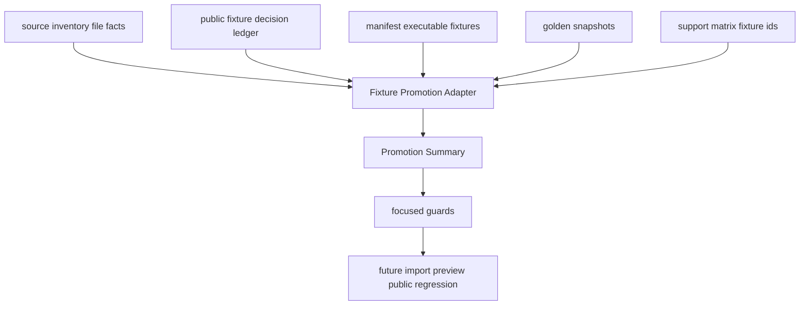

# parser-public-fixture-promotion-adapter design

## 0. 术语约定

- **Fixture Promotion Adapter**：测试侧只读 helper，用 decision ledger、source inventory、manifest、golden snapshot 和 support matrix 派生 public fixture promotion 状态，并暴露不一致项。
- **Promoted Decision**：`public-fixture-decisions.yaml` 中 `decision=allowed` 且 `promotion=promoted` 的逐文件决策。当前只有 `ase-extxyz-project-authored` 的 4 个 project-authored files 属于这一类。
- **Source-gated Fixture**：manifest 中 `source.kind` 为 `vendored-third-party` 或 `user-redacted` 的 executable fixture；这类 fixture 必须能追溯到 `allowed/promoted` decision。
- **Promotion Summary**：adapter 返回的汇总对象，列出 promoted decisions、blocked/reference-only decisions、source-gated fixtures、covered executable fixtures、snapshot/support matrix 覆盖和 unresolved items。
- **Executable Promotion Coverage**：promoted decision 指向的 fixture 必须存在于 manifest，`support_status` 为 `supported` 或 `partial`，有 golden snapshot，并被 support matrix 的 `fixture_ids` 覆盖。

术语 grep 结论：现有代码已有 Public Fixture Decision Ledger、Candidate Fetch Verify、MAPLE/cclib resolution summary 和 extxyz Variant Intake Summary。本 feature 复用这些命名，不把 adapter 放进 `rxnflow.parsers` runtime API。

## 1. 决策与约束

### 需求摘要

当前 public fixture intake 已经有三类局部 guard：

- decision ledger 能阻止 `promotion=promoted` 但 `decision!=allowed`。
- manifest loader 能校验 `vendored-third-party` source 的 upstream path/hash/size 和 redistributable。
- MAPLE/cclib/extxyz summary 能分别证明各自 source 的 blocked/reference/promoted 状态。

缺口是还没有一个统一 adapter，能跨所有 source 检查“promoted decision 是否真的被 manifest/snapshot/support matrix 承接”，以及“manifest 中任何 third-party/user-redacted executable fixture 是否都有对应 `allowed/promoted` decision”。后续如果用户授权真实输出，或者 public license 明确允许 vendor，缺这个 adapter 会让 fixture files、decision ledger 和 support matrix 漂移。

本 feature 的目标是增加测试侧 Fixture Promotion Adapter：统一汇总并校验 promoted/blocked/reference-only decision 与 executable fixture corpus 的关系。当前不会新增真实第三方文件；已有 extxyz project-authored promoted decisions 用 fallback executable fixtures 证明 coverage。MAPLE/cclib public originals 继续 blocked/reference-only，不得被误标 executable supported。

### 明确不做

- 不 vendor MAPLE、cclib-data、ASE public examples 或其他第三方 original 输出。
- 不新增 user-redacted 真实用户输出。
- 不新增 parser fixture 文件或 golden snapshot，除非实现阶段发现当前 corpus 缺少 adapter 必须使用的最小测试替身。
- 不修改 `rxnflow.parsers` runtime、ImportRegistryWorkflow、Platform Shell、Web UI 或 report export。
- 不让 blocked、needs-permission、reference-only、synthetic-only 或 rejected source file 进入 source-gated executable fixture。
- 不把 synthetic-derived fallback 描述成 public original 已 vendor。
- 不让普通 unit tests 访问网络、外部 clone 或本机下载目录。

### 复杂度档位

测试侧/dev tooling feature，默认低复杂度。偏离点：

- 当前 `allowed/promoted` extxyz 决策是 project-authored vendored source file，manifest fixture 仍是 `source.kind=synthetic`。adapter 必须允许“project-authored promoted decision -> fallback executable fixture”这种合法关系。
- 未来 `vendored-third-party` / `user-redacted` fixture 需要更强约束，但不能反向要求所有 synthetic fixture 都有 decision。
- `decision_id` 目前不在 `ParserFixtureSource` 中。实现阶段可以增加 optional `decision_id` 字段，并只对 source-gated fixture 强制；现有 synthetic fixtures 不需要填写。

### 关键决策

1. **统一 summary，而不是分散在各 source-specific helper 里**：MAPLE/cclib/extxyz summary 继续保留，promotion adapter 负责跨 source 的共同契约。
2. **source-gated fixture 必须有 decision_id**：`vendored-third-party` 或 `user-redacted` manifest source 必须追溯到 `allowed/promoted` decision；synthetic / synthetic-derived fallback 不强制。
3. **promoted decision 必须有 executable coverage**：每个 promoted decision 的 fallback fixture ids 必须存在、可执行、有 snapshot、被 support matrix 覆盖。
4. **blocked/reference-only decision 必须保持不可执行**：它们不能通过 manifest source `decision_id` 进入 source-gated fixture，也不能被 docs/support matrix 说成 public original supported。
5. **只读、无网络、无自动 vendor**：adapter 只读本地 YAML/snapshot，不写 files，不更新 hash，不调用 fetch。

## 2. 名词与编排

### 2.1 名词层：值对象 / 接口契约

**现状**

- `ParserPublicFixtureDecisionLedger` 能按 `decision_id` 或 `source_id/file_id` 查 decision。
- `ParserFixtureManifest` 记录 executable fixture，但 `ParserFixtureSource` 当前没有 `decision_id` 字段。
- `ParserSupportMatrix` 能给出全部 `fixture_ids` 覆盖和 candidate/reference-only entries。
- `assert_parser_fixture_snapshot` 能证明 executable fixture 的 golden snapshot 与 parser 输出一致。

**变化**

新增测试侧派生契约：

```python
@dataclass(frozen=True)
class ParserPublicFixturePromotionSummary:
    promoted_decision_ids: tuple[str, ...]
    promoted_file_ids: tuple[str, ...]
    blocked_file_ids: tuple[str, ...]
    reference_only_file_ids: tuple[str, ...]
    source_gated_fixture_ids: tuple[str, ...]
    covered_fixture_ids: tuple[str, ...]
    snapshot_fixture_ids: tuple[str, ...]
    support_matrix_fixture_ids: tuple[str, ...]
    unresolved_decision_ids: tuple[str, ...]
    unresolved_fixture_ids: tuple[str, ...]
```

新增 helper shape：

```python
def summarize_parser_public_fixture_promotion(
    source_inventory: ParserSourceInventory,
    decision_ledger: ParserPublicFixtureDecisionLedger,
    manifest: ParserFixtureManifest,
    support_matrix: ParserSupportMatrix,
) -> ParserPublicFixturePromotionSummary:
    ...
```

可选扩展 manifest source：

```yaml
source:
  kind: vendored-third-party
  ...
  decision_id: maple-dev-example:maple-sp-output-example
```

约束：

- `source.kind in {"vendored-third-party", "user-redacted"}` 时必须有 `decision_id`，且 decision 必须是 `allowed/promoted`。
- `vendored-third-party` source 的 `source_path/source_sha256/source_size_bytes` 必须与 source inventory 对应 file 的 path/sha256/size 一致。
- `user-redacted` source 必须 `redistributable: true`，`redaction` 不能是空值；授权证据在 decision evidence/reason 中体现。
- promoted decision 的 `fallback_fixture_ids` 必须存在于 manifest，且 fixture `support_status` 必须是 `supported` 或 `partial`。
- promoted decision 覆盖的 fixture 必须有存在且 schema 为 `parser-golden-v1` 的 snapshot，并出现在 support matrix `fixture_ids`。
- blocked/reference-only decisions 不能被 source-gated fixture 的 `decision_id` 引用。
- synthetic fallback 可以被 promoted decision 引用，但不能因此被描述为 third-party original。

### 2.2 编排层：主流程与控制流



**现状**

Promotion gate 分散在 loader、decision ledger、MAPLE/cclib/extxyz summary 和 docs 中。没有一个 helper 可以回答“当前所有 promoted decisions 是否都有可执行、可追溯、可 snapshot 验证的 fixture coverage”。

**变化**

- 增加 promotion summary dataclass/helper。
- `ParserFixtureSource` 增加 optional `decision_id`，不改变现有 synthetic fixture YAML。
- loader 对 source-gated fixture 增加 decision_id 形状校验；完整 ledger cross-check 由 adapter helper 完成。
- focused tests 覆盖当前 corpus：4 个 extxyz promoted decisions 全部有 executable coverage；MAPLE/cclib blocked/reference-only decisions 没有 source-gated executable fixture。
- focused tests 覆盖未来 source-gated fixture 的错误分支：缺 decision_id、decision 不存在、decision 非 allowed/promoted、metadata 与 source inventory 不一致、snapshot/support matrix 漏覆盖。

**跨层纪律**

- 错误语义：schema 形状错误用 `AssertionError`；跨表不一致进入 summary 的 unresolved 字段并由 focused test 断言为空。
- 幂等性：helper 只读本地对象和 snapshot 文件，不写 YAML、fixture file 或 snapshot。
- 扩展点：后续 `public-fixture-import-preview-regression` 只消费 adapter 已确认的 covered fixture ids。
- 可观测点：summary fields、focused unit tests、YAML validation、scope diff、acceptance architecture 回写。

### 2.3 挂载点清单

- `tests/parser_fixture_harness.py`：新增 promotion summary dataclass/helper，给 `ParserFixtureSource` 增加 optional `decision_id`，并对 source-gated fixture 加 loader guard。
- `tests/test_parser_fixture_harness.py`：新增 adapter 正向与错误分支测试。
- `tests/fixtures/parsers/manifest.yaml`：当前不需要给 synthetic fixtures 补 `decision_id`；若测试替身需要 source-gated temp manifest，应在临时文件中构造。
- `docs/dev/parser-fixture-corpus.md`：补 Fixture Promotion Adapter 维护说明，明确 source-gated fixture 的 decision_id 和 metadata 规则。
- CodeStable 回写：roadmap item in-progress，acceptance 归并 architecture/roadmap。

不挂入 `rxnflow.parsers`、Import Workflow、Platform Shell、Web UI、report export、fixture files 或真实第三方 public outputs。

### 2.4 推进策略

1. **Promotion contract skeleton**：新增 summary dataclass/helper 和 optional source `decision_id` 读取能力。
   - 退出信号：当前 corpus 可派生 promotion summary，extxyz promoted decisions、blocked files、reference-only files 均分类正确。
2. **Cross-link guards**：补 source-gated fixture 和 promoted decision 的 decision/source/manifest/snapshot/support matrix 关系校验。
   - 退出信号：缺 decision_id、unknown decision、non-promoted decision、metadata mismatch、missing snapshot、missing support matrix coverage 都能被 focused tests 捕获。
3. **Current corpus regression**：用现有 ledger 证明 4 个 project-authored extxyz promoted decisions 全部覆盖，MAPLE/cclib candidates/reference-only 全部不可执行。
   - 退出信号：summary `unresolved_decision_ids == ()` 且 `unresolved_fixture_ids == ()`；普通 tests no-network。
4. **Docs and validation**：更新 developer guide，运行 focused/full tests、YAML validation 和 scope diff。
   - 退出信号：`tests.test_parser_fixture_harness`、`python3 -m unittest discover`、相关 YAML validation 和 `git diff --check` 通过。

## 3. 验收契约

### 关键场景清单

1. 能从当前 source inventory、decision ledger、manifest 和 support matrix 派生 `ParserPublicFixturePromotionSummary`。
2. Summary 中 promoted decisions 只包含当前 4 个 `ase-extxyz-project-authored` allowed/promoted decisions。
3. 每个 promoted decision 的 fallback fixture 存在于 manifest，`support_status` 是 `supported` 或 `partial`，snapshot 文件存在且 schema 为 `parser-golden-v1`。
4. 每个 promoted decision 覆盖的 fixture 都出现在 support matrix `fixture_ids`。
5. MAPLE/cclib-data candidate decisions 全部保持 blocked，不出现在 source-gated executable fixture 中。
6. MAPLE/cclib-data reference-only decisions 全部保持 reference-only/not-applicable，不出现在 source-gated executable fixture 中。
7. 临时 `vendored-third-party` fixture 缺 `decision_id` 时会被拒绝。
8. 临时 source-gated fixture 引用 unknown decision 或 non-promoted decision 时会被 adapter 标为 unresolved。
9. 临时 `vendored-third-party` fixture 的 `source_path/source_sha256/source_size_bytes` 与 source inventory 不一致时会被 adapter 标为 unresolved。
10. 临时 promoted fixture 缺 snapshot 或缺 support matrix coverage 时会被 adapter 标为 unresolved。
11. Synthetic fixtures 不被强制要求 `decision_id`；synthetic-derived fallback 不被描述为 third-party original。
12. Docs 明确 source-gated fixture 必须先有 decision ledger，再进入 manifest/snapshot/support matrix。
13. Scope guard 证明未新增真实 third-party/user-redacted fixture files，未修改 parser runtime、Import Workflow、Platform Shell、Web UI 或 report export。

### 明确不做的反向核对项

- 不 vendor MAPLE、cclib-data、ASE public examples 或其他第三方 original 输出。
- 不新增 user-redacted 真实用户输出。
- 不新增 parser runtime 字段、导入确认、图谱、能量曲线或报告导出能力。
- 不让 blocked/reference-only files 通过 source-gated fixture 进入 executable corpus。
- 不让普通 tests 访问网络。

## 4. 与项目级架构文档的关系

Acceptance 阶段需要更新：

- `codestable/architecture/ARCHITECTURE.md`：在 Parser Fixture Harness / Parser Fixture Corpus 中补 Fixture Promotion Adapter 当前边界和 source-gated fixture 规则。
- `codestable/architecture/core-platform.md`：在测试侧 harness 能力、fixture corpus 当前状态和已知限制中补 promotion summary/guards。
- `docs/dev/parser-fixture-corpus.md`：补 Fixture Promotion Adapter 维护入口、source-gated fixture decision_id 规则和 no-auto-vendor 边界。
- `codestable/roadmap/rxnflow-parser-public-fixture-intake/*`：验收时把 `parser-public-fixture-promotion-adapter` 标为 done，并同步主文档。
