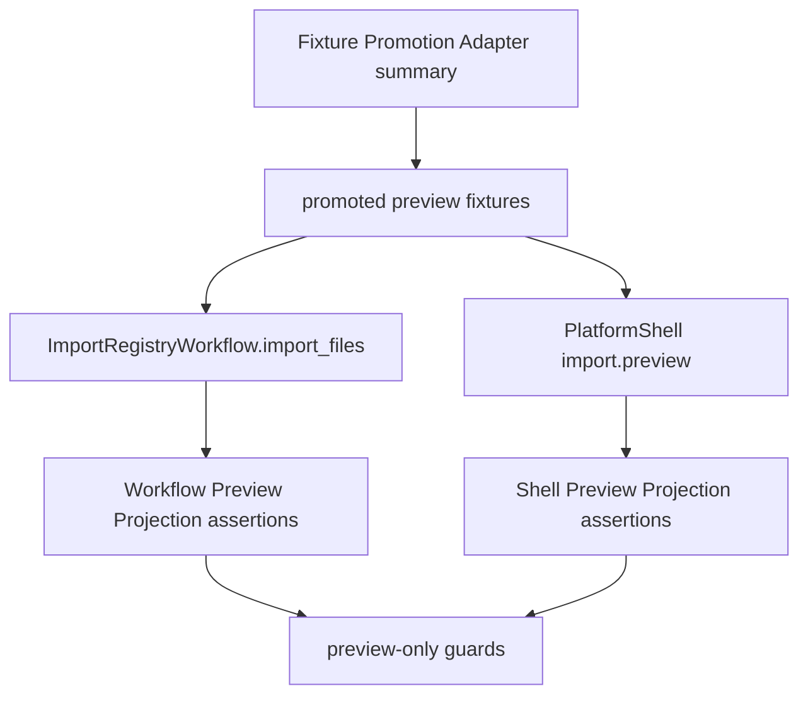

# public-fixture-import-preview-regression design

## 0. 术语约定

- **Public Fixture Import Preview Regression**：测试侧回归，用 Fixture Promotion Adapter 确认的 promoted fixture coverage 驱动 `ImportRegistryWorkflow.import_files` 和 Platform Shell `import.preview`。
- **Promoted Preview Fixture**：`summarize_parser_public_fixture_promotion(...).covered_fixture_ids` 中的 fixture；当前是 4 个 `ase-extxyz-project-authored` project-authored promoted fixtures。
- **Preview Projection**：导入预览对 parser result 的投影，包括 parser_id、parser_version、object_count、warnings、raw resource linkage 和 provenance。
- **Preview-only Discipline**：本 feature 只验证 preview，不确认导入、不登记 ChemicalObject、不调用 graph/energy/export/bundle。
- **Non-executable Public Source**：MAPLE/cclib-data blocked candidates 和 reference-only files；它们不能进入 promoted preview fixture set。

术语 grep 结论：现有 `tests/test_import_preview_parser_regression.py` 已有 all executable fixture preview regression；本 feature 增加 promotion-adapter-driven public fixture regression，不替代现有全量 fixture 回归。

## 1. 决策与约束

### 需求摘要

当前 import preview parser regression 已经遍历 manifest 中所有 executable fixtures，验证 Workflow Preview Projection 和 Shell Preview Projection 保留 parser metadata、object_count、warnings、raw_resource 和 provenance，并用 guard 证明 preview 不登记 ChemicalObject。

缺口是它没有显式接入 public fixture intake 的 promotion contract：未来一旦有 public/user-redacted fixture 被 promoted，测试应该从 Fixture Promotion Adapter 读出 promoted coverage，而不是靠人工记得把 fixture 加进 import preview regression。与此同时，MAPLE/cclib-data blocked/reference-only public originals 仍不能因为在 source inventory 中出现就进入 preview regression。

本 feature 的目标是把 promoted fixture set 明确接到 import preview regression：用 `summarize_parser_public_fixture_promotion` 派生 promoted fixture ids，分别跑 Workflow 和 Platform Shell preview projection，保留 preview-only 纪律，并反向证明 blocked/reference-only sources 不在 promoted preview set 中。

### 明确不做

- 不新增 fixture files、source inventory entries、decision ledger entries、snapshots 或 support matrix entries。
- 不 vendor MAPLE/cclib-data/ASE public originals，也不新增 user-redacted 输出。
- 不修改 parser runtime、parser adapter、ChemicalRegistry、ReactionGraph、EnergyProfile 或 report export。
- 不确认导入、不登记 ChemicalObject、不保存 confirmed import ledger。
- 不改变 Platform Shell command contract 或 Web UI。
- 不让 blocked/reference-only candidates 进入 promoted preview regression。
- 不让普通 tests 访问网络。

### 复杂度档位

测试侧 regression feature，默认低复杂度。偏离点：

- 当前 promoted set 是 project-authored extxyz fixtures，不是真实第三方 originals；测试命名必须说明是 promotion adapter 确认的 promoted coverage，不声称真实 public version 完整支持。
- 现有 all-executable fixture regression 已覆盖这些 fixtures；本 feature 的价值是用 promotion adapter 作为选择器，防止后续 public/user-redacted promoted fixtures 漏进 import preview regression。
- Preview-only discipline 必须继续用 `_PreviewOnlyRegistry`、`_NoGraphService`、`_NoEnergyEngine`、`_NoExportService` 和 `_NoBundleService` 守住。

### 关键决策

1. **复用 promotion adapter，不新增第二份 promoted fixture 清单**：promoted preview fixture ids 来自 `ParserPublicFixturePromotionSummary.covered_fixture_ids`。
2. **保留全量 executable fixture regression**：现有 all-executable tests 不删除；新增 focused tests 覆盖 public promotion path。
3. **Workflow 和 Shell 都要覆盖**：core workflow 与 platform shell 投影都必须验证 promoted fixtures。
4. **blocked/reference-only 反向 guard**：测试必须证明 MAPLE/cclib-data candidate/reference-only source files 不在 promoted preview fixture set 中。
5. **无 runtime 变化**：所有改动只在 `tests/test_import_preview_parser_regression.py` 和 checklist/docs/acceptance。

## 2. 名词与编排

### 2.1 名词层：值对象 / 接口契约

**现状**

- `load_parser_fixture_manifest` 可得到所有 executable fixtures。
- `summarize_parser_public_fixture_promotion` 可得到 `covered_fixture_ids`、blocked/reference-only files 和 unresolved ids。
- `ImportRegistryWorkflow.import_files` 返回 ImportBatch/ImportItem preview，不确认导入。
- `PlatformShellService(import.preview)` 返回 JSON-safe ShellResponse projection。

**变化**

新增测试侧 helper shape：

```python
def _promoted_preview_fixtures() -> tuple[object, ...]:
    ...
```

约束：

- helper 加载 manifest、source inventory、decision ledger、support matrix 和 promotion summary。
- `summary.unresolved_decision_ids` 与 `summary.unresolved_fixture_ids` 必须为空。
- 返回 fixtures 必须来自 `summary.covered_fixture_ids`，而不是手写 id list。
- 当前返回 4 个 extxyz promoted fixtures；后续 public/user-redacted promoted fixtures 只要进入 promotion adapter coverage，就会自动进入 preview regression。

### 2.2 编排层：主流程与控制流



**现状**

`tests/test_import_preview_parser_regression.py` 直接遍历 all executable fixtures。它已经验证 preview projection 和 preview-only scope，但没有从 promotion summary 选择 promoted fixtures。

**变化**

- 增加 `_promoted_preview_fixtures` helper，读取 promotion adapter summary。
- 增加 Workflow promoted fixtures preview regression，复用现有 assertion shape。
- 增加 Platform Shell promoted fixtures preview regression，复用现有 shell projection assertion shape。
- 增加反向 guard，证明 blocked/reference-only source file ids 不在 promoted preview fixture set 中，且 summary unresolved 为空。

**跨层纪律**

- 错误语义：promotion summary unresolved 非空时测试失败，不自动修复 corpus。
- 幂等性：tests 只创建临时 Project Directory，不写 fixture corpus。
- 扩展点：后续 promoted public/user-redacted fixtures 会通过 summary 自动进入 preview regression。
- 可观测点：focused import preview tests、scope guard、full unittest、acceptance report。

### 2.3 挂载点清单

- `tests/test_import_preview_parser_regression.py`：新增 promotion-adapter-driven promoted fixture helper、Workflow/Shell focused tests 和 blocked/reference-only guard。
- CodeStable checklist/acceptance：记录实现、验证和 roadmap 回写。

不挂入 `tests/fixtures/parsers/` 数据文件、parser runtime、Import Workflow implementation、Platform Shell implementation、Web UI 或 report export。

### 2.4 推进策略

1. **Promoted fixture selector**：在 import preview regression 中接入 promotion adapter summary。
   - 退出信号：helper 返回当前 4 个 extxyz promoted fixtures，summary unresolved 为空。
2. **Workflow preview regression**：对 promoted fixtures 跑 `ImportRegistryWorkflow.import_files` preview projection。
   - 退出信号：parser metadata、object_count、warnings、raw resource/provenance linkage 保真，registry 仍为空。
3. **Shell preview regression and guards**：对 promoted fixtures 跑 Platform Shell `import.preview`，并补 blocked/reference-only 反向 guard。
   - 退出信号：ShellResponse JSON-safe projection 保真，blocked/reference-only files 不进入 promoted preview set，no graph/energy/export/bundle。
4. **Validation**：运行 focused tests、full unittest、YAML validation、scope diff。
   - 退出信号：`tests.test_import_preview_parser_regression`、`python3 -m unittest discover`、相关 YAML validation 和 `git diff --check` 通过。

## 3. 验收契约

### 关键场景清单

1. `_promoted_preview_fixtures` 从 Fixture Promotion Adapter summary 派生 fixture set，而不是手写 id list。
2. 当前 promoted preview fixtures 只包含 4 个 extxyz project-authored promoted fixtures。
3. Promotion summary 的 unresolved decision/fixture ids 必须为空。
4. Workflow preview 对每个 promoted fixture 保留 parser_id、parser_version、object_count、warning codes、raw resource id/path/checksum 和 provenance source_file_id。
5. Workflow preview 不登记 ChemicalObject。
6. Platform Shell `import.preview` 对每个 promoted fixture 返回 JSON-safe payload，保留 raw_resource、parser metadata、object_count 和 warnings。
7. Platform Shell promoted preview 不调用 graph/energy/export/bundle，也不登记 objects。
8. MAPLE/cclib-data blocked candidate file ids 不进入 promoted preview fixture ids。
9. MAPLE/cclib-data reference-only file ids 不进入 promoted preview fixture ids。
10. Existing all-executable fixture preview regression 保留，不被删除或降级。
11. Scope guard 证明未修改 parser runtime、Import Workflow implementation、Platform Shell implementation、Web UI 或 report export。

### 明确不做的反向核对项

- 不新增 fixture files、source inventory entries、decision ledger entries、snapshots 或 support matrix entries。
- 不 vendor public originals 或 user-redacted outputs。
- 不确认导入、不登记 ChemicalObject。
- 不修改 runtime parser/import/shell/web/export implementation。
- 不让普通 tests 访问网络。

## 4. 与项目级架构文档的关系

Acceptance 阶段需要更新：

- `codestable/architecture/ARCHITECTURE.md`：在 Import Preview Parser Regression 当前边界中补 promotion-adapter-driven promoted fixture regression。
- `codestable/architecture/core-platform.md`：在测试侧 import preview regression 职责中补 promoted fixture selector 和 preview-only guard。
- `codestable/roadmap/rxnflow-parser-public-fixture-intake/*`：验收时把 `public-fixture-import-preview-regression` 标为 done，并同步主文档。
