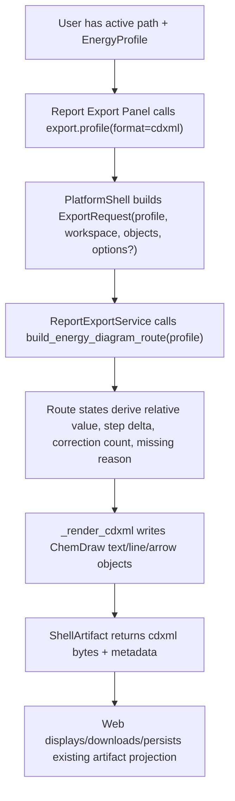

# minimal-cdxml-energy-delta-export design

## 0. 术语约定

| 术语 | 定义 | 防冲突结论 |
|---|---|---|
| Minimal CDXML Energy Delta Export | 基于当前 `EnergyProfile` 生成 ChemDraw 可打开的 CDXML 能量图，图中只包含能量图对象和文本标注 | 不是 CDX binary，不包含 molecule atoms/bonds 或 ChemDraw 编辑器 |
| CDXML Energy Delta Label | 相邻两个有效 profile points 的相对能量差文本，例如 `dE +5.20 kcal/mol` | 只从 profile relative values 派生，不调用 Energy Engine 重算 |
| CDXML Correction Marker | 某个 point 的 `expression.corrections.length > 0` 时显示的 `corr xN` 文本 | 不显示 correction contribution 总和，不做前端或 writer 侧重新求和 |
| CDXML Missing Marker | point 缺失 relative energy 时显示 `missing` 或 `missing: {reason}` | 不把 missing point 当 0，不画假 state line |
| CDXML-only Boundary | 当前 ChemDraw 路径是 XML CDXML；`cdx` 仍是 unsupported external conversion boundary | 不新增 CDX writer / converter |

术语 grep 结果：当前 `rxnflow/export.py` 已有 `CdxmlDiagramOptions`、`EnergyDiagramRoute`、`EnergyDiagramState`、`build_energy_diagram_route`、`_render_cdxml` 和 `rxnflow-cdxml-energy-v1` writer；`ReportExportService` 已支持 `cdxml`；Web Report Export Panel 已能调用 `export.profile` 并持久化 `exports/*.cdxml`。本 feature 增强现有 writer，不新增浏览器端 writer。

## 1. 决策与约束

### 需求摘要

本 feature 目标是让用户在当前 active path / PES Preview 已经成立后，导出的 CDXML 能量图可直接用于第一版 ChemDraw 交流：

1. CDXML 图中每个有效 state 保留结构名称和相对能量，并把相对能量写成带单位的文本。
2. 相邻两个有效 state 之间显示 step delta label；任一相邻 point missing 时不显示 delta。
3. 含 correction expression 的 point 显示 correction marker；missing point 显示 missing marker 和 reason。
4. `export.profile` / Report Export Panel 继续作为唯一导出入口，Web 不生成 CDXML bytes。
5. `cdx` 继续 unsupported；CDXML 不包含 molecule-level atoms/bonds。

### 明确不做

- 不做 ChemDraw `.cdx` binary writer、CDXML->CDX converter、外部 ChemDraw 自动转换或平台相关转换依赖。
- 不做 molecule-level CDXML、原子/键语义、反应式结构、结构布局或 ChemDraw 编辑器。
- 不新增 Web 前端 CDXML writer，不在浏览器拼 XML，不让 Report Export Panel 重算 energy/profile。
- 不新增 `ExportFormat`；`cdxml` 仍使用现有 supported format，`cdx` 仍返回 unsupported。
- 不改变 PNG/XLSX/CSV/SVG writer 的行为；PNG 可继续忽略 step delta/correction marker。
- 不新增 Project Content schema、ExportArtifactRecord schema、Browser Project Repository schema 或 localStorage key。
- 不把 missing relative energy 当作 0；不为 missing point 画 state line 或 connector。

### 复杂度档位

- Core writer：L2。增强现有 CDXML route/state annotation 和 XML text rendering。
- Shell/Web boundary：L1。复用 `export.profile` 和 Web artifact persistence；最多透传 `options`，不新增 Web 控件。
- ChemDraw compatibility：L2。仍使用标准 CDXML XML/DTD、text/graphic/arrow object，不依赖 ChemDraw 私有二进制。
- Persistence：L1。不改 artifact schema；新信息只进入 bytes 和 metadata。

### 关键决策

1. **增强现有 `rxnflow-cdxml-energy-v1`，不新增 writer id**：这是同一最小能量图 writer 的内容补全；metadata 可新增 feature flags，writer id 保持稳定。
2. **step delta 放在 route/state annotation 层**：`build_energy_diagram_route(profile)` 从相邻 `EnergyProfile.points[]` 派生 delta，CDXML writer 只负责渲染。
3. **CDXML 默认显示完整最小信息**：结构名称、relative value + unit、step delta、missing marker、correction marker 默认开启；`CdxmlDiagramOptions` 可保留开关以便测试和后续 UI。
4. **Web 仍只调用 `export.profile`**：Report Export Panel 不新增复杂选项，不导入 XML 库，不读取 profile 重新生成 CDXML。
5. **scope guard 对 CDX 特别严格**：任何 `cdx` 请求仍走 capability unsupported；本 feature 不接 converter。

## 2. 名词与编排

### 2.1 名词层：值对象 / 实体 / 接口契约

**现状**：

- `EnergyDiagramState` 只有 `label`、`relative_value`、`unit`、`missing_reason` 和图形坐标。
- `CdxmlDiagramOptions` 只有 state line span、label/value 显示、decimals、axis label 和 line style。
- `_render_cdxml` 当前会画 axis、state line、connector arrow、structure label、relative value 和 `missing` 文本。
- `_artifact_metadata` 会合并 `_RenderedArtifact.metadata`，因此 CDXML writer 可增加 metadata flags 而不改 `ExportArtifact` schema。
- `PlatformShellService._run_export_profile` 当前创建 `ExportRequest` 时没有透传 command `options`。

**变化**：

新增或扩展 core-only diagram annotation：

```python
@dataclass(frozen=True)
class EnergyDiagramState:
    node_id: str
    label: str
    relative_value: float | None
    unit: EnergyUnit
    step_delta_value: float | None = None
    correction_count: int = 0
    missing_reason: str | None = None
    ...

@dataclass(frozen=True)
class CdxmlDiagramOptions:
    show_step_delta: bool = True
    show_correction_markers: bool = True
    show_missing_reason: bool = True
    ...
```

CDXML 文本口径：

- structure label：`point.label`
- relative value：`{value:.decimals} {unitLabel}`，例如 `5.20 kcal/mol`
- step delta：`dE +5.20 kcal/mol` 或 `dE -3.10 kcal/mol`
- correction marker：`corr x2`
- missing marker：`missing` 或 `missing: missing_energy`

边界：

- `step_delta_value` 只从相邻两个有效 `point.relative_energy.value` 派生。
- `correction_count` 只来自 `point.expression.corrections` 长度；`expression is None` 时为 0。
- CDXML metadata 可记录 `cdxml_includes_step_delta=true`、`cdxml_correction_marker_count`、`cdxml_missing_point_count`。
- 不改 `EnergyProfile` / `EnergyPoint` dataclass，不把这些展示字段持久化到 profile snapshot。

### 2.2 编排层：主流程与控制流



**现状**：

- `ReportExportService.export()` dispatches `cdxml` to `build_energy_diagram_route()` and `_render_cdxml()`.
- `build_energy_diagram_route()` already guards missing points and route bounds.
- Web default export formats already include `cdxml`; active browser project persistence already writes `exports/{basename}.cdxml`.

**变化**：

- `build_energy_diagram_route()` records per-state `step_delta_value` and `correction_count`.
- `_render_cdxml()` writes additional text objects near connectors/state labels for step delta and correction/missing markers.
- CDXML rendered metadata records marker counts and feature flags.
- Platform Shell passes `command.args["options"]` to `ExportRequest.options` when it is a dict; Web may ignore this and rely on defaults.

**跨层纪律**：

- Energy authority：CDXML writer only consumes the supplied `EnergyProfile`; it never recomputes an `EnergyProfile`.
- Missing semantics：missing point breaks connector continuity and delta computation.
- XML safety：all labels/reasons go through ElementTree text escaping; no raw string XML injection.
- Format boundary：CDXML stays supported; CDX stays unsupported in capability table.
- Web isolation：browser UI displays ShellArtifact; it never builds CDXML bytes.
- Backward compatibility：existing `cdxml` export command still works without options.

### 2.3 挂载点清单

- Core Energy Diagram Route annotation：extend route state/options and metadata summary in `rxnflow/export.py`.
- Core CDXML writer rendering：render relative value with unit, step delta label, missing reason and correction marker in `_render_cdxml`.
- Platform Shell export option passthrough：allow `export.profile` to pass `options` into `ExportRequest` without adding new commands.
- Tests and docs：update core/shell/Web tests and report export docs to lock CDXML/CDX boundary and new text markers.

本 feature 不挂入 Web CDXML writer、Project Content schema、Browser Project Repository schema、parser、registry、ReactionGraph editing、Energy Engine computation algorithm or CDX converter。

### 2.4 推进策略

1. **Route Annotation Contract**：扩展 `EnergyDiagramState` / `CdxmlDiagramOptions`，让 route 派生 step delta、correction count、missing count。
   - 退出信号：unit tests 证明 delta 只在相邻有效 points 间出现，missing adjacency 不产生 delta，correction count 来自 expression。
2. **CDXML Writer Text Markers**：增强 `_render_cdxml`，输出 structure name、relative value + unit、`dE` label、`corr xN` 和 missing reason。
   - 退出信号：解析 CDXML XML 后能在 text nodes 中找到预期 labels，missing point 不生成 state line / connector。
3. **Shell/Web Export Boundary**：Platform Shell 透传 export options；Web 保持只调用 `export.profile`、下载和 persistence 现有路径。
   - 退出信号：shell tests 覆盖 enhanced CDXML bytes/metadata；Web tests 证明无需前端 writer，CDXML artifact 仍显示和持久化。
4. **Documentation / Scope Guard**：更新 architecture / docs 中 CDXML/CDX 边界和最小 CDXML 口径。
   - 退出信号：文档说明 CDXML 包含 name/relative/delta/missing/correction，CDX 仍 unsupported。
5. **Verification**：运行 Python tests、Web targeted tests/build、YAML、diff check 和必要浏览器 smoke。
   - 退出信号：验证通过；未新增 CDX、molecule-level CDXML、Web XML writer 或持久化 schema。

## 3. 验收契约

### 关键场景清单

1. 对三点 profile `[A=0.00, TS=12.50, B=4.20]` 导出 CDXML，文本包含 `A`、`TS`、`B`、`0.00 kcal/mol`、`12.50 kcal/mol`、`4.20 kcal/mol`。
2. 同一 profile 的 CDXML 包含相邻 delta：`dE +12.50 kcal/mol` 和 `dE -8.30 kcal/mol`。
3. 第一 point 不显示 step delta。
4. 任一相邻 point missing 时，不显示跨 missing point 的 `dE`，并且 missing point 不画 state line / connector。
5. missing point 显示 `missing` 或 `missing: {reason}`，export warnings 保留 `missing_energy_point`。
6. expression corrections 长度为 2 的 point 显示 `corr x2`；长度为 0 或 expression missing 时不显示 correction marker。
7. CDXML metadata 包含 writer id、MIME、path/profile ids，以及 step delta / correction / missing marker summary。
8. `export.profile` shell command 导出 CDXML 时返回 enhanced bytes；`include_bytes=false` 仍只返回 metadata。
9. Report Export Panel 不新增前端 writer；CDXML download link 和 active browser project persistence 仍使用 ShellArtifact bytes。
10. 请求 `cdx`、`pdf`、`pptx` 仍返回 unsupported `invalid_input target=formats`，supported set 不变。
11. PNG/XLSX/CSV/SVG baseline tests 不因 CDXML marker 增强改变输出 contract。
12. CDXML text label 经过 XML escaping，含 `<`, `&`, quotes 的 structure label 不破坏 XML parse。

### 反向检查

- 不新增或启用 `.cdx` writer/converter。
- 不在 CDXML 中输出 atoms/bonds/molecule-level structures/reaction scheme。
- 不在 Web 前端生成 CDXML bytes 或拼 XML。
- 不重算 EnergyProfile、relative energy、correction total 或 unit conversion。
- 不把 missing point 当 0，不跨 missing point 画 connector 或 delta。
- 不改 Project Content / ExportArtifactRecord / Browser Project Repository schema。

## 4. 与项目级架构文档的关系

Acceptance 阶段需要更新：

- `codestable/architecture/core-platform.md`：记录 CDXML writer 当前输出 name、relative value、step delta、missing/correction markers，并强调 CDX unsupported。
- `codestable/architecture/web-workbench.md`：记录 Web 仍只消费 ShellArtifact bytes，Report Export Panel 不生成 CDXML。
- `codestable/requirements/web-workbench-shell.md`：补 CDXML 导出用户故事和边界。
- `docs/dev/report-export-artifacts.md` / `docs/user/report-export-artifacts.md`：更新用户和开发者可见 CDXML 口径。
- roadmap items/main doc：`minimal-cdxml-energy-delta-export` 验收时标为 `done`。

不更新 parser、registry、reaction graph、energy engine 或 project persistence 架构，除非实现阶段发现现有 `EnergyProfile` projection 无法表达 correction marker；当前设计认为 `EnergyPoint.expression.corrections` 已足够。
